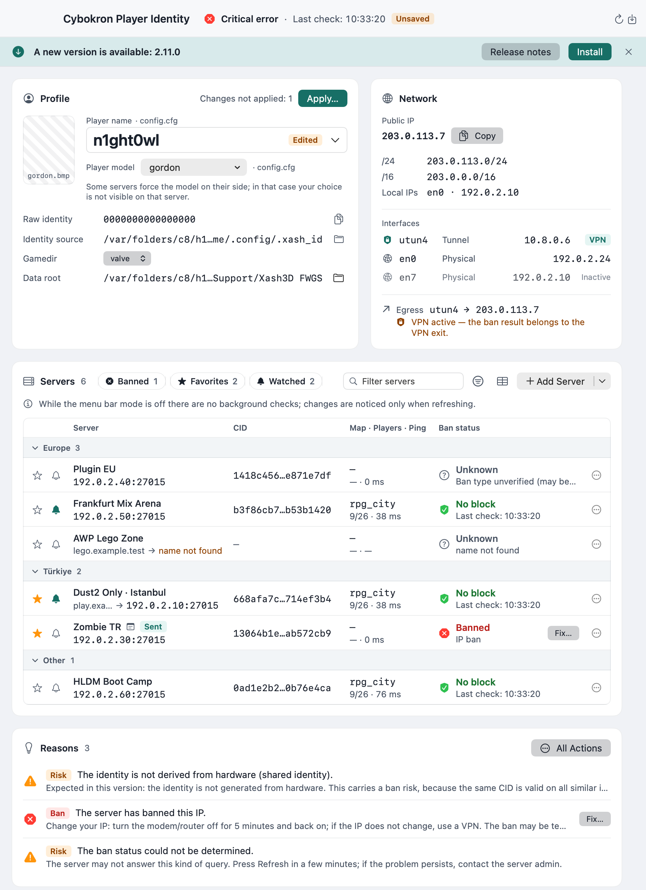
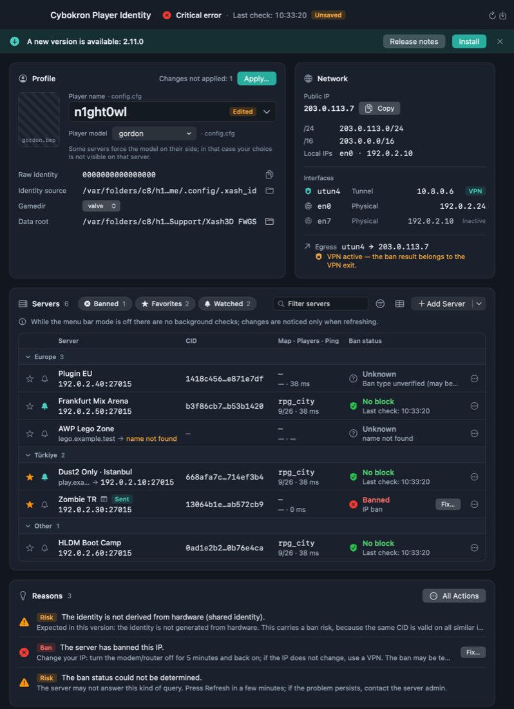
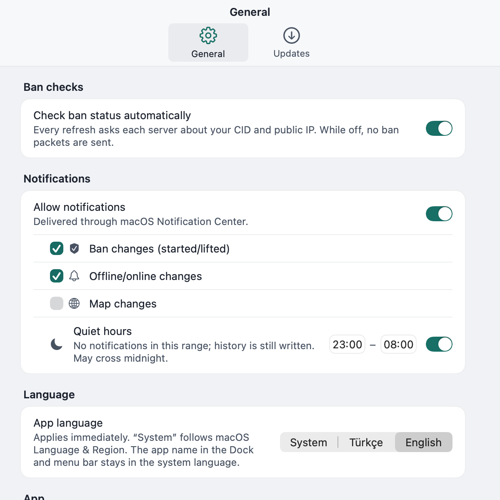
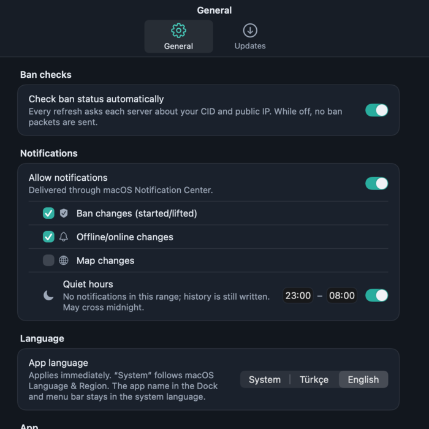

# Player Identity (macOS)

[](https://github.com/ercanatay/player-identity/actions/workflows/ci.yml)
[](https://github.com/ercanatay/player-identity/actions/workflows/ui-tests.yml)
[](https://github.com/ercanatay/player-identity/releases/latest)
[](LICENSE)


A native SwiftUI utility for **Xash3D FWGS / GoldSrc** players on macOS. It shows the identity the game
client actually uses, derives the per-server **CID** (the value servers see and ban by), checks **IP and CID
bans**, and helps you act on the result — renewing an IP, spotting a range ban, or generating a precise unban
appeal for the server admin.

It is a **read-only tool by default**. The only game files it ever writes are the `name` and `model` lines of
`config.cfg` / `userconfig.cfg`, and only when you press **Apply**. Everything else lives in the app's own
folder (`profile.json`, history, metrics, updates).

**Turkish and English UI** — follows the system language by default and can be switched at runtime.

---

## Screenshots

| | |
|---|---|
|  |  |
| Main window — light | Main window — dark |
|  |  |
| Settings — light | Settings — dark |

---

## What's new in v2.10.1

- **Persistent error log**: `errors.json` keeps the last 50 errors, written atomically; diagnostics show its status as `errorLogStatus`.
- **Token-free tap**: the tap flow no longer requires a `TAP_TOKEN`.

## What's new in v2.10.0

- **CLI data tools**: `playeridentityctl` gains backup, restore, servers and diagnostics commands.
- **URL scheme**: `playeridentity://` links open the matching app actions.
- **Diagnostics**: `errors.json` is written with the diagnostic bundle.
- **Accessibility**: keyboard navigation and VoiceOver labels are improved.
- **Per-server notification thresholds**: each server can set its own alert threshold.
- **CI security**: CodeQL, Dependabot and secret scanning are enabled; release cask is verified after publishing.

## What's new in v2.9.3

- **CLI updates**: `playeridentityctl update --check` compares the installed app with the latest stable release; `update --install` downloads and verifies it like the app does (HTTPS, size, SHA-256, Gatekeeper). Exit codes are documented in the CLI section; `brew upgrade` is the alternative for cask installs.
- **Stricter validation**: dataRoot symlinks and previews are validated more strictly.
- **Gatekeeper**: updates must be `Notarized Developer ID`.

## What's new in v2.9.2

- **Backup and restore in the background**: automatic backups and restores no longer block the UI; failures are reported.
- **Safer updates**: update checks have timeouts, stuck updaters are killed (SIGKILL), and downloaded updates are verified with Gatekeeper before install.
- **Backup integrity**: manifest counters are verified against the files, old manifests are pruned by modification time, and `autoBackupEnabled` is respected in archives.
- **Import safety**: settings import is locked against concurrent runs and produces a clear report; pre-downloaded update files are cleaned up.
- **Clearer install blocking**: when installation is blocked, the app now states the reason.

## What's new in v2.9.1

- **Toolbar overflow fixed**: the title flexes and the toolbar switches to a compact layout when space is tight.
- **Data safety**: restore rolls back on failure, a warning appears when a backup is missing, erase is locked and partial deletes are guarded, and unsaved changes prompt before closing.
- **Silent failure fixes**: automatic backup errors, appeal reminders, relaunch errors and cancel/error messages are now reported to you.

## What's new in v2.9.0

- **Add servers from URLs or pasted lists**: paste GameTracker links, `steam://connect` links, `host:port` entries (IPv4, hostnames and IPv6) or a list of them. Up to 100 entries per import.
- Every entry is previewed before it is added, with duplicates and invalid lines flagged so you can decide what to keep.

## What's new in v2.8.0

- **Full data backup and restore**: export everything (records, history, metrics, watch state) to one archive with a manifest, preview what a restore will change, and restore it. A pre-restore backup is written before any data is overwritten.
- **Automatic daily backups** with 5 rotations, so recent state is kept without manual exports.

## What's new in v2.7.0

- **Redesigned History, Ban Matrix and Metrics windows** using the same design language as the main window: new toolbar, filter chips, narrow-width behaviour, and a chart card for metrics.

## What's new in v2.6.0

- **Redesigned main window and Settings** following the Claude Design handoff: new layout, light and dark appearance, Turkish and English UI.
- **Design tokens** (colours, spacing, typography) shared across the main window and Settings.
- **Reset Settings** and **Erase All Data** in Settings (see spec §47).

## What's new in v2.5.0

- **Settings and server export/import**: choose the scope (Settings only, or Settings + servers), export to JSON, and import with merge or replace.
- Preview of what will change, plus a result summary after import.
- Replace mode keeps a `profile.json.appbak-*` backup of the previous data.

## Contents

- [Screenshots](#screenshots)
- [Features at a glance](#features-at-a-glance)
- [Requirements](#requirements)
- [Install](#install)
- [How it works](#how-it-works)
  - [Identity and CID](#identity-and-cid)
  - [Status colours and suggestions](#status-colours-and-suggestions)
  - [Ban checks](#ban-checks)
  - [Fix: what can and cannot be fixed](#fix-what-can-and-cannot-be-fixed)
  - [Full data backup and restore](#full-data-backup-and-restore)
  - [Servers: groups, favourites, filters](#servers-groups-favourites-filters)
  - [Adding servers from URLs or pasted lists](#adding-servers-from-urls-or-pasted-lists)
  - [Notes and appeal tracking](#notes-and-appeal-tracking)
  - [Watched servers and notifications](#watched-servers-and-notifications)
  - [Per-server notification thresholds](#per-server-notification-thresholds)
  - [History](#history)
  - [Metrics and charts](#metrics-and-charts)
  - [Ban matrix](#ban-matrix)
  - [Name and model editing](#name-and-model-editing)
  - [Model catalogue and previews](#model-catalogue-and-previews)
  - [Join game](#join-game)
  - [Settings export/import](#settings-exportimport)
  - [Share card](#share-card)
  - [Menu bar and launch at login](#menu-bar-and-launch-at-login)
  - [Updates and downgrade](#updates-and-downgrade)
  - [Language](#language)
  - [Accessibility and keyboard](#accessibility-and-keyboard)
  - [Diagnostics](#diagnostics)
  - [Shortcuts and Siri](#shortcuts-and-siri)
  - [Command-line tool](#command-line-tool)
- [Data and privacy](#data-and-privacy)
- [Security and signing](#security-and-signing)
- [Security policy](SECURITY.md)
- [Troubleshooting](#troubleshooting)
- [Build and test](#build-and-test)
- [Project layout](#project-layout)
- [Releases and Homebrew](#releases-and-homebrew)
- [Design spec](#design-spec)
- [Changelog](CHANGELOG.md)
- [License](#license)

---

## Features at a glance

| Area | What it does |
|---|---|
| **Identity** | Reads the engine's `.xash_id` files, decodes the raw 64-bit identity and shows where it comes from |
| **CID** | Derives the 32-hex MD5 the server sees, per server, for IPv4 and IPv6 |
| **Ban checks** | UDP probes: A2S_INFO, `getchallenge` (IP ban) and `connect 49` (CID ban), with strict rate limits |
| **Fix** | Tries an honest IP renewal, detects `/16` range bans, and writes a complete admin appeal |
| **Servers** | Groups, favourites, ordering, filters (banned / favourite / watched), notes, appeals |
| **Monitoring** | Watched servers notify on ban changes, online/offline and map changes; quiet hours |
| **History** | Append-only event log with filters and JSON/Markdown export |
| **Metrics** | Ping and player-count samples with charts and 24-hour uptime |
| **Ban matrix** | One table of every server × ban type, CSV/copy export |
| **Name/model** | Dropdowns, effective-source detection, override removal, diff preview, atomic writes |
| **Models** | Catalogue and thumbnails from the game folder **and** downloaded (`valve_downloads`) models |
| **Game** | One-click “Join game” with `+connect`; “Fix” and ban helpers |
| **Sharing** | 1200×630 PNG card with the CID and a QR code |
| **Updates** | Signed, checksum-verified in-app updates with rollback; version history and downgrade with data backup |
| **i18n** | Turkish and English, switchable at runtime (System / Türkçe / English) |
| **Automation** | `playeridentityctl` CLI and three Shortcuts/Siri actions |
| **Diagnostics** | Redacted support bundle (ZIP) |

---

## Requirements

- **macOS 14 or newer**
- **Xash3D FWGS** (`/Applications/Xash3D-FWGS.app`) with a `valve` (or `gearbox`) data folder
- For building: Xcode 16 or newer (Swift 6) and [XcodeGen](https://github.com/yonaskolb/XcodeGen)

No third-party runtime dependencies. The app is not sandboxed because it must read the game folder and
optionally update itself in `/Applications`.

---

## Install

### Homebrew (recommended)

```sh
brew tap ercanatay/tap https://github.com/ercanatay/player-identity
brew install --cask ercanatay/tap/player-identity
```

The tap is this repository itself (the cask lives in `Casks/`), so the release workflow updates the cask in the same
repo and **no `TAP_TOKEN` secret is needed**. The separate
[`ercanatay/homebrew-tap`](https://github.com/ercanatay/homebrew-tap) repository is kept for backward compatibility:
existing `brew tap ercanatay/tap` setups keep working.

This installs `PlayerIdentity.app` into `/Applications` and links the CLI to `/opt/homebrew/bin/playeridentityctl`.
Upgrade later with:

```sh
brew upgrade --cask player-identity
```

### Direct download

Download the latest notarized build from [Releases](https://github.com/ercanatay/player-identity/releases/latest),
unzip it, move `PlayerIdentity.app` to `/Applications` and open it.

### Local build

```sh
git clone https://github.com/ercanatay/player-identity.git
cd player-identity
xcodegen generate
xcodebuild -project PlayerIdentity.xcodeproj -scheme PlayerIdentity \
  -destination 'platform=macOS' -configuration Release -derivedDataPath .build-release build
ditto .build-release/Build/Products/Release/PlayerIdentity.app /Applications/PlayerIdentity.app
codesign --force --deep --sign - /Applications/PlayerIdentity.app
open /Applications/PlayerIdentity.app
```

### Uninstall

```sh
brew uninstall --cask player-identity            # Homebrew install
rm -rf "$HOME/Library/Application Support/tr.ercanatay.playeridentity"   # app data, optional
```

---

## How it works

### Identity and CID

Xash3D stores a 16-character hex value in a file and XORs it with a fixed mask. The app reads the files in the
engine's priority order:

1. `~/.config/.xash_id`
2. `~/.local/.xash_id`
3. `~/.xash_id`
4. `<data root>/<gamedir>/.xash_id`

The raw 64-bit identity is `file value ^ mask`, using `0x10331C2DCE4C91DB` for the home files and
`0x7FFC48FBAC1711F1` for the per-gamedir file.

The value a server sees is **not** the raw identity. It is derived per server:

```
CID = lowerHex( MD5( littleEndian64(rawIdentity) || serverIPBytes ) )
```

- IPv4 → 4 address bytes, IPv6 → 16 bytes
- “Local machine” (no address) → only the 8 identity bytes
- Always 32 lowercase hex characters

Because the server address is part of the hash, **the same player has a different CID on every server**.
Hostnames are resolved first (IPv4 preferred, then IPv6) and cached for five minutes; the resolved address is
shown next to the server and used for both the CID and the ban check.

> **macOS note.** The engine build shipped for macOS has no hardware serial source, so the raw identity
> collapses to `0000000000000000` and the `.xash_id` files contain only the mask. In practice **all macOS
> clients derive the same CID for a given server**. The app detects this and shows a permanent
> “shared identity” warning instead of pretending the identity is unique.

### Status colours and suggestions

One overall state is computed from all checks:

| Colour | Meaning |
|---|---|
| 🟢 Green | All critical checks passed and everything matches the saved record |
| 🟠 Orange | Something differs or is unverifiable (changed IP, changed name/model, no record yet, shared identity, unreachable server) |
| 🔴 Red | A critical failure: identity file missing/invalid, no public IP, corrupt record, or a ban |

Every reason is listed with an icon and text, plus a one-line **suggestion** (for example “renew your IP”,
“appeal with this text”, “save a baseline”). The status label opens a **What should I do?** popover with all
current suggestions and a copy button.

### Ban checks

For every server the app performs one UDP probe sequence, reusing the A2S_INFO reply for server details:

1. **A2S_INFO** — is the server alive? Also yields name, map, players and ping.
2. **getchallenge** — the reply text is inspected; `banned` means the **IP is banned**.
3. **connect 49** — a modern-protocol connect packet carrying the CID; the reply distinguishes
   *no block* (`client_connect`), *CID banned* (`errormsg`/`disconnect` mentioning a ban), or
   *CID check not applicable* (GoldSrc protocol 48 servers, which never see a raw CID).

Constraints: 4 seconds per step, 12 seconds total, **one attempt per server per refresh**, at least 10 seconds
between attempts, no retries, and no spawn packet. The whole check can be disabled in Settings.

### Fix: what can and cannot be fixed

**No client can remove a server-side ban.** “Fix” is honest about this:

- **IP ban** — the app offers to renew the network (Wi-Fi off/on or a DHCP lease renewal, with a macOS admin
  prompt), waits up to 45 seconds for the network to come back, compares the new public IP and re-runs the ban
  check. If the IP did not change, it says so and points to the router page and VPN options. If the IP changed
  but the same `/16` is still banned, it reports a **range ban** — reloading the IP cannot help there.
- **CID ban** — cannot be fixed locally. The app produces a ready-to-send appeal containing the server, your
  name, CID, egress IP, timestamp, the raw server reply, and a checklist for the admin:
  `listid`/`listip`, `removeid` + `writeid`, `removeip` + `writeip`, AMXX `amx_unban`, SQL/AMXBans removal,
  `sv_filterban`, and verification after a restart.
- **Unreachable** — no network command is attempted; only a re-check and the server page are offered.

A single fix can run at a time, is cancellable, and always leaves the network interface enabled.

### Full data backup and restore

- **Backup** writes records, history, metrics and watch state to one archive, with a manifest describing its contents.
- **Restore** shows a preview of what will change first. Before overwriting anything, the app saves a pre-restore backup so the previous state can be recovered.
- **Automatic daily backups** keep the 5 most recent rotations.

### Servers: groups, favourites, filters

- Add, edit and delete servers (`host:port`, IPv4, IPv6 or hostname).
- Assign a **group** (or “No group”); groups are shown as sorted sections, with ungrouped servers last.
- Mark **favourites**; they sort first and can be filtered.
- Reorder rows with ▲/▼ inside a section; the order is persisted.
- Filters: **only banned**, **only favourites**, **only watched** — they combine.
- Per-server detail sheet shows the resolved IP, group, notes, appeals and metrics.

### Adding servers from URLs or pasted lists

Paste one or more entries and the app parses them into server addresses:

- GameTracker server links
- `steam://connect/<host>:<port>` links
- `host:port` entries, with IPv4, hostnames or bracketed IPv6 (`[2001:db8::1]:27015`)

Up to 100 entries are accepted per import. The preview shows what will be added, which entries are duplicates of
existing servers, and which lines are invalid. Only the entries you confirm are saved.

#### `playeridentity://` links

The app registers the `playeridentity` URL scheme, so a link on a web page, in a chat or from the terminal adds
servers directly:

```sh
open "playeridentity://add?host=example.com&port=27015&label=Demo&group=EU&watch=1"
open "playeridentity://add?host=198.51.100.10&host=198.51.100.11:27016&host=%5B2001:db8::1%5D"
```

- `host` may be repeated (or comma-separated); each value follows the import rules above (`host:port`,
  bracketed IPv6, GameTracker and `steam://connect/` links). `port` applies to hosts given without one; otherwise
  27015 is used.
- `label` (default: the host), `group` (an existing group keeps its spelling) and `watch=1` apply to every added
  server.
- The main window comes to the front and an alert reports how many servers were added, which were already in the
  list and which entries were invalid (and why). Added rows are **unsaved** (“Kaydedilmedi”) until you press Save.
- Nothing is added while a restore, an erase or a settings import is running.

### Notes and appeal tracking

- A free-form note per server (up to 2000 characters); changes are recorded in history.
- An **appeal** record with channel (Discord, Telegram, forum, e-mail, other), status
  (sent → answered → accepted/rejected), sent date, follow-up date and a summary.
- The appeal has a **timeline** of status changes and “postpone +1 day / +3 days” buttons.
- When a follow-up date passes, a single notification is produced (respecting notification settings and
  quiet hours); the reminder is not repeated.
- The §17.9-style **unban message** can be copied from the same sheet.

### Watched servers and notifications

Mark any server with the 🔔 switch (row, context menu or detail sheet). On every full refresh — including the
menu-bar 30-minute loop — the app compares the new state with the previously stored one and can notify you
about:

- **ban appeared** (IP or CID, type included in the text)
- **ban lifted**
- **server offline**
- **server back online** (only after at least 10 minutes offline)
- **map changed** (old → new)

The baseline is stored in `watch-state.json`. The first observation never notifies. Identical transitions are
deduplicated within 10 minutes. Notification categories can be toggled individually (ban / online / map);
the master switch and **quiet hours** (default 23:00–08:00, may cross midnight) apply on top. History entries
are written even when notifications are muted.

### Per-server notification thresholds

The server details have a **Notifications** section that overrides the general settings for that server
(stored as an optional `notifications` object in the server record; old records and the defaults mean
*inherit*):

| Setting | Values | Effect |
|---|---|---|
| Mode | Use general settings / All changes / Ban events only / Off | *All* ignores the category switches, *Ban events only* keeps ban appeared/lifted, *Off* notifies nothing for this server. The master switch is never overridden. |
| Ping threshold (ms) | empty or 0 = off, 1–5000 | "Back online" and "map changed" are notified only while the measured ping is at most this value. |
| Minimum players | empty or 0 = off, 1–256 | The same two events are notified only with at least this many players on the server. |
| Quiet hours | Use general setting / Apply to this server / Don't apply to this server | *Apply* uses the general window even when quiet hours are off in Settings; *Don't apply* lets this server through during quiet hours. |

- Thresholds hold back only the online and map notifications of watched servers; ban and unreachable
  notifications are never held back by a threshold. A threshold that cannot be checked (no ping or player
  count in the reply) holds the event back.
- An event below a threshold is **not notified, but the history entry is still written**.
- The mode and quiet-hours override also apply to the regular ban notifications of unwatched servers.
  Fix-attempt results and appeal reminders keep following the general settings only.
- Invalid thresholds (letters, signs, decimals, values above the limit) are rejected in the sheet and OK stays
  disabled; a hand-edited record with unknown values falls back to *inherit* / 0 instead of becoming unreadable.

### History

An append-only `history.jsonl` records meaningful transitions: refreshes, IP changes, ban appeared/lifted,
identity/name/model changes, applies, fix attempts, appeals, notes, config-override removals, watched-server
events and update availability. The **History** window (⌘Y) lists newest first, filters by server and type,
and exports JSON or Markdown. Retention: 5,000 entries or 90 days.

### Metrics and charts

Every ban check also appends a sample to `metrics.jsonl`: timestamp, server, online, ping, players/max and map.
The app, the Fix flow and the CLI all feed it (deduplicated per server per second; `--no-metrics` opts out).
Retention: 5,000 samples per server or 30 days.

The server detail sheet shows **Swift Charts** graphs for ping and player count, offline gaps marked, and the
**24-hour uptime** percentage. Data can be exported as JSON or CSV.

### Ban matrix

A separate window shows every server against **IP ban**, **CID ban**, **range** and last check. Banned servers
sort first; “ban type unverified” rows are marked; unreachable cells show “—”. Export as RFC 4180 CSV or copy
the table to the clipboard.

### Name and model editing

The profile card exposes the player name and the player model as dropdowns plus **Apply (⌘⏎)**.

- The **effective value** is resolved with the game's execution order: `userconfig.cfg` runs after
  `config.cfg`, so if it contains `name`/`model`, that value wins. The UI always shows the source.
- **Override handling.** If `userconfig.cfg` overrides the value, a prominent warning explains that in-game
  changes will not stick and offers **“Remove line”**: it backs the file up to `userconfig.cfg.appbak-<stamp>`,
  comments out only that key, and records a `configOverrideRemoved` event. Refused while the game is running.
- **Apply** shows a **diff preview** (line numbers, `-`/`+`) before writing. Nothing is written until you
  confirm.
- Writes are byte-preserving: only the target keys change, line endings are kept, all occurrences are updated,
  missing keys are appended, the write is atomic, and a single rolling `*.appbak` is kept per file. The game's
  own `config.cfg.bak` is never touched.
- Writing is refused while the game is running, because the engine rewrites `config.cfg` on exit.

### Model catalogue and previews

The model dropdown merges folder names from:

1. `<gamedir>/models/player/`
2. `<data root>/valve_downloads/models/player/`
3. `<data root>/<gamedir>_downloads/models/player/`

Names are de-duplicated and sorted; the current value is kept even if it is not in any folder. The row and the
card show a thumbnail from the model's own BMP preview (case-insensitive extension), with the file path in a
tooltip; a person icon is used when no preview exists. Downloaded models such as custom server models are
therefore both selectable and previewed. A note reminds you that some servers force a model server-side.

### Join game

Select a server and press **Join game**: the app runs
`open -a /Applications/Xash3D-FWGS.app --args -game <gamedir> +connect <host>:<port>`.
If the game is already running, a confirmation warns that the current session will be replaced. If Xash3D is
not installed, the action is hidden.

### Share card

“Create share card” renders a **1200×630 PNG** with the app icon, server name and address, CID (monospaced),
player name, timestamp and a **QR code** of the CID. Copy it to the clipboard or save it with a save panel.

### Menu bar and launch at login

Optional menu bar item with a colour-coded status icon (green/orange/red) and a menu containing the status,
last check time, **Refresh (⌘R)**, **Settings**, **Show** and **Quit**. While enabled, the app also refreshes
every 30 minutes. **Launch at login** uses `SMAppService`; registration errors are shown in Settings.

### Updates and downgrade

- **Feed:** the GitHub releases API (stable releases, semantic-version sorted).
- **Verification before installing:** HTTPS only, asset size, SHA-256 from `SHA256SUMS.txt`, unzip, then
  `codesign --verify --deep --strict`, **TeamIdentifier**, bundle identifier and version equality. Any failure
  aborts and deletes the download.
- **Install:** the current app is moved to `updates/backup/`, the new one is put in place, quarantine is
  cleared, and the app relaunches. Failures roll back automatically.
- **Schedule:** check at launch (24-hour throttle) and every 6 hours while running. Automatic *download* is
  opt-in; automatic *install* never happens.
- **Version history and downgrade:** the last 20 stable releases are listed. “Go back to this version” asks for
  confirmation, optionally (by default) backs up `profile.json`, `history.jsonl` and defaults into
  `updates/backups/data-<from>-to-<to>-<stamp>/`, installs the older build with the same verification, and can
  offer a restore if the current record schema is unsupported. Up to 10 data backups are kept.

### Language

**Settings → General → Language**: `System (default)`, `Türkçe`, `English`. The default follows the system
language (`tr*` → Turkish, anything else → English). The switch is immediate; the app name in the Dock/menu
bar follows the system language by design.

### Accessibility and keyboard

The main window can be used without a mouse:

| Key | Where | Action |
|---|---|---|
| ⌘F | main window | focus the server search field |
| Tab / ⇧Tab | main window | the search field and the server table are always Tab stops; the filter chips, filter options, ban matrix button and the **+** menu join the Tab order (in reading order) when *Keyboard navigation* is on in System Settings › Keyboard |
| ↑ / ↓ | server table | select the previous / next server (the first press starts at the top / bottom) |
| Home / End | server table | select the first / last server |
| Return | server table | open the details of the selected server |
| Esc | server table | clear the selection (otherwise Esc reaches the sheet / window as usual) |

- The search field and the server table draw a visible focus ring (2 pt accent text colour inside the focus
  halo token, at least 3 : 1 against every surface); the selected row has an accent tint and a leading bar.
- VoiceOver: filter chips read their name and "N servers, On/Off"; the ★ / 🔔 row switches read the action and
  "Favorite: On/Off" / "Watching: On/Off"; the ban cell reads "Ban: <status>" with the last check; charts read
  their summary; a row with its own notification settings reads "Custom notifications: <mode>". Status is
  never shown by colour alone.
- High-contrast appearances keep the design tokens (every text token stays at WCAG AA, ≥ 4.5 : 1, on every
  surface in light, dark and both high-contrast variants); with *Increase contrast* the table border uses the
  strong border token. Clickable controls are at least 24 × 24 pt.
- Covered by tests: the key map and selection model, label coverage of every chip / switch / ban status /
  appeal status / notification option in both languages, contrast ratios of the tokens, minimum targets and a
  real ⌘F key event focusing the search field.

### Diagnostics

**Settings → General → Create diagnostics bundle…** produces a ZIP with app version/build, OS/architecture,
a **redacted** snapshot (IPs and the home path masked), history and metrics tails, update state and
`errors.json`. Useful for bug reports without leaking personal data.

`errors.json` lists the **last 50 app errors** (time, area, message), with areas `update`, `backup`, `metrics`,
`watch` and `login` — e.g. a failed update check or install, a failed automatic/manual backup or restore, a
`metrics.jsonl` or `watch-state.json` write error, or a refused launch-at-login registration. The list is kept in
persisted in `errors.json` next to the record (atomic write, ring buffer of 50, loaded again at launch; a damaged
file is ignored), is redacted in the package like the other files, and never shows anything new to the user.
`app-info.json` carries `errorLogStatus` (`ok` or `writeFailed` when the log file could not be written). `playeridentityctl diagnostics` writes the same package (its `errors.json` is empty, since the errors
belong to the running app).

### Shortcuts and Siri

Three App Intents are exposed to Shortcuts and Siri:

- **Check server ban** (with a server parameter)
- **Show my CID** (with a server parameter)
- **Refresh**

Phrases are localized in Turkish and English and use the app name automatically.

### Command-line tool

`playeridentityctl` ships inside the app (`Contents/Helpers`) and is linked into `PATH` by the Homebrew cask.

```sh
playeridentityctl cid 198.51.100.10 --json
playeridentityctl ban example.com:27015 --json
playeridentityctl ban 203.0.113.10:27015 --no-metrics
playeridentityctl status --json
playeridentityctl update --check --json
playeridentityctl update --install
playeridentityctl update --install --yes --app /Applications/PlayerIdentity.app --json
playeridentityctl backup --out ~/Desktop --json
playeridentityctl restore ~/Documents/playeridentity-backup-20261112-093015.zip
playeridentityctl servers list --json
playeridentityctl servers add play.example.com:27016 --label Demo --group EU --watch
playeridentityctl servers remove 2 --yes
playeridentityctl diagnostics --out ~/Desktop
playeridentityctl --version
```

- `cid <ip>` — derive the CID for an address (uses the local identity unless `--raw-id <hex>` is given)
- `ban <host:port>` — run the ban checks; `--cid`, `--timeout`, `--json`, `--no-metrics`
- `status` — summarize the saved record (servers, ban states, watched count)
- `update --check` — compare the installed app (the bundle containing the CLI) with the newest stable GitHub
  release; JSON fields `current`, `latest`, `updateAvailable`, `asset`, `sha256`, `notesURL`
- `update --install` — download and verify the release exactly like the app does (HTTPS, size, SHA-256, code
  signature/team/bundle/version, Gatekeeper), back up the data, then replace the app. It asks `y/N` on a terminal;
  without a terminal it refuses unless `--yes` is given. `--app <path>` picks another bundle. The new version is
  **not** started (`relaunchRequired: true`): quit and reopen the app yourself. JSON fields `from`, `to`,
  `installed`, `relaunchRequired`. With a Homebrew install, `brew upgrade --cask player-identity` keeps the cask
  version in step
- `backup [--out <path>]` — full data backup (same ZIP as Settings → Data); default
  `~/Documents/playeridentity-backup-<time>.zip`, a folder gets that name inside it, an existing file is never
  overwritten. JSON fields `path`, `counts`, `files`, `skipped`, `complete`
- `restore <zip> [--yes]` — validates the backup (manifest, checksums, counts) first, then backs up the current
  data to `backups/pre-restore-<time>.zip` and puts the files in place (rolled back on failure). It asks `y/N` on a
  terminal; without one it needs `--yes`. Reopen the app afterwards if it was running. JSON fields `backup`,
  `preRestoreBackup`, `keptPrevious`, `restored`
- `servers list` — the saved record's servers with their **index** (position in `profile.json`)
- `servers add <host:port> [--label <text>] [--group <name>] [--watch]` — same rules as the import sheet
  (GameTracker and `steam://connect/` links too); an entry already in the list is refused
- `servers remove <host:port|index> [--yes]` — asks `y/N` on a terminal, otherwise needs `--yes`; an address
  that appears twice must be removed by index
- `servers add/remove` write `profile.json` (honouring `PLAYERIDENTITYCTL_SNAPSHOT`) and keep the previous version as
  `profile.json.appbak-<time>`; a running app keeps its own list until it is reopened (its next Save would replace
  the change)
- `diagnostics [--out <path>]` — the redacted diagnostics ZIP (default `~/Documents/PlayerIdentity-diagnostics-<time>.zip`)
- Exit codes: `0` success, `1` usage error, `2` network/resolution error, `3` a ban was found
- `backup` / `restore` / `servers` / `diagnostics` exit codes: `0` success, `1` usage error or not confirmed,
  `2` validation or write error, `3` not found (no data to back up, no saved record, no such file or server,
  server already added). None of them uses the network.
- `update` exit codes: `0` up to date / installed, `1` usage error or not confirmed, `2` network, download or
  verification error, `3` no update to install, `4` update available (`--check`)
- JSON output uses a stable `schemaVersion: 1`

The CLI appends a metrics sample for successful A2S replies unless `--no-metrics` is used.

---

### Settings export/import

Exports settings and, optionally, the server list to a JSON file named `playeridentity-settings-*.json`.

- **Scope**: *Settings only*, or *Settings + servers*.
- `dataRoot` is excluded by default, so a file exported on one Mac does not point another Mac at a local folder.
- **Merge**: servers are matched by `host:port`; matching entries are updated and new ones are added.
- **Replace**: the current data is replaced. Before replacing, the previous `profile.json` is kept as `profile.json.appbak-*`.
- A preview lists the planned changes before anything is written, and a result summary follows the import.
- Identity (CID), history and metrics are **not** exported or imported.

## Data and privacy

Everything the app writes lives in:

```
~/Library/Application Support/tr.ercanatay.playeridentity/
├── profile.json        # your record (identity, servers, notes, appeals, settings snapshot)
├── history.jsonl       # append-only event log
├── metrics.jsonl       # ping/player samples
├── watch-state.json    # last seen state per watched server
├── updates/            # downloads, staging, app backups, data backups
└── *.appbak            # backups of config files it edited
```

Game data is read from `~/Library/Application Support/Xash3D FWGS/<gamedir>` and, for models, from
`valve_downloads` / `<gamedir>_downloads`.

**Network endpoints used**

| Purpose | Endpoint |
|---|---|
| Public IP | `https://api.ipify.org?format=json`, fallback `https://ifconfig.me/ip` |
| Release feed | `https://api.github.com/repos/ercanatay/player-identity/releases` |
| Ban checks | the server you configured, UDP |
| Hostnames | system DNS resolver |

There is **no telemetry**. The app never uploads your record, notes or history. Diagnostics are only created
when you ask for them, and they are redacted.

---

## Security and signing

- Released builds are **signed with a Developer ID certificate and notarized by Apple**, then stapled.
- Hardened runtime is enabled; the app is not sandboxed because it needs the game folder and self-updates.
- In-app updates verify the code signature, the signing team, the bundle identifier and the version before
  replacing anything, and roll back on failure.
- Writes to game files are limited to `name`/`model` in `config.cfg` / `userconfig.cfg`, with backups.
- Supported versions, how to report a vulnerability privately, and what the app writes: see [SECURITY.md](SECURITY.md).
- CI security: CodeQL analysis (Swift) runs on pushes, pull requests and weekly; Dependabot keeps GitHub Actions up to date; secret scanning and push protection are enabled.
- Release check: the Homebrew cask's `version` and `sha256` must match the published `SHA256SUMS.txt` asset, or the release job fails.

Verify a download yourself (the full vulnerability reporting process and update verification chain are in [SECURITY.md](SECURITY.md)):

```sh
codesign --verify --deep --strict /Applications/PlayerIdentity.app
spctl -a -vv -t exec /Applications/PlayerIdentity.app     # accepted, Notarized Developer ID
xcrun stapler validate /Applications/PlayerIdentity.app
shasum -a 256 -c SHA256SUMS.txt
```

---

## Troubleshooting

| Symptom | Cause / fix |
|---|---|
| Name or model keeps reverting after joining a server | `userconfig.cfg` sets `name`/`model` and runs after `config.cfg`. The app shows a warning and **Remove line** fixes it (with a backup). |
| Name changes in-game but not on the next launch | The game rewrites `config.cfg` on exit. Change values from the app while the game is **closed**, or use the override removal. |
| Model changes do not appear on one server | Many mods force the player model server-side. The app cannot override that. |
| `IP ban` even after the IP changed | Likely a **range ban** (same `/16`). Use a different network (mobile hotspot / VPN outside the range) or ask the admin. |
| `CID check not applicable` | The server uses the GoldSrc 48 protocol and never sees a raw CID. Only the IP check applies there. |
| “Shared identity” warning | The macOS engine build has no hardware serial; all macOS clients derive the same raw identity. This is expected. |
| Gatekeeper warning | Use the notarized release or the Homebrew cask. Local ad-hoc builds need right-click → Open once. |
| App asks for Documents access | Only the test host asks while scanning sources for the localization test; the app itself never reads Documents. Deny it. |
| UI smoke test fails in CI | Known runner limitation: the app window is visible via `open`, but XCTest sees `windows=0` on GitHub macOS runners. The workflow is best-effort; run it locally. |
| Shortcuts do not list the app | Launch the app once, then quit and reopen Shortcuts. App Shortcuts are indexed by the system after first launch. |

---

## Build and test

```sh
xcodegen generate
xcodebuild -project PlayerIdentity.xcodeproj -scheme PlayerIdentity \
  -destination 'platform=macOS' -derivedDataPath .build build
xcodebuild -project PlayerIdentity.xcodeproj -scheme PlayerIdentity \
  -destination 'platform=macOS' -derivedDataPath .build test
```

- The `.xcodeproj` is generated and not tracked in git.
- Tests are isolated: temporary fixture folders, fake HTTP/UDP clients, fake command runner, no network.
- **727 tests** in the main scheme. Most assertions compare Turkish source strings, so the scheme runs tests
  with Turkish; `LocalizationTests` switch languages explicitly.

### UI tests

Separate scheme, not part of the main CI:

```sh
xcodebuild test -project PlayerIdentity.xcodeproj -scheme PlayerIdentityUITests \
  -destination 'platform=macOS' -derivedDataPath .build-ui
```

or run the `ui-tests.yml` workflow manually. The smoke test launches the app, opens Settings and checks the
Updates pane. It passes locally; GitHub macOS runners cannot see the app window from XCTest, so the workflow
is best-effort and uploads diagnostics (`ui-diagnostics`, `ui-test-results`) for inspection.

### CI

| Workflow | Trigger | What it does |
|---|---|---|
| `ci.yml` | push / PR | Spec sanitization gate, XcodeGen, build, 727 tests on `macos-26` |
| `release.yml` | `v*` tag | Release build, Developer ID signing, notarization, stapling, verification, GitHub release, cask update |
| `ui-tests.yml` | manual | UI smoke test (best-effort) with diagnostics |

---

## Project layout

```
PlayerIdentity/
  App/            SwiftUI app, model, views, intents
  Core/           identity, CID, config, ban checks, fix, history, metrics, updates, …
  Resources/      tr/en Localizable.strings, AppShortcuts.strings
  Assets.xcassets app icon
PlayerIdentityTests/      Unit tests (727)
PlayerIdentityUITests/    XCUITest smoke test
CLI/                      playeridentityctl sources
Casks/                    Homebrew cask
docs/spec.md              Design/behaviour specification (Turkish)
scripts/                  release, cask, CLI smoke, spec sync, icon tooling
```

---

## Releases and Homebrew

- Every `vX.Y.Z` tag builds and publishes a **signed, notarized** ZIP plus `SHA256SUMS.txt`.
- Release history is kept in [`CHANGELOG.md`](CHANGELOG.md) (Keep a Changelog format).
- The cask is updated automatically by the release workflow in this repository, which is the tap
  (`brew tap ercanatay/tap https://github.com/ercanatay/player-identity`); no `TAP_TOKEN` is required.
- Legacy tap: [`ercanatay/homebrew-tap`](https://github.com/ercanatay/homebrew-tap) is kept for backward
  compatibility. Its sync step in the release workflow runs only when the optional `TAP_TOKEN` secret is set;
  otherwise run `scripts/sync-tap.sh` manually (uses your local `gh` login; `--dry-run` shows the diff first).
- Version history inside the app can install older stable releases with the same verification and a data backup.

---

## Design

- [`docs/design/ui-brief.md`](docs/design/ui-brief.md): UI brief for the redesign.
- [`docs/design/claude-design-prompt.md`](docs/design/claude-design-prompt.md): prompt used with Claude Design.
- [`docs/design/handoff/`](docs/design/handoff/): handoff bundle: `tokens.css`, `MainWindow.dc.html`, `SettingsWindow.dc.html`, `icons.js`, and `Player Identity Canvas.dc.html` (canvas notes).
- **Deviations from the handoff:** the light theme uses teal tones adjusted for contrast; the Fix action opens an inline popover instead of a separate sheet.

## Design spec

The full behaviour specification — status rules, localization keys, ban checks, update/downgrade rules,
acceptance criteria — is in [`docs/spec.md`](docs/spec.md) (Turkish). It is the single source of truth for the
implementation. The published copy is sanitized by `scripts/sync-spec.sh`; CI runs `scripts/sync-spec.sh --check`
to block personal or private network data from being committed.

---

## License

[MIT](LICENSE) © 2026 Ercan ATAY
