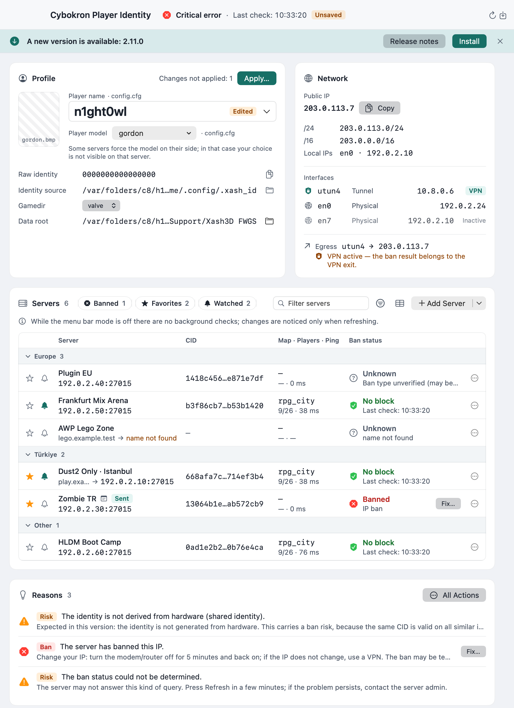
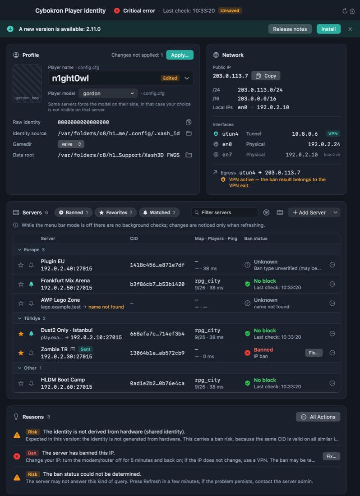
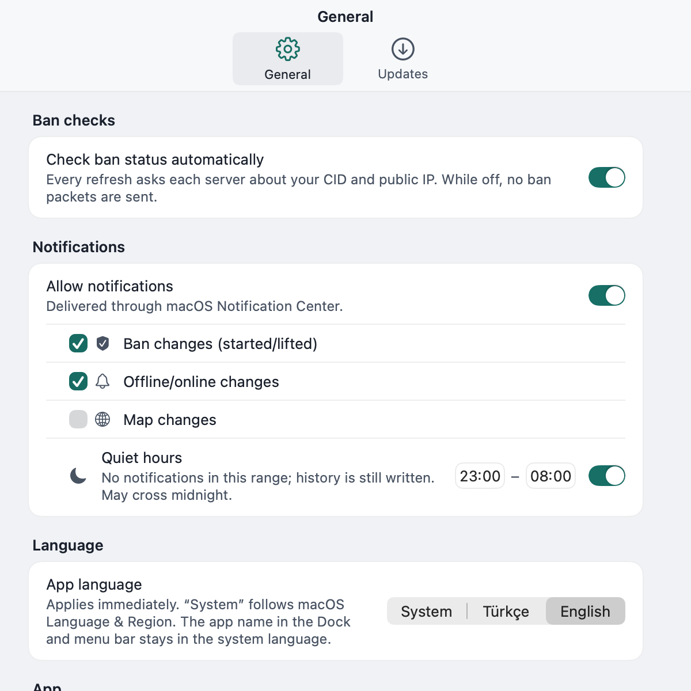
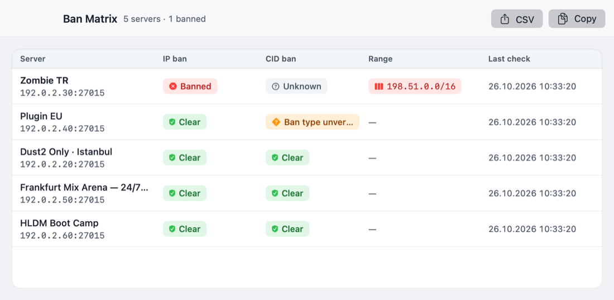
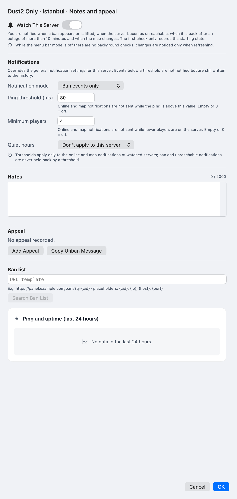
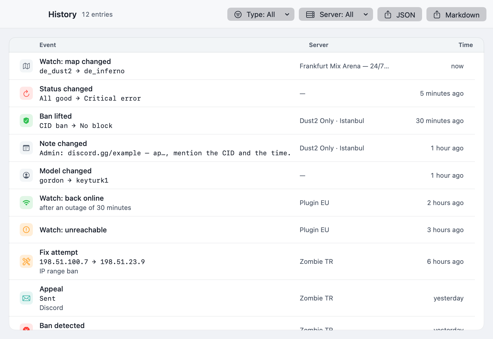
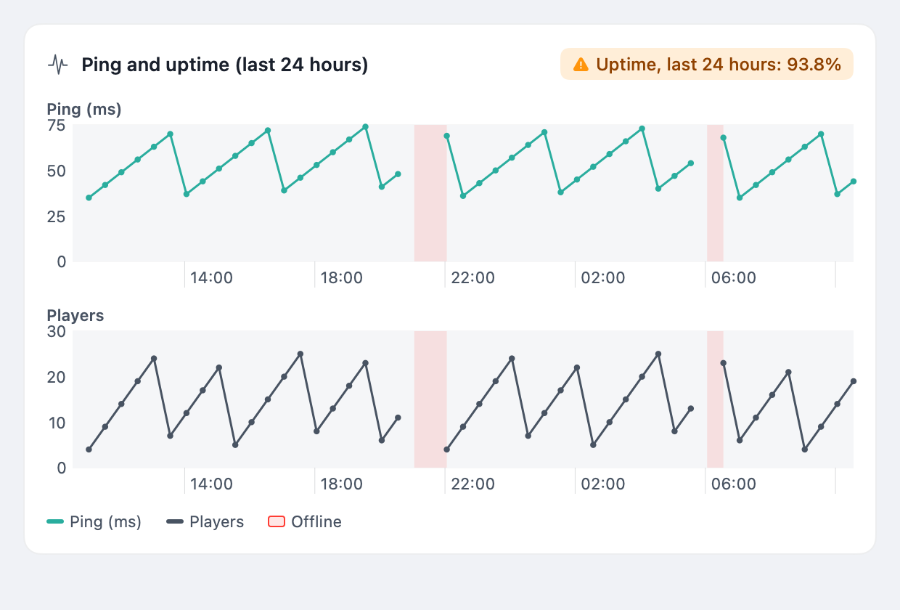
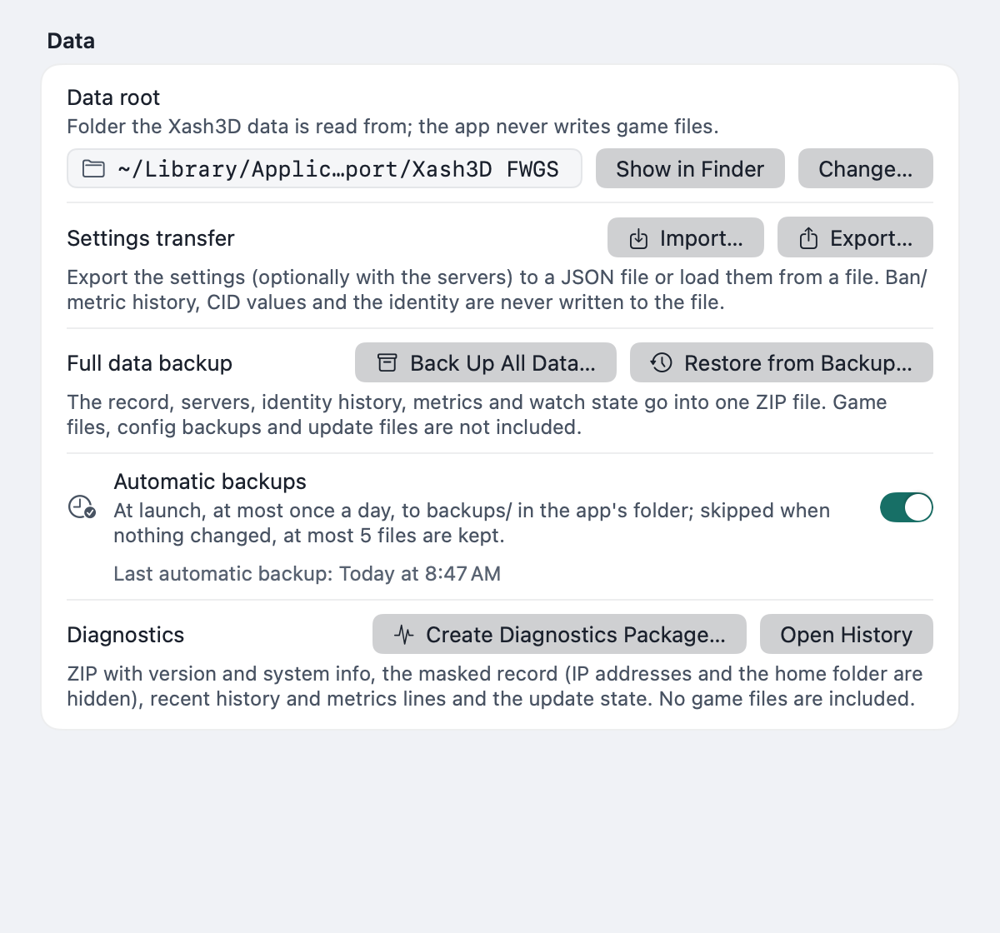
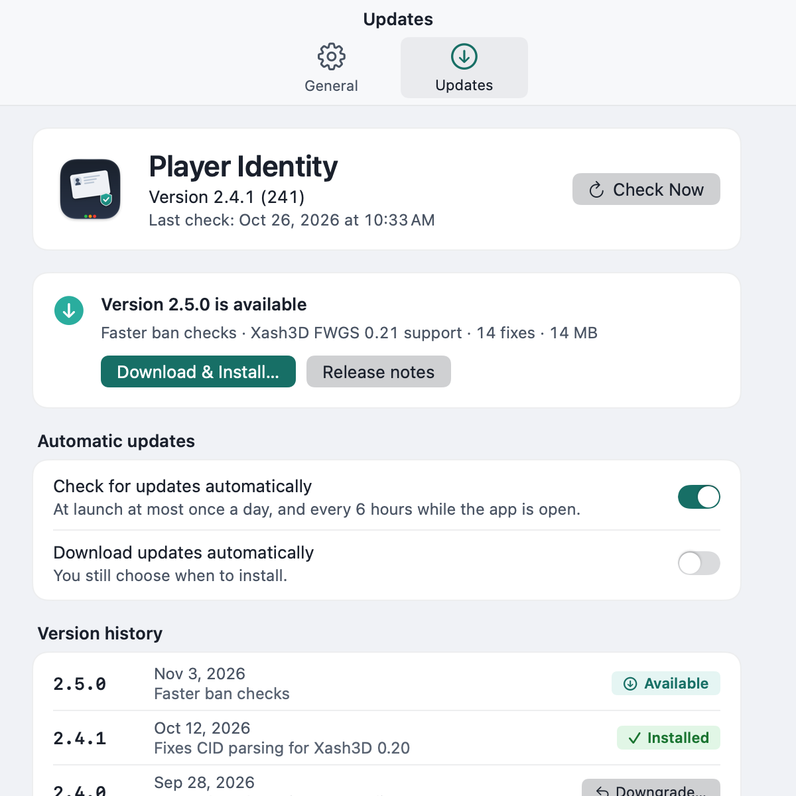

<p align="center">
  
</p>

# Cybokron Player Identity — Feature Reference
A complete, behaviour-level description of **Cybokron Player Identity**, a native SwiftUI utility for **Xash3D FWGS / GoldSrc** players on macOS. It shows the identity the game client really uses, derives the per-server **CID** that servers see and ban by, checks IP and CID bans, and helps you act on the result.

> **Documentation version:** written for app **v2.12.0** (783 automated tests), against behaviour specification **v3.7** ([`spec.md`](spec.md), Turkish, sanitized public copy). Where this document and the spec differ, the spec and the code win. Example hosts use reserved documentation addresses (`192.0.2.x`, `198.51.100.x`, `example.test`).



## At a glance
| Item | Detail |
|---|---|
| **Platform** | macOS 14 or newer; Swift 6, SwiftUI, no third-party runtime dependencies |
| **Game** | Xash3D FWGS (`/Applications/Xash3D-FWGS.app`) with a `valve` or `gearbox` data folder |
| **Data source** | Read-only access to the engine's `.xash_id` files and `config.cfg` / `userconfig.cfg`; public IP from `api.ipify.org` (fallback `ifconfig.me`); server answers over UDP |
| **Write behaviour** | Read-only by default. The only game files ever written are the `name` and `model` lines of `config.cfg` / `userconfig.cfg`, and only after you confirm **Apply** (or **Remove line**). Everything else lives in the app's own folder |
| **Languages** | 24 languages (857 localization keys per language) shown with native names, `en` fallback for missing keys, RTL support, switchable at runtime |
| **Distribution** | Developer ID signed, Apple-notarized, stapled ZIP on GitHub Releases with `SHA256SUMS.txt`; Homebrew cask `ercanatay/tap/player-identity` |
| **Automation** | `playeridentityctl` CLI, `playeridentity://` URL scheme, three Shortcuts/Siri actions; menu-bar quick actions, profile switcher and ban-list templates in the UI |
| **Tests** | 783 unit tests in the main scheme (temporary fixtures, fake HTTP/UDP/command runners, no network) |
| **Sandbox** | Not sandboxed (needs the game folder and self-update in `/Applications`); hardened runtime enabled |
| **Telemetry** | None |
| **License** | MIT |

## How the identity works
### The `.xash_id` file
Xash3D stores a 16-character hexadecimal value (`0-9a-fA-F`; surrounding whitespace and line ends are tolerated, any other length or character is invalid) in a file and XORs it with a fixed mask. The app reads candidate files in the engine's priority order and uses the first **readable and valid** one:

1. `~/.config/.xash_id`
2. `~/.local/.xash_id`
3. `~/.xash_id`
4. `<data root>/<gamedir>/.xash_id`

The **raw identity** (a 64-bit number, shown as 16 uppercase hex characters) is `file value XOR mask`:

| Source | Mask |
|---|---|
| Any of the three home-folder files | `0x10331C2DCE4C91DB` |
| The per-gamedir file | `0x7FFC48FBAC1711F1` |

If no file is readable and valid, the status turns **red** (identity missing/invalid).

### Shared identity on macOS
The Xash3D build shipped for macOS has no hardware serial source, so the raw identity collapses to `0000000000000000` and the `.xash_id` files contain only the mask. In practice **every macOS client derives the same CID for a given server**. The app detects a raw identity of zero and shows a permanent, non-critical **shared identity** warning (orange) instead of pretending the identity is unique.

### The CID
The value a server sees is not the raw identity. It is derived per server:

```text
CID = lowerHex( MD5( littleEndian64(rawIdentity) || serverIPBytes ) )
```

- IPv4 address → 4 bytes; IPv6 address → 16 bytes.
- The special "local machine" row (no address) hashes only the 8 identity bytes.
- The result is always **32 lowercase hexadecimal characters**.

Because the server address is part of the hash, the **same player has a different CID on every server**. The CID is therefore *server specific*: a CID ban on one server says nothing about another, and the CID shown for a hostname server is computed from the **resolved IP**, not the name.

Reference vectors (raw identity = 0, checked by unit tests):

| Server address | CID |
|---|---|
| `127.0.0.1` | `e3f650e2c5f1293838ba8e934ba3b796` |
| Local machine (no IP bytes) | `7dea362b3fac8e00956a4952a3d4f474` |

### When the CID is recomputed
CIDs are recalculated immediately, without any network request, whenever an input changes: the server's host or port, the selected gamedir, or the data root. A hostname is resolved with the system resolver (`getaddrinfo`, first IPv4, otherwise first IPv6) and cached for **five minutes**; the resolved address is shown next to the server and used both for the CID and for the ban check. A hostname that does not resolve marks only that row as invalid and does not change the overall status.

### The identity fields
| Field | Meaning |
|---|---|
| **Identity source** | The file the raw identity was read from (home path shortened, full path in a tooltip) |
| **Gamedir** | The game folder inside the data root (`valve`, `gearbox`, …). Auto-discovered among first-level folders containing `.xash_id` or `config.cfg`; `valve` is the default if present |
| **Data root** | The folder the game data is read from, normally `~/Library/Application Support/Xash3D FWGS`. Changeable in Settings; the app never writes there except the `name`/`model` edits described below |

The record the app saves (`profile.json`) stores the last observed identity, so it can report **identityChanged** if the raw identity differs on a later check.

## Main window


The window has a minimum size of 720×520 and follows the system light/dark appearance.

### Toolbar
- **Status** — one overall colour plus text: green (everything passed and matches the saved record), orange (something differs or cannot be verified), red (critical failure: identity missing/invalid, no public IP, corrupt record, a ban). Clicking it opens **What should I do?** with every current suggestion and a copy button.
- **Unsaved badge** — shown when there are unsaved changes (hidden in the narrowest toolbar layout); extra reasons are summarised as "· +N more".
- **Last check** — time of the most recent refresh (`HH:mm:ss`).
- **Refresh (⌘R)** and **Save (⌘S)**.
- While servers are being checked, the toolbar reads "Checking N servers…". The toolbar switches to a compact layout when horizontal space runs out, and the title flexes.
- **History (⌘Y)**, the **Ban Matrix** window and **Settings** are reachable from the app's menus and toolbar.
- **Share card** — the 1200×630 PNG is created from a server row's menu (see [Server management](#server-management)).

Quitting or closing with unsaved changes asks for confirmation.

### Update banner
When a newer stable release exists, a banner shows "New version X.Y.Z" with **Install**, **Release notes** and **Ignore**. Install always asks for confirmation first and states the reason when installation is blocked (for example while a restore is running). See [Updates](#updates).

### Profile card
| Row | Content |
|---|---|
| **Player name** | Dropdown with recent names plus "New name…" |
| **Player model** | Dropdown of installed models (with thumbnails) plus manual entry |
| **Raw identity** | Monospace, with the shared-identity warning when zero |
| **Identity source** | File path, "Show in Finder" |
| **Gamedir** | Picker of discovered gamedirs |
| **Data root** | Current folder with **Choose Folder…** |
| **Apply (⌘⏎)** | Writes name/model after a diff preview; an "unsaved/pending changes" counter shows how many edits are not applied |

Empty and error states ("No identity found", "Couldn't read identity") offer **Scan Again**. Details of editing are in [Name and model editor](#name-and-model-editor).

### Network card


| Row | Content |
|---|---|
| **Public IP** | Large and copyable; looked up via `https://api.ipify.org?format=json` (8 s timeout) with `https://ifconfig.me/ip` as fallback. If both fail the status is red |
| **Range** | The `/24` and `/16` of the public IP (IPv6: `/64` and `/48`), e.g. `Range: 198.51.100.0/24 · 198.51.0.0/16` |
| **Local IPs / Interfaces** | Every non-loopback, non-link-local interface address with its name (`en0 · 192.0.2.10`), IPv4 first; active/inactive state and kind (physical, tunnel, bridge) |
| **VPN / Egress** | "VPN active" when a `utun*` interface exists **and** the default route uses it. Because NAT gives one egress IP, the card shows a single "Egress: IP · interface" line; with a VPN active it warns that **the ban result belongs to the VPN exit** |

Ban checks are always made from the egress IP.

### Servers table
| Column | Content |
|---|---|
| Status icon, label, `host:port` | Row identity; the resolved IP is shown for hostnames |
| **CID** | Monospace; click to copy with a "Copied" confirmation |
| **Map · Players · Ping** | From the A2S_INFO reply, e.g. `de_dust2 · 9/26 · 42 ms`; hidden if the server did not answer |
| **Ban status** | Icon + text (never colour alone); last check time in a tooltip |

- **Grouping:** by group (sorted sections, ungrouped servers under "Other"/last) or "No grouping".
- **Search:** "Filter servers" field, focused with ⌘F.
- **Filters:** *Banned*, *Favorites*, *Watched* chips plus a filter-options menu ("Show only", "Group by", "Hide unresolved hosts", "Clear Filters"). Filters combine.
- A row menu offers more actions (details, edit, favorite, watch, share card, join game, Fix, delete). When ban checks are disabled, the table shows "Ban checks are off" with a link to Settings.

### Reasons list
Each reason has an icon, text and a one-line suggestion. Typical entries:

| Level | Examples |
|---|---|
| 🔴 Red | identity file missing or invalid, no public IP, corrupt record, IP ban, CID ban |
| 🟠 Orange | changed public IP, changed name/model, no baseline record yet, shared identity, unreachable server, ban type unverified, no local IP |
| 🟢 Green | no reasons — all critical checks passed and everything matches the saved record |

Suggestions are actions such as "renew your IP", "appeal with this text", "save a baseline".

## Server management
### Adding, editing, removing
- **Add** from the **+** menu: label, host (IPv4, IPv6, or an RFC 1123 hostname up to 253 characters) and port (default **27015**).
- **Edit** the same fields plus group, favorite, watch, notes, appeal and ban-list URL in the details sheet.
- **Remove** via the row's context menu or hover control.
- `host:port` is validated on entry; IPv6 requires brackets (`[2001:db8::1]:27015`). Ports must be 1–65535.
- Every change recalculates status immediately and marks the record **unsaved** until you press **Save (⌘S)**.

### Labels, groups, favorites, watched
- **Label** defaults to the host.
- **Group** — pick an existing group or type a new one; groups appear as sorted sections, ungrouped servers last.
- **Favorites** (★) sort first inside a section and can be filtered.
- **Watched** (🔔) servers produce [notifications](#notifications); a bell badge marks them.
- **Ordering** uses ▲/▼ inside a section and is persisted. Drag-and-drop reordering is not implemented.

### Search and filter semantics
Search matches the label/host text; the three filter chips (*banned*, *favorites*, *watched*) are cumulative with each other and with search. An empty result shows "No server matches the filter" with **Clear Filters**.

### Duplicates
A duplicate is the same host **and** port. Duplicates are flagged in the import preview, skipped by the URL scheme and refused by `servers add` in the CLI. Duplicate entries inside one pasted list are collapsed.

### Import from text or URL
**+ → Add from URL / pasted list…** accepts up to **100** entries (one per line or comma-separated):

- `host:port` (IPv4, hostname, bracketed IPv6);
- GameTracker links `https://www.gametracker.com/server_info/<host>:<port>/` (query and fragment ignored);
- `steam://connect/<host>:<port>` links.

Surrounding whitespace, `http`/`https` and a trailing `/` are tolerated; a missing port means 27015. The sheet shows a **preview**: label, host, port, "already exists" flag and invalid lines with the reason. Valid new entries are pre-selected; you can change the selection. Only confirmed entries are added (⌘V pastes, ⌘⏎ adds).

### Notes, appeals and ban-list URL
- A free-text **note** per server, up to **2,000 characters**; changes are written to the history (old → new, cut to 500 characters).
- A per-server **ban-list URL template** (`https`, with at least one of `{cid}`, `{ip}`, `{host}`, `{port}`), for example `https://panel.example.test/bans?q={cid}`. **Search in ban list** opens it in the default browser with URL-encoded values; the app never scrapes the page.

### The "unsaved" model
Edits live in memory until **Save**. New rows from imports, the URL scheme and the CLI-independent UI are marked **unsaved** ("Kaydedilmedi" in Turkish). Closing, restoring a backup or importing settings with unsaved changes prompts you; restore offers **Save first** (on by default).

## Ban checks


For every server the app runs one UDP probe sequence per refresh and reuses the A2S_INFO reply for server details. **No spawn packet is ever sent**, so you never actually enter the game.

### The sequence
1. **A2S_INFO** — `FF FF FF FF` + `TSource Engine Query` + `00`. A `0x6D` (GoldSrc) or `0x49` (Source) reply means the server is alive; `0x41` is a challenge that the app answers once. The reply also yields name, map, players/max and ping (round-trip time). No answer within 4 s → *unreachable*; the later steps are skipped.
2. **getchallenge** — `FF FF FF FF` + `getchallenge` + `\n`. A reply body containing `banned` (case-insensitive) → **IP banned**. A `0x41` challenge → IP OK, and the challenge value is kept for step 3. No/unknown reply → *unknown*.
3. **connect 49** (only if a challenge was received) — a modern-protocol connect packet carrying the CID as `uuid` (`prot=cidtest; uuid=<cid>; …`). The check stops immediately after the handshake answer.

### Result matrix
| Result | Meaning | Shown as |
|---|---|---|
| `clear` | IP OK and CID OK (`client_connect`, `0x42`) | 🟢 No block |
| `banned` (IP) | `getchallenge` reply says banned | 🔴 IP ban |
| `cidBanned` | `errormsg` / `disconnect` / `0x39` reply to connect 49 mentioning a ban | 🔴 CID ban |
| `rangeBanned` | After an IP change the same `/16` (IPv6 `/48`) is still IP-banned | 🔴 IP range ban |
| `unverified` | Server rejected the client with a ban-like answer but the type is unknown (plugin/SQL ban possible) | ⚪ Ban type unverified, raw reply shown |
| `notApplicable` | GoldSrc protocol 48 server rejects the modern connect ("unsupported protocol") — CID cannot be tested | ⚪ CID check not applicable (counts as no CID block when IP is OK) |
| `error` / unreachable | No A2S answer in 4 s | ⚪ Unreachable (orange overall, not critical) |
| `error` / DNS | Hostname does not resolve | Row shown as invalid host; overall status unaffected |
| `unknown` | Reply missing or unrecognised | ⚪ Undetermined |

Any `banned` result turns the overall status **red** and adds a reason; unreachable/unknown makes it **orange**.

### Range detection
The app compares the old and new public IP after a Fix attempt: if the IP changed but the **same `/16`** is still banned, it reports a **range ban** and no longer suggests renewing the IP. A different `/16` that is still banned keeps the generic "still banned" message with an extra hint that a CID or plugin ban is possible. A `/24` match with a different `/16` is not a range ban.

### CID ban and "ban type unverified"
`cidBanned` is an engine-level CID/uuid ban proven by the `connect 49` reply. "Ban type unverified" means the server refused but the evidence does not identify the system (engine IP, engine CID or plugin/SQL such as AMXX/AMXBans); the raw reply text is displayed so the admin can classify it.

### Checks off
**Settings → General → Ban checks → "Check ban status automatically"** (on by default). While off, **no ban packets are sent**, the Ban column shows "Checks off" and Fix reports that no recheck was made. (Xash3D running does not disable checks; it only blocks config writes and triggers a confirmation before *Join game*.)

### Network cost and limits
- 4 s timeout per step, 12 s maximum per server, **one attempt per server per refresh**, at least **10 s** between two checks of the same server, no automatic retries.
- All checks are cancellable together with the refresh.
- The CLI uses the same limits; `ban --timeout` changes the per-step timeout.

## Acting on a ban
**No client can remove a server-side ban.** Fix is honest about this and never claims "solved" without proof. It is visible only for IP-banned, CID-banned and unreachable rows.

### IP ban flow
1. **Confirmation page**: current public IP, what will be done, expected downtime (5–20 s), a risk note, **Start / Cancel**.
2. The old IP (A) is stored. The primary interface is the default route's interface.
3. **Network renewal** with a fixed allowlist of commands: Wi-Fi is switched off for 3 s and on again; Ethernet gets a DHCP lease renewal (one-time macOS administrator prompt — the app never sees the password). Cancelling the prompt is distinguished from a prompt failure.
4. The app waits up to **45 s** for the network (public IP polled every 3 s).
5. New IP (B):
   - A ≠ B → the ban check runs again: clear → "Solved: IP changed (A → B), ban lifted"; still banned → "range/plugin possible"; same `/16` → **range ban**.
   - A = B → "IP did not change", with the next steps: open the router page (`http://<gateway>`) for a PPPoE/WAN reconnect, use a VPN, try again after a few hours (time-limited ban).
6. The interface is always left enabled (a failed flow still tries the `on` command). One Fix runs at a time, with a lock, and it is cancellable.

An ISP static IP, CGNAT or a router that keeps its PPPoE session can leave the IP unchanged; the app reports exactly what happened. Ban duration and subnet are not readable remotely.

### CID ban flow
Nothing can be fixed locally. The sheet explains this and offers **Copy unban message**, **Open server page**, **Check again**.

### Unreachable flow
No network command is run; only **Check again** and **Open server page**.

### The unban/appeal message
The generated text contains the filled-in server name and `host:port`, check time (local and UTC), player name, **CID (32 hex)**, egress IP, gamedir, the raw server reply, the **kind of check** (`engine IP (getchallenge)`, `engine CID (connect 49)` or "unknown, may be plugin/SQL"), a suspected range line when applicable (`Possible range ban: 198.51.0.0/16 (old IP: A, new IP: B)`), a request for the ban expiry and reason, and an **admin checklist**:

1. find the entry with `listid` and `listip`;
2. engine ID ban: `removeid <id>` + `writeid`;
3. engine IP ban: `removeip <ip>` + `writeip`;
4. AMXX: `amx_unban <ip>` (IP only) or the ban-manager menu;
5. SQL/AMXBans: delete from the panel/database;
6. check `sv_filterban`;
7. restart, verify with `listid`/`listip`, invite the player to reconnect.

Three independent systems can ban a player (engine ID, engine IP, plugin/SQL); clearing one does not clear the others, and without `writeid`/`writeip` the ban returns after a map change or restart.

### Appeal tracking
Each server can hold one **appeal**: channel (Discord, Telegram, forum, e-mail, other), status (`sent → answered → accepted / rejected`), sent date, follow-up date and a summary. Status changes build a timeline of up to 20 events, and the follow-up date can be postponed by **+1 day** or **+3 days**. When the follow-up date passes, **one** notification is produced (it respects notification settings and quiet hours and is not repeated). Saving an appeal writes an `appeal` history event.

### Server page and check again
The server page opens `https://www.gametracker.com/server_info/<host>:<port>/` ("Contact the admin"); the app never scrapes it. **Check again** re-runs only that server's check, subject to the 10 s limit. There is no Discord or webhook integration.

## Name and model editor


*(The screenshot shows a server's detail sheet with its notification section.)*

### Effective value and sources
The game executes `config.cfg` first and `userconfig.cfg` afterwards, so a `name`/`model` line in `userconfig.cfg` **wins**. The app always shows the effective value and its source ("config.cfg" or "userconfig.cfg (overrides config.cfg)"). Within a file the **last** occurrence of a key wins, quotes are removed and inner spaces kept. A missing key is an orange warning, not an error.

### Removing an override
When `userconfig.cfg` overrides the value, a warning explains that in-game changes will not stick and offers **Remove line**: the file is backed up to `userconfig.cfg.appbak-<stamp>`, only that key is commented out, and a `configOverrideRemoved` history event is written. This is refused while the game is running.

### Apply
1. Press **Apply (⌘⏎)**. If nothing changes, Apply is disabled.
2. A **diff preview** lists each file with line numbers and `-`/`+` lines. Nothing is written until you confirm; cancelling changes nothing.
3. Writes are byte-preserving: only the target keys change, LF/CRLF endings are kept, all occurrences are updated, missing keys are appended, and the write is atomic. One rolling `*.appbak` is kept per file; the game's own `config.cfg.bak` is never touched.

### Game running lock
Apply and Remove line are **refused while Xash3D is running** (a process whose name starts with `xash3d`), because the engine rewrites `config.cfg` on exit and would undo the edit.

### Validation
Names and models are validated before writing. **Name:** 1–31 characters (trimmed) and at most 31 UTF-8 bytes; `"`, `\`, line breaks and control characters are rejected. **Model:** 1–32 characters from `A-Z a-z 0-9 _ -` only (no spaces or quotes). An invalid value shows an inline error and Apply stays disabled.

### Model previews
The dropdown merges model folder names from `<gamedir>/models/player/`, `<data root>/valve_downloads/models/player/` and `<data root>/<gamedir>_downloads/models/player/`, de-duplicated and sorted; the current value is always kept. Rows and the card show a thumbnail from the model's own BMP (case-insensitive extension) for both `valve` and `gearbox` models, with the file path as a tooltip, or a person icon when no preview exists. A note reminds you that **some servers force a model server-side**, so your choice may not be visible there.

## History


`history.jsonl` is an append-only log of meaningful **transitions** (the same state is not written twice). The History window (⌘Y) lists newest first.

### Event types
| `kind` | When |
|---|---|
| `refresh` | Overall status changed after a refresh |
| `ipChanged` | Public IP differs from the stored one |
| `banAppeared` / `banLifted` | A server's ban status changed (type included) |
| `identityChanged` / `nameChanged` / `modelChanged` | Observed identity, name or model changed |
| `apply` | Name/model written by Apply |
| `fixAttempt` | A Fix run finished (result, range ban, failure) |
| `appUpdateAvailable` | A newer release was found |
| `appeal` | An appeal was saved (`old`/`new` = status, `note` = channel) |
| `note` | A server note changed |
| `watchBanAppeared` / `watchBanLifted` | Ban transition on a watched server |
| `watchOffline` / `watchOnline` | Watched server became unreachable / came back |
| `watchMapChanged` | Watched server changed map (old → new) |
| `configOverrideRemoved` | The `userconfig.cfg` override line was commented out |

### Fields
Each line is `{ts, kind, serverID?, host?, old?, new?, note?}` with ISO-8601 timestamps. Unreadable lines are skipped on load.

### Filters and display
Filter by **Type** and **Server**; rows show icon + label, server, relative time (full time in a tooltip) and details. Empty history ("No entries yet") and filter-without-match states have separate messages.

### Export
- **JSON** — the entries as pretty-printed JSON with the field names above.
- **Markdown** — one table whose columns are `ts | kind | serverID | host | old | new | note`, with `|` and newlines escaped.

### Retention
The newest **5,000** entries or **90 days**, whichever limit is hit first.

## Metrics


### Sampling
Every ban check appends one sample to `metrics.jsonl`: `{ts, serverID, host, online, ping, players, maxPlayers, map}`. The app, the Fix flow and the CLI all feed it (deduplicated per server per second); `playeridentityctl ban --no-metrics` opts out.

### Charts
The server details show **Swift Charts** graphs for ping (ms) and player count over the last 24 hours, with **offline gaps** shaded and a header with the **24-hour uptime** percentage (`online samples / total samples`). Charts read their summary for VoiceOver ("N points, lowest …, highest …"). Data can be exported as JSON or CSV.

### Retention and states
30 days and at most 5,000 samples per server, pruned automatically. With no data in the last 24 hours the card shows "No data in the last 24 hours." A failing `metrics.jsonl` write is surfaced as a status line instead of being silent.

## Ban matrix
### Columns
A dedicated window lists every server against **Server**, **Address**, **IP ban**, **CID ban**, **Range** and **Last check**. Cells show icon + text: *Banned*, *Clear*, *Unknown*, *Not applicable*, or "—" when never checked or unreachable. "Ban type unverified" rows are marked separately.

### Order and counters
Banned rows sort first, then unverified, unknown/unreachable, clear, not yet checked; equal ranks keep list order. A summary line reads "N servers · M banned".

### Export
**Export CSV…** writes an RFC 4180 file (commas, quotes and line breaks escaped); **Copy** places the same table on the clipboard.

### Narrow windows
Columns are prioritised and truncated text gets a tooltip. With no servers: "No servers yet."

## Notifications


### Permission and channel
Notifications use macOS Notification Center (`UNUserNotificationCenter`). Permission is requested only just before the first notification. If macOS denies it, Settings shows a warning and appeal reminders wait until it is granted. A notification counts as "delivered" only if sending actually succeeded; failed sends do not enter the de-duplication list.

### Event types
| Event | Notified when |
|---|---|
| Ban appeared / lifted | Any server (IP or CID, type in the text) |
| IP changed, identity changed, Fix result | Application-level transitions |
| Watched server offline / back online / map changed | Only for servers with the 🔔 switch |
| Appeal follow-up due | Once per appeal |

"Back online" is notified only after at least **10 minutes** offline; identical transitions are de-duplicated within 10 minutes.

### Global switches and quiet hours
**Settings → General → Notifications**: a master switch plus *Ban changes*, *Offline/online changes* and *Map changes* (all on by default). **Quiet hours** (default 23:00–08:00) suppress notifications; the window may **cross midnight**, and start = end means an empty window. History entries are **still written** during quiet hours or when notifications are muted.

### Per-server overrides
The server details have a **Notifications** section (stored as an optional `notifications` object; "inherit" is the default):

| Setting | Values | Effect |
|---|---|---|
| Mode | `inherit` / `all` / `bansOnly` / `off` | *all* ignores category switches; *bansOnly* keeps ban appeared/lifted; *off* silences the server. The master switch is never overridden |
| Ping threshold (ms) | empty/0 = off, 1–5000 | "Back online" and "map changed" are notified only while ping ≤ threshold |
| Minimum players | empty/0 = off, 1–256 | The same two events need at least this many players |
| Quiet hours | inherit / apply to this server / don't apply | *Apply* uses the general window even if quiet hours are off; *Don't apply* lets this server through |

- Thresholds hold back **only** online and map events of watched servers; ban and unreachable notifications are never held back. A threshold that cannot be evaluated (no ping/player count in the reply) holds the event back.
- An event below a threshold is **written to the history but not notified**.
- Mode and quiet-hours overrides also apply to ban notifications of unwatched servers; Fix results and appeal reminders follow the general settings only.
- Invalid thresholds (letters, signs, decimals, too large) are rejected in the sheet and OK stays disabled; a hand-edited record with unknown values falls back to *inherit* / 0.

### Baseline behaviour
The **first check only records the baseline** (`watch-state.json`) — it never notifies. There is **no background checking when the menu-bar mode is off**; the UI notes this. With the menu-bar mode on, the 30-minute loop evaluates watched servers.

## Menu bar and login
- **Show in menu bar** (default off) adds a status item with a green/orange/red icon and a menu: status text, last check time, **Refresh (⌘R)**, **Settings…**, **Show**, **Quit**. While enabled, the window can be closed without quitting and the app refreshes **every 30 minutes** (ban probes obey the normal limits). The Dock icon stays visible. The menu uses the new language on its next open.
- **Launch at login** (default off) uses `SMAppService.mainApp`. Registration errors and "waiting for approval in System Settings → General → Login Items" are shown in Settings.
- Xash3D running does not change menu-bar behaviour; it only matters for config writes and *Join game*.

## CLI reference
`playeridentityctl` ships inside the app (`Contents/Helpers`) and is linked into `PATH` by the Homebrew cask (`/opt/homebrew/bin/playeridentityctl`). Output text is English and not localized.

### Global flags
| Flag | Meaning |
|---|---|
| `--json` | Machine-readable output with a stable `schemaVersion: 1` (per command) |
| `--version` | Print the version (takes no command) |
| `--help` | Print usage |

### Exit codes
| Code | Meaning |
|---|---|
| `0` | Success |
| `1` | Usage error (or confirmation declined) |
| `2` | Network, resolution, download, validation or write error |
| `3` | `ban`: a ban was found. Data commands: not found (no data, no record, no such file/server, server already added). `update`: nothing to install |
| `4` | `update --check` only: an update is available |

### Commands
```sh
playeridentityctl cid 198.51.100.10 --json
playeridentityctl ban example.test:27015 --json
playeridentityctl ban 192.0.2.10:27015 --no-metrics --timeout 4
playeridentityctl status --json
playeridentityctl update --check --json
playeridentityctl update --install --yes --app /Applications/PlayerIdentity.app --json
playeridentityctl backup --out ~/Desktop --json
playeridentityctl restore ~/Documents/playeridentity-backup-20261112-093015.zip
playeridentityctl servers list --json
playeridentityctl servers add play.example.test:27016 --label Demo --group EU --watch
playeridentityctl servers remove 2 --yes
playeridentityctl diagnostics --out ~/Desktop
playeridentityctl --version
```

| Command | Syntax and behaviour | Notable JSON fields |
|---|---|---|
| `cid` | `cid <ip> [--raw-id <hex>] [--json]` — derive the CID for an address (local identity unless `--raw-id`) | `host`, `rawIDSource`, `cid` |
| `ban` | `ban <host:port> [--cid <hex>] [--timeout <s>] [--no-metrics] [--json]` — the same checks as the app; appends one metrics sample unless `--no-metrics`; exit `3` if banned | `host`, `port`, `address`, `cid`, `status` |
| `status` | `status [--json]` — summary of the saved record (servers, ban states, watched count) | `version`, servers with `cid`, `ban`, `appeal`, `lastCheckedAt` |
| `update --check` | Compare the installed app (the bundle containing the CLI) with the newest stable release; exit `0` current / `4` available | `current`, `latest`, `updateAvailable`, `asset`, `sha256`, `notesURL` |
| `update --install` | Download and verify like the app does (HTTPS, size, SHA-256, signature/team/bundle/version, Gatekeeper), back up data, replace the app; **does not relaunch** | `from`, `to`, `installed`, `relaunchRequired` |
| `backup` | `backup [--out <path>] [--json]` — full backup ZIP; default `~/Documents/playeridentity-backup-<time>.zip`; a folder gets that name inside it; an existing file is never overwritten | `path`, `counts`, `files`, `skipped`, `complete` |
| `restore` | `restore <zip> [--yes] [--json]` — validates manifest/checksums/counts, writes `backups/pre-restore-<time>.zip`, puts files in place (rolled back on failure) | `backup`, `preRestoreBackup`, `keptPrevious`, `restored` |
| `servers list` | `servers list [--json]` — servers with their 1-based **index** in `profile.json` | `servers[]` (index, id, label, host, port, group, favorite, watch, order, cid, ban) |
| `servers add` | `servers add <host:port> [--label <t>] [--group <g>] [--watch] [--json]` — import-sheet rules, GameTracker/`steam://` links accepted; an existing entry is refused | `server`, `recordBackup` |
| `servers remove` | `servers remove <host:port\|index> [--yes] [--json]` — an address that appears twice must be removed by index | `removed`, `recordBackup` |
| `diagnostics` | `diagnostics [--out <path>] [--json]` — the redacted ZIP (default `~/Documents/PlayerIdentity-diagnostics-<time>.zip`); its `errors.json` is empty (the log belongs to the running app) | `path`, `files`, `redacted` |

### Confirmation, backups and the running app
- `update --install`, `restore` and `servers remove` ask **y/N on a terminal**. Without a terminal (script, pipe) they refuse unless **`--yes`** is given.
- `servers add/remove` write `profile.json` (honouring the `PLAYERIDENTITYCTL_SNAPSHOT` environment variable) and keep the previous version as **`profile.json.appbak-<time>`**.
- **A running app keeps its own list** until reopened; its next Save would replace the CLI's change. The same applies after `restore`: reopen the app.
- `backup`, `restore`, `servers` and `diagnostics` never use the network.
- With a Homebrew install, `brew upgrade --cask player-identity` keeps the cask version in step after `update --install`.

## Profiles (multiple identities)
Profiles let one app instance switch between several game setups (for example two data roots or game folders).

| Field | Meaning |
|---|---|
| `id` | Stable identifier |
| `name` | Display name |
| `dataRoot` | Folder holding the engine's `.xash_id` data |
| `gamedir` | `valve` or `gearbox` folder |
| `createdAt` | Creation time |

`profile.json` stores `profiles: [Profile]` and `activeProfileID`. On first launch after the upgrade the existing single `dataRoot`/`gamedir` pair migrates into a profile named **Default**.

### Switching and managing
- A **profile picker** sits in the main toolbar; **Settings → General → Data** lists profiles with **Add**, **Rename**, **Delete** and **Make default**.
- On a switch the identity source, gamedir and data root are re-resolved and the **identity and CIDs are recomputed** (no network involved).
- The **server list is shared** by all profiles. History and metric rows are tagged with `profileID` and `profileName`; older rows without these fields remain readable and are shown as untagged.
- The switch is **blocked while the game is running** (config-write risk); a read-only notice explains why.

### Rules
| Rule | Behaviour |
|---|---|
| Minimum | At least one profile always remains |
| Deleting the active profile | Falls back to the first profile |
| Delete | Asks for confirmation; cannot be undone |
| Duplicates | A second profile with the same `dataRoot` + `gamedir` is rejected with a warning |

## Ban-list templates
The **Ban list** field of a server offers ready-made URL templates:

| Template | Intended for |
|---|---|
| SourceBans++ | SourceBans++ ban pages |
| AMXBans | AMXBans ban pages |
| HLstatsX | HLstatsX player pages |
| Generic (CID) | Any site keyed by CID |
| Generic (IP) | Any site keyed by IP |

Placeholders: `{cid}`, `{ip}`, `{host}`, `{port}`, for example:

```
https://bans.example.test/search?cid={cid}&server={host}:{port}
```

- **Validation:** `https` only, at least one placeholder, no whitespace, at most 2048 characters. An invalid pattern is not saved and an error row is shown.
- **Encoding:** substituted values are URL-encoded (a CID is hex and unchanged; hosts need it).
- **Storage:** the choice is stored **per server**; **Apply to all servers** copies it to every server.
- Existing hand-written patterns are preserved and keep working.

## URL scheme
The app registers the `playeridentity` scheme so a link on a web page, in a chat or from a terminal adds servers:

```sh
open "playeridentity://add?host=example.test&port=27015&label=Demo&group=EU&watch=1"
open "playeridentity://add?host=198.51.100.10&host=198.51.100.11:27016&host=%5B2001:db8::1%5D"
```

| Parameter | Behaviour |
|---|---|
| `host` | Required; may be repeated or comma-separated. Each value follows the import rules (`host:port`, bracketed IPv6, GameTracker and `steam://connect/` links) |
| `port` | Applies to hosts given without one; otherwise 27015 |
| `label` | Applies to every added server (default: the host) |
| `group` | An existing group keeps its spelling |
| `watch=1` | Marks every added server as watched |

- Invalid entries are ignored and reported; duplicates are skipped.
- The main window comes to the front and an alert reports how many servers were added, which were already present and which were invalid (and why).
- Added rows are **unsaved** ("Kaydedilmedi") until you press **Save**.
- Nothing is added while a restore, erase or settings import is running.

## Menu bar quick actions
With **Show in menu bar** on, the menu gains identity shortcuts above the existing items:

| Item | Behaviour |
|---|---|
| Status line | Overall status plus the time of the last check |
| **Copy CID** | Copies the CID for the selected (or first) server |
| **Copy raw identity** | Copies the raw identity string |
| Server submenu | Per server: **Copy CID** and **Check again** |

- After a copy the menu shows **"Copied"** for 2 seconds.
- A clipboard failure is never swallowed: an error row stays in the menu until the next successful action, and the failure is recorded in `errors.json` with area `clipboard`.
- With the menu bar off these items do not exist; main-window behaviour is unchanged.

## Backup and restore


### What a full backup contains
A ZIP named `playeridentity-backup-YYYYMMDD-HHmmss.zip` with:

| File | Content |
|---|---|
| `manifest.json` | `schemaVersion: 1`, `appVersion`, `createdAt`, `kind` (`manual`, `auto`, `pre-restore`, `pre-update`), record date, counts (servers, history entries, metric samples, watched servers), per-file `bytes`/`lines`/`sha256`, a combined `contentSHA256`, optional `skipped` list |
| `profile.json` | The record (identity, servers, notes, appeals, settings snapshot) |
| `history.jsonl` | Event log (only decodable lines) |
| `metrics.jsonl` | Metric samples (only decodable lines) |
| `watch-state.json` | Last seen state of watched servers (if present) |

**Excluded:** game files, config backups (`*.appbak`), update downloads and app backups, logs. A file that exists but is unreadable or corrupt is left out and listed in `skipped` (`unreadable`, `corrupt`, `corrupt-lines`); the backup result then warns "N files skipped, this backup is incomplete".

### Restore
1. Choose a ZIP. The app validates the manifest and schema, and **recomputes counters and the record date from the files**; a mismatch rejects the backup.
2. A **preview** shows the record date, server count, history/metric line counts and version compatibility; a backup with missing files states that the current versions of those files will be deleted.
3. Unsaved changes are warned about with **Save first** (on by default; a failed save aborts the restore).
4. A **pre-restore backup** (`backups/pre-restore-YYYYMMDD-HHmmss.zip`) is written before anything is overwritten.
5. Files are extracted to a staging folder, parsed, and moved into place atomically. The UI reloads afterwards.

### Rollback safety
If placing files fails, the previously set-aside files are moved back first. If the rollback is complete, the error says "current data was not changed" and the staging folder is removed. If any rollback step fails, the staging folder (`.restore-<UUID>/previous`) is **kept**, the error says the restore could not be completed and gives its path. Restore and erase share a single data-operation lock; while it is held, refresh, save, install, auto-backup and data-root changes are refused. Restore is refused while an update runs, and runs in the background with progress steps.

### Automatic backups
On by default (**Settings → General → Data**): at most **one per day**, at launch, as `backups/auto-YYYYMMDD.zip`. If the content equals the newest automatic backup (combined SHA-256), nothing is written. The **5 newest** automatic backups are kept. Backups are also taken before an update install and before a restore. If an automatic backup fails, the day marker is rolled back, the error is shown in Settings and it is retried at the next launch.

## Settings import and export
### Scope and file
Export writes `playeridentity-settings-YYYYMMDD-HHmmss.json` with `{ schemaVersion: 1, appVersion, exportedAt, scope, settings, servers }`.

| Scope | Included |
|---|---|
| **Settings only** (`settingsOnly`) | Language, notification master switch, categories and quiet hours, menu bar, launch-at-login preference, update preferences, ban check, automatic-backup preference, gamedir |
| **Settings + servers** (`settingsAndServers`) | Additionally the servers: label, host, port, group, favorite, watch, note, appeal, ban-list URL |

**Never exported or imported:** ban and metric history, CID values, the identity. `dataRoot` is **excluded by default** (so another Mac is not pointed at a local folder); an opt-in switch includes it.

### Import behaviour
- The file is schema-validated: missing or unsupported version, broken JSON and wrong types are rejected; unknown fields are ignored; only JSON files are accepted (no symlinks or special paths).
- A **preview** reports how many settings and servers, conflicting servers (same `host:port`) and invalid lines.
- **Merge** (default): settings apply; matching servers are updated, local-only servers are kept, new ones are added. **Replace**: the server list is replaced after keeping the previous record as `profile.json.appbak-<time>`.
- `dataRoot` is applied only if included, and only if it is an absolute, existing directory without `..`, not `/` (compared after resolving symlinks, so `/var` ≡ `/private/var`; a leading `~` is expanded). Invalid paths are flagged in the preview and rejected again at apply time.
- **Preview equals apply:** an unusable `dataRoot` is marked **"cannot be applied"** in the preview and is *not* counted among the changes; at apply time it is not skipped silently but reported as `skippedFields: ["dataRoot"]`. A path that resolves to the current one is not a change.
- A result summary lists added/updated/skipped counts, invalid entries, data-root and launch-at-login side effects. The result leaves rows **unsaved**.
- Imports take the shared data-operation lock and are refused while a restore or erase runs.

### Reset and erase
- **Reset Settings…** restores default preferences and keeps servers, record, history, metrics, backups, data root and gamedir.
- **Erase All Data…** empties only the app's own folder (record, history, metrics, watch state, updates, `*.appbak`). Game files, the data root and preferences are untouched. An optional "Export settings first" (off by default) aborts the erase if the export fails. It is disabled while an update runs, reports leftover items by name and reloads from disk after a partial delete.

## Updates


### Check
The feed is the GitHub releases API (stable, non-draft, non-prerelease, semantic-version sorted). The app checks at launch (24-hour throttle), every 6 hours while running, and on demand (**Settings → Updates → Check Now** or the menu). Checks have timeouts. **Automatic download** is opt-in (off by default); **automatic install never happens**.

### Download and verification
Assets are `PlayerIdentity-<version>-macos.zip` and `SHA256SUMS.txt`. Everything below must pass, otherwise nothing is installed and the download is deleted:

1. HTTPS only (HTTP only for `127.0.0.1` in tests);
2. asset size;
3. SHA-256 from `SHA256SUMS.txt`;
4. unzip (`ditto -x -k`);
5. `codesign --verify --deep --strict`;
6. TeamIdentifier, bundle identifier (`tr.ercanatay.playeridentity`) and version equal to the release;
7. **Gatekeeper**: `spctl -a -vv -t exec` must report exit code 0, `accepted` **and** a `Notarized Developer ID` source.

**Verification details**
- `spctl` output is parsed independent of line endings (`\n` / `\r\n`) and surrounding whitespace; the *notarized* text is matched case-insensitively.
- **`rejected` is never accepted**, under any condition.
- If `spctl` itself cannot run (tool missing, restricted environment) the check falls back to `codesign --verify --deep --strict` plus TeamIdentifier, bundle identifier and version. The fallback is logged as `spctlUnavailable`, the user is told, and the CLI reports `verification: "codesign"` in its JSON (otherwise `"gatekeeper"`).

Helper processes have a 120 s limit and are terminated (then killed) on timeout or cancel.

### Update-flow data backup
Before an install the app takes a data backup. If a readable file cannot be included, the backup is marked **`partial`** and the result carries `skippedCount` plus the first 5 skipped paths (redacted) with the reason.

| Situation | Behaviour |
|---|---|
| Backup complete | Install continues |
| Backup `partial` (GUI) | A prompt says "N files could not be backed up"; the install continues **only if you confirm**. Without confirmation it is cancelled and the app is unchanged |
| Backup `partial` (CLI) | Result field `partialBackup`; without `--yes` (or a terminal `y`) the install stops with `partialBackupDeclined` |
| Cleanup | The 5-file limit is kept; `partial` backups are deleted first, before older complete ones |

### Install and rollback
A data backup is taken first (see above). The current app moves to `updates/backup/PlayerIdentity-<old>.app`, the new app is placed, quarantine is cleared, and the app relaunches. If copying or unpacking fails the backup is restored automatically; if even that fails, the backup path is shown. If `/Applications` is not writable, a one-time administrator prompt or a "move the app to Applications" hint appears.

### Downgrade
**Settings → Updates → Version history** lists the last 20 stable releases with the current one marked. **Go back to this version** is available for older releases only (the same version is disabled). The confirmation sheet names the target, warns that an older version may not read newer data and has **Back up data first** (on by default), which writes `updates/backups/data-<from>-to-<to>-<stamp>/` (`profile.json`, `history.jsonl`, exported defaults, `snapshot-info.json`); up to **10** data backups are kept. Installation uses the same verification chain (an unsigned older release is refused). On first launch after the downgrade, if the record schema is unsupported, **Restore from backup** is offered; restoring needs your confirmation. A failed relaunch is shown as a localized banner with **Relaunch**.

### Error states
Checksum, size, team, bundle, version, signature or Gatekeeper mismatch; HTTP refusal; timeout; cancel; a running restore/erase blocking install (the reason is displayed and **Install** disabled); a stale pre-downloaded file that no longer matches (deleted). Failures are also recorded in `errors.json` (area `update`).

## Diagnostics
**Settings → General → Create diagnostics bundle…** (or `playeridentityctl diagnostics`) writes a ZIP named `PlayerIdentity-diagnostics-YYYYMMDD-HHmm.zip`:

| File | Content |
|---|---|
| `app-info.json` | App, version, build, OS, architecture, language, `generatedAt`, **`errorLogStatus`** (`ok` or `writeFailed`) |
| `snapshot.redacted.json` | The record with IPs masked and the home path replaced; `{"state":"missing"}` / `corrupt` when applicable |
| `history.tail.jsonl` | Last 200 history lines, redacted |
| `metrics.tail.jsonl` | Last 500 metric lines, redacted |
| `update-state.json` | Last check, latest version/URL, ignored version, auto-check/auto-download preferences |
| `errors.json` | The persistent error log, redacted |

### Redaction
IP addresses are masked and the user's home folder path is replaced in every file, so the bundle can accompany a bug report without personal data. Bundles are created only when you ask for one.

### Persistent error log
`errors.json` (next to the record) keeps the **last 50** app errors (time, area, message), areas `update`, `backup`, `metrics`, `watch`, `login`. It is written **atomically**, held as a 50-entry ring buffer, loaded at launch, and **created as an empty array** when missing, so diagnostics always contain the file; a damaged file is ignored. Recording an error **never shows anything new to the user** — it exists for diagnostics only; a failed write is reflected in `errorLogStatus`. The CLI's package contains an empty `errors.json`.

## Accessibility and keyboard
| Key | Where | Action |
|---|---|---|
| ⌘F | Main window | Focus the server search field |
| Tab / ⇧Tab | Main window | The search field and server table are always stops; the filter chips, options, ban matrix button and **+** menu join in reading order when *Keyboard navigation* is on in System Settings → Keyboard |
| ↑ / ↓ | Server table | Previous / next server (first press starts at top / bottom) |
| Home / End | Server table | First / last server |
| Return | Server table | Open the selected server's details |
| Esc | Server table | Clear the selection (otherwise Esc reaches the sheet/window as usual) |
| ⌘R / ⌘S / ⌘⏎ / ⌘Y | Window | Refresh / Save / Apply / History |

- **Focus ring:** the search field and table draw a 2 pt accent ring inside the focus-halo token, at least **3 : 1** against every surface; the selected row has an accent tint and a leading bar.
- **VoiceOver:** chips read "N servers, On/Off"; ★/🔔 switches read the action and "Favorite/Watching: On/Off"; the ban cell reads "Ban: <status>" with the last check; charts read their summary; rows with custom notification settings read "Custom notifications: <mode>".
- **High contrast:** every text token stays at WCAG AA (≥ 4.5 : 1) on every surface in light, dark and both high-contrast variants; *Increase contrast* uses the strong border token.
- **Targets:** clickable controls are at least **24 × 24 pt**.
- **Colour independence:** status is always conveyed by icon and text, never by colour alone.

## Languages

The interface ships in the same 24 languages as cybokron.com: Turkish, English, German, French, Spanish, Italian, Portuguese, Dutch, Swedish, Polish, Czech, Romanian, Hungarian, Greek, Bulgarian, Ukrainian, Russian, Arabic, Persian, Hindi, Simplified Chinese, Japanese, Korean and Indonesian.

- **Selection:** Settings → Language offers *System* plus the 24 languages, each shown with its native name. The choice applies immediately; the system language decides the default.
- **Fallback:** if a language is missing a key, the English value is shown; the app never shows a raw key.
- **Resources:** `Localizable.strings` (857 keys) and `InfoPlist.strings` per language; the product name is "Cybokron Player Identity" in every language except Turkish ("Cybokron Oyuncu Kimlik Kartı").
- **Right-to-left:** Arabic and Persian use the system layout direction; text is translated, icons and arrows keep their meaning.
- **Quality gate:** `tools/check-l10n-parity.sh` compares every language against English — key sets, format placeholders and empty values — and fails the build pipeline on a mismatch.

## Shortcuts and Siri
Three App Intents are exposed to Shortcuts and Siri, with Turkish and English phrases that contain the app name automatically:

| Action | Parameter | Result |
|---|---|---|
| **Check Server Ban** | `Server` (chosen from saved servers) | Speaks/returns the server's ban status |
| **Show My CID** | `Server` | Returns `CID for <server>: <32-hex>` |
| **Refresh** | none | Refreshes and returns the overall status |

Example phrases: "Check server ban with Cybokron Player Identity", "Show my CID with Cybokron Player Identity", "Refresh Cybokron Player Identity". Errors are explicit: no saved record, no servers, server not found, more than one match (choose the server), identity file missing, address could not be resolved. Launch the app once so macOS indexes the shortcuts.

## Data and privacy
### Files
```text
~/Library/Application Support/tr.ercanatay.playeridentity/
├── profile.json        # your record: identity, servers, notes, appeals, settings snapshot
├── history.jsonl       # append-only event log (5,000 entries / 90 days)
├── metrics.jsonl       # ping/player samples (5,000 per server / 30 days)
├── watch-state.json    # last seen state per watched server
├── errors.json         # last 50 app errors (diagnostics only)
├── backups/            # auto-YYYYMMDD.zip (5), pre-restore-*.zip, manual copies
├── updates/            # downloads, staging, app backups, data backups (10)
└── *.appbak            # backups of config files the app edited
```

Game data is read from `~/Library/Application Support/Xash3D FWGS/<gamedir>` and, for models, from `valve_downloads` / `<gamedir>_downloads`.

### Network access
| Purpose | Endpoint |
|---|---|
| Public IP | `https://api.ipify.org?format=json`, fallback `https://ifconfig.me/ip` |
| Ban checks and server info | The servers you configured, **UDP** |
| Update check and download | `https://api.github.com/repos/ercanatay/player-identity/releases` and the release assets |
| Host names | System DNS resolver |

There is **no telemetry**. Notes, history and the record are never uploaded. The ban-list URL and the server page are opened in your browser only when you click.

### Limits of writing
The app never writes game files except the `name` and `model` keys of `config.cfg` / `userconfig.cfg` after confirmation, with backups. **Erase All Data** is limited to the app's own folder.

## Security and distribution
- Releases are signed with a **Developer ID** certificate, **notarized** by Apple and **stapled**; the hardened runtime is on.
- A `vX.Y.Z` tag builds the release, signs, notarizes, staples, verifies, publishes a GitHub release with the ZIP and **`SHA256SUMS.txt`**, and updates the Homebrew cask. The release job **fails** if the cask's `version`/`sha256` does not match the published `SHA256SUMS.txt`.
- The cask lives in this repository (`Casks/`); the tap is the separate `ercanatay/homebrew-tap` repository (synced with a deploy key, or `scripts/sync-tap.sh`).
- CI: build + tests, **CodeQL (Swift)** on pushes, pull requests and weekly, **Dependabot** for GitHub Actions, **secret scanning** with push protection, and a spec sanitization gate.
- Verify a download yourself:

```sh
codesign --verify --deep --strict /Applications/PlayerIdentity.app
spctl -a -vv -t exec /Applications/PlayerIdentity.app     # accepted, Notarized Developer ID
xcrun stapler validate /Applications/PlayerIdentity.app
shasum -a 256 -c SHA256SUMS.txt
```

- The vulnerability reporting process is in `SECURITY.md`.

## Limits and known behaviour
- **macOS shared identity:** all macOS clients derive the same raw identity (zero), so the CID for a given server is identical across Macs.
- **GoldSrc protocol 48:** such servers never see a CID; the CID test is *not applicable* and only the IP check counts.
- **ISP and range bans:** an IP renewal cannot help against a `/16` range ban, a static IP, CGNAT or a kept PPPoE session. Ban duration and the ban system (engine/plugin/SQL) are not readable remotely.
- **Server does not answer:** the result is *unreachable* or *unknown* — never a guess of "clear" or "banned".
- **VPN:** checks always use the egress IP; with a VPN active the result belongs to the VPN exit.
- **Ban-list URL template:** `https`, at least one of `{cid}`, `{ip}`, `{host}`, `{port}`; opened in the browser, never scraped.
- **Game rewrites config:** Xash3D rewrites `config.cfg` on exit, so edits are refused while it runs.
- **Servers may force a model** server-side.
- **A running app vs the CLI:** CLI edits to the record are seen by the app only after it is reopened.
- **No push of data:** the app never uploads anything; "Fix" never executes server commands.

## Troubleshooting
| Symptom | Cause and fix |
|---|---|
| **No identity found** | None of the four `.xash_id` paths is readable. Start Xash3D once, check the data root in Settings, then **Scan Again** |
| **Invalid identity** | The file is not exactly 16 hex characters. Restore it by launching the game, or remove the broken file so the engine recreates it |
| **Host shows a DNS error** | The hostname does not resolve; check spelling or use the IP. Only that row is affected |
| **"Game is running" when applying** | Quit Xash3D, then Apply or Remove line; the engine rewrites `config.cfg` on exit |
| **Name/model keeps reverting** | `userconfig.cfg` overrides `config.cfg`; use **Remove line** (with backup). If only one server shows another model, the server forces it |
| **No notifications** | Check macOS permission (Settings shows a warning if denied), the master and category switches, quiet hours, the server's mode/thresholds, and that the server is watched. Remember the first check only records a baseline, and there is no background check unless the menu-bar mode is on |
| **Update failed** | See the banner/Settings message and `errors.json` in a diagnostics bundle. Typical: Gatekeeper not "Notarized Developer ID", checksum/size mismatch, a restore blocking install. Use `brew upgrade --cask player-identity` as an alternative |
| **Restore rejected** | Manifest/schema or counter mismatch, a corrupt file, an update in progress, or another data operation running. The current data is left unchanged |
| **CLI change not visible in the app** | A running app keeps its own list; reopen it (and do not Save before that, or the app's list replaces the change) |
| **IP ban persists after the IP changed** | Probably a range ban; use another network (hotspot, VPN outside the range) or ask the admin |
| **Shortcuts do not list the app** | Launch the app once, then reopen Shortcuts |

## Glossary
| Term | Meaning |
|---|---|
| **CID** | The 32-hex client identifier a server sees: `MD5(raw identity ‖ server IP bytes)`. Different for every server |
| **Raw identity** | The 64-bit value from `.xash_id` XOR the mask, shown as 16 hex characters; `0` on macOS |
| **Mask** | The fixed constant XORed with the file value: `0x10331C2DCE4C91DB` (home files) or `0x7FFC48FBAC1711F1` (gamedir file) |
| **A2S** | Valve's server-query protocol; `A2S_INFO` returns name, map, players and lets the app measure ping |
| **Challenge** | A server-issued number that must be echoed in the next packet (`getchallenge` → `connect`) |
| **Gamedir** | The game folder inside the data root (`valve`, `gearbox`, …) |
| **Data root** | The folder the game data is read from, normally `~/Library/Application Support/Xash3D FWGS` |
| **Unban appeal** | The generated message sent to a server admin with the CID, IP, time, raw reply and a removal checklist |
| **Range ban** | A ban on a whole IP block (`/16`, IPv6 `/48`) rather than a single address; changing IP inside the block does not help |
| **Egress IP** | The public IP your traffic leaves from (the VPN exit when a VPN is active) |
| **Manifest** | `manifest.json` inside a backup ZIP, listing files, counts and checksums |
