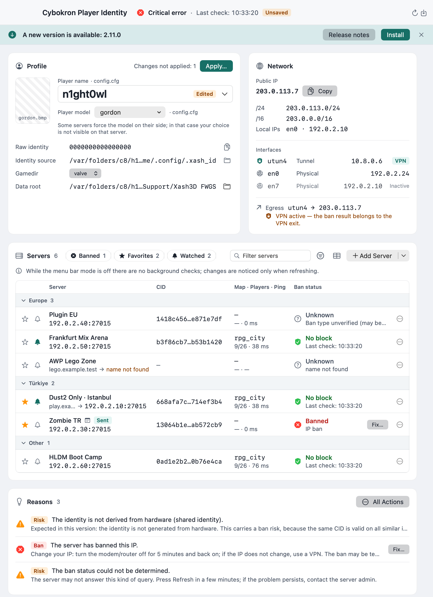
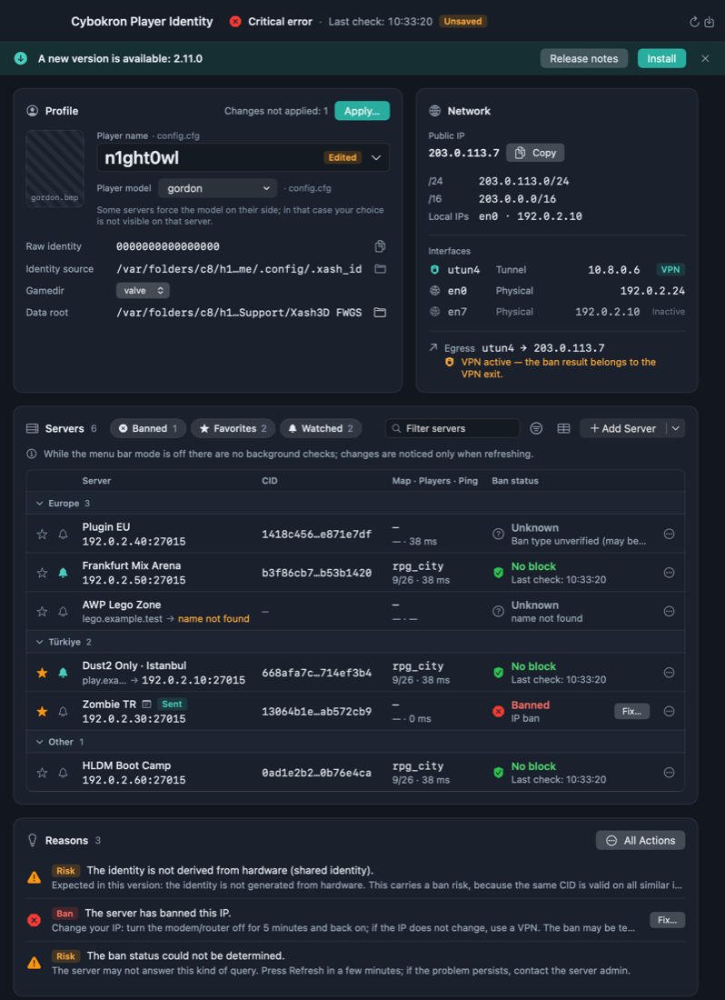
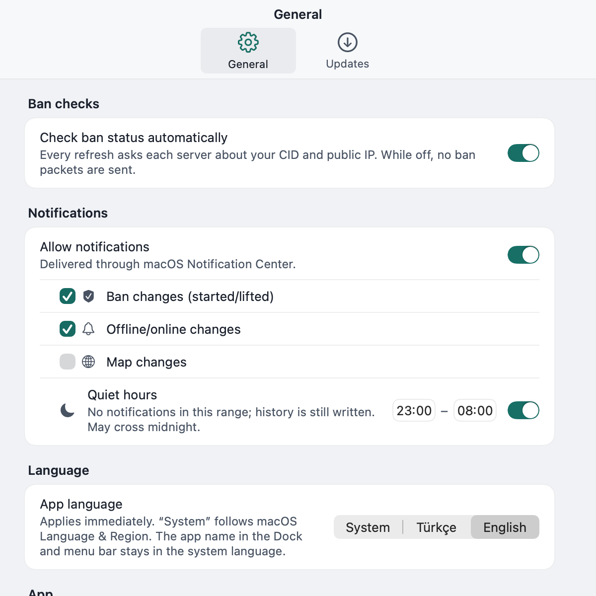
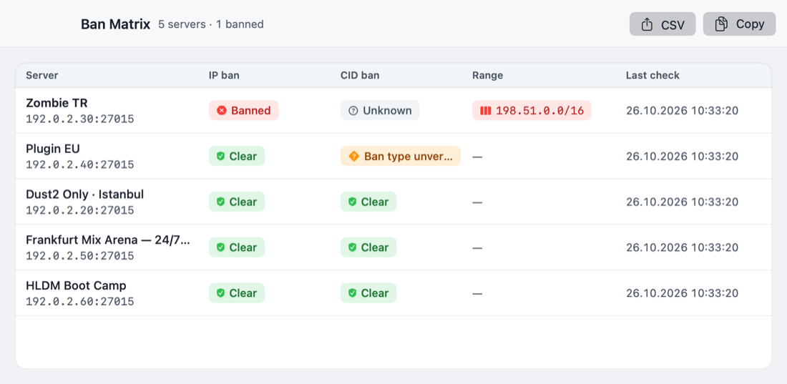
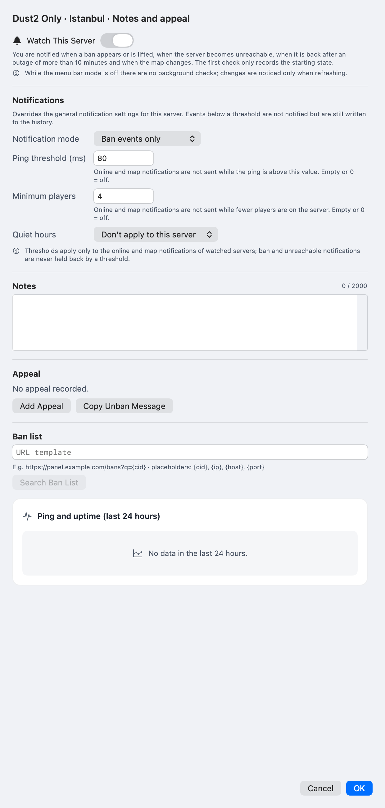
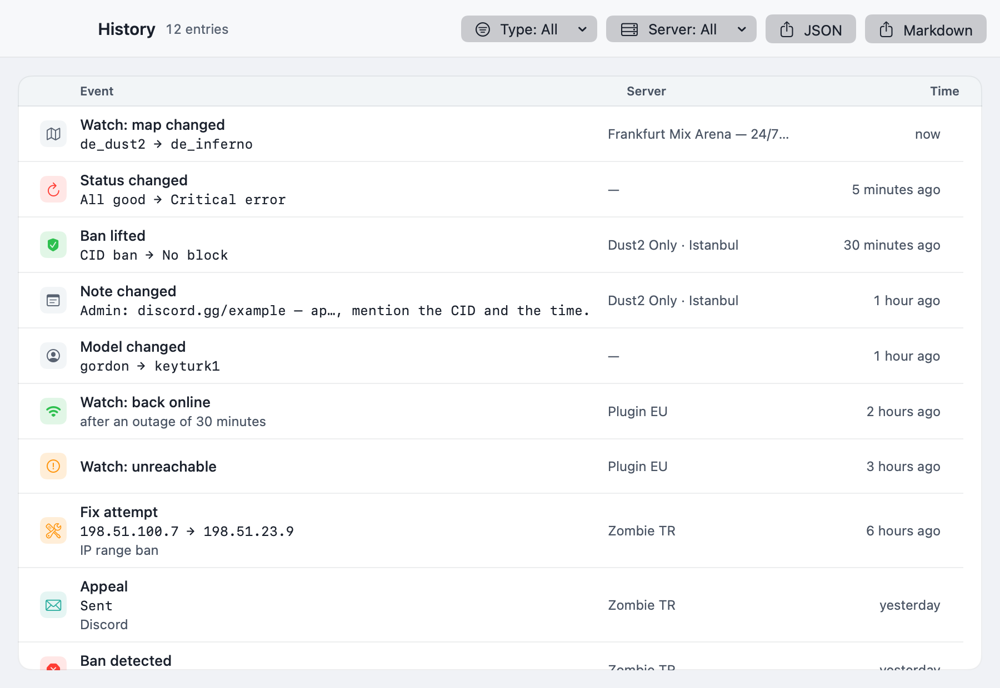
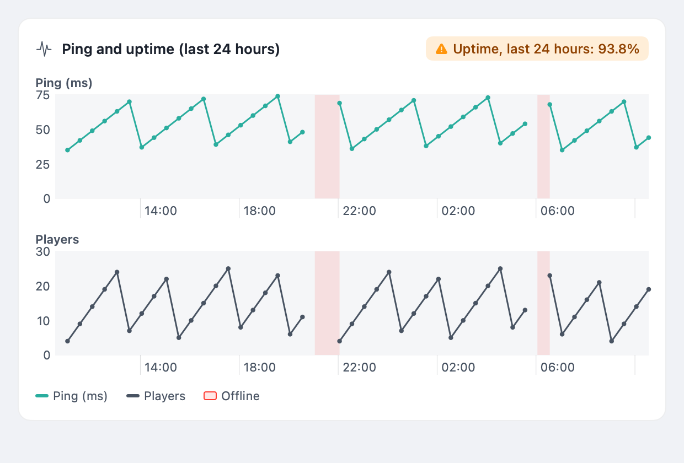
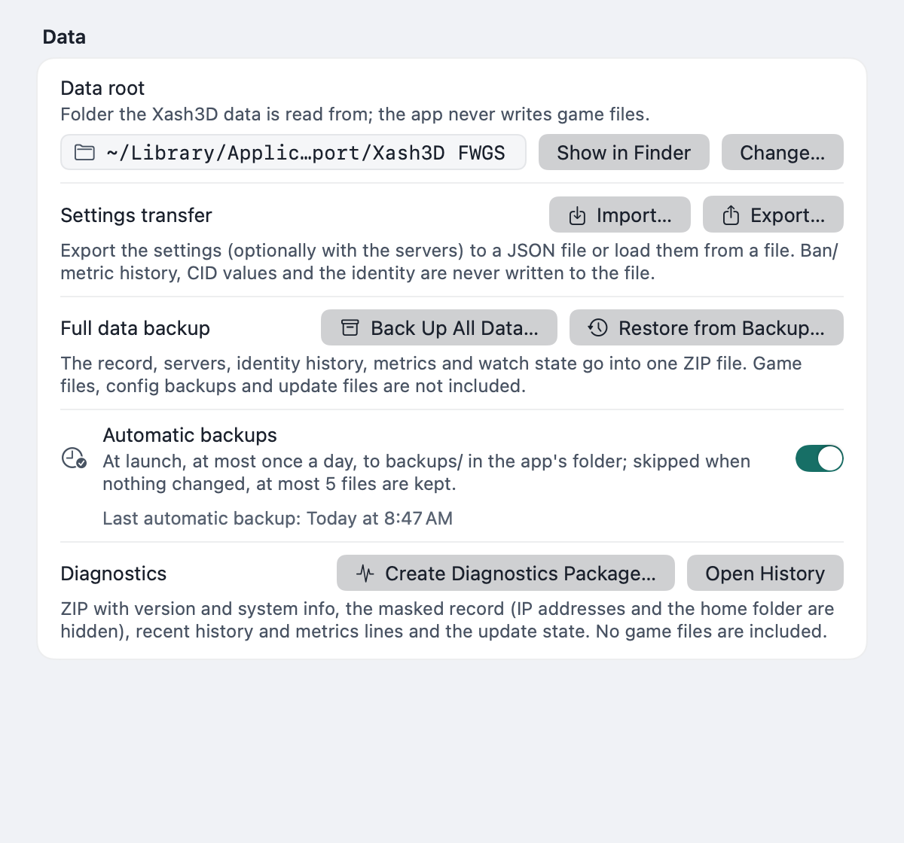
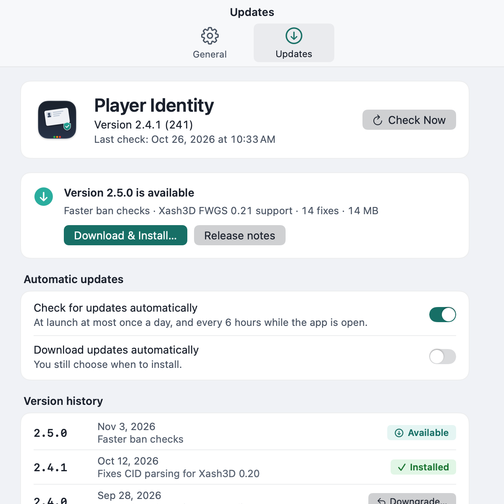

<p align="center">
  
</p>

> Bu doküman İngilizce sürümün çevirisidir: [FEATURES.md](FEATURES.md).

# Cybokron Player Identity — Özellik Referansı
macOS üzerindeki **Xash3D FWGS / GoldSrc** oyuncuları için yerel bir SwiftUI yardımcı programı olan **Cybokron Player Identity**'nin davranış düzeyinde eksiksiz bir açıklamasıdır. Oyun istemcisinin gerçekte kullandığı kimliği gösterir, sunucuların gördüğü ve ban uygularken temel aldığı sunucuya özel **CID** değerini türetir, IP ve CID banlarını denetler ve çıkan sonuca göre harekete geçmenize yardımcı olur.

> **Dokümantasyon sürümü:** Uygulama **v2.14.0** (828 otomatik test) için, davranış spesifikasyonu **v4.1** ([`spec.md`](spec.md), Türkçe, temizlenmiş genel kopya) temel alınarak yazılmıştır. Bu doküman ile spesifikasyon arasında fark olması durumunda spesifikasyon ve kod esas alınır. Örnek sunucularda dokümantasyon için ayrılmış adresler kullanılmıştır (`192.0.2.x`, `198.51.100.x`, `example.test`).



## Bir bakışta
| Öğe | Ayrıntı |
|---|---|
| **Platform** | macOS 14 veya daha yenisi; Swift 6, SwiftUI, üçüncü taraf çalışma zamanı bağımlılığı yok |
| **Oyun** | `valve` veya `gearbox` veri klasörüne sahip Xash3D FWGS (`/Applications/Xash3D-FWGS.app`) |
| **Veri kaynağı** | Oyun motorunun `.xash_id` dosyalarına ve `config.cfg` / `userconfig.cfg` dosyalarına salt okunur erişim; `api.ipify.org` üzerinden genel IP (yedek: `ifconfig.me`); UDP üzerinden sunucu yanıtları |
| **Yazma davranışı** | Varsayılan olarak salt okunur. Üzerine yazılan tek oyun dosyaları `config.cfg` / `userconfig.cfg` içindeki `name` ve `model` satırlarıdır ve bu yalnızca siz **Uygula**'yı (veya **Satırı kaldır**'ı) onayladıktan sonra gerçekleşir. Geri kalan her şey uygulamanın kendi klasöründe bulunur |
| **Diller** | 24 dil (dil başına 958 yerelleştirme anahtarı), yerel adlarla gösterilir, eksik anahtarda `en` düşüşü, RTL desteği, çalışma zamanında değiştirilebilir |
| **Dağıtım** | Developer ID ile imzalanmış, Apple tarafından onaylanmış (notarized), GitHub Releases üzerinde `SHA256SUMS.txt` ile birlikte zımbalanmış (stapled) ZIP; Homebrew cask `ercanatay/tap/player-identity` |
| **Otomasyon** | `playeridentityctl` CLI, `playeridentity://` URL şeması, üç Kestirmeler/Siri eylemi; menü çubuğu hızlı eylemleri, profil değiştirici ve arayüzde ban listesi şablonları |
| **Testler** | Ana şemada 828 birim testi (geçici fikstürler, sahte HTTP/UDP/komut çalıştırıcıları, ağ kullanımı yok) |
| **Sandbox** | Korumalı alanda değil (oyun klasörüne ve `/Applications` altında kendi kendini güncellemeye ihtiyaç duyar); hardened runtime etkindir |
| **Telemetri** | Yok |
| **Lisans** | MIT |

## Kimlik nasıl çalışır
### `.xash_id` dosyası
Xash3D, bir dosya içinde 16 karakterlik onaltılık (hex) bir değer saklar (`0-9a-fA-F`; baştaki/sondaki boşluklar ve satır sonları tolere edilir, diğer tüm uzunluklar veya karakterler geçersizdir) ve bunu sabit bir maske ile XOR işlemine tabi tutar. Uygulama, aday dosyaları oyun motorunun öncelik sırasına göre okur ve ilk **okunabilir ve geçerli** olanı kullanır:

1. `~/.config/.xash_id`
2. `~/.local/.xash_id`
3. `~/.xash_id`
4. `<data root>/<gamedir>/.xash_id`

**Ham kimlik** (16 büyük harf hex karakteri olarak gösterilen 64 bitlik bir sayı), `dosya değeri XOR maske` formülüyle elde edilir:

| Kaynak | Maske |
|---|---|
| Kullanıcı klasöründeki üç dosyadan herhangi biri | `0x10331C2DCE4C91DB` |
| Gamedir başına düşen dosya | `0x7FFC48FBAC1711F1` |

Hiçbir dosya okunabilir ve geçerli değilse durum **kırmızıya** döner (kimlik eksik/geçersiz).

### macOS üzerinde paylaşımlı kimlik
macOS için dağıtılan Xash3D derlemesinde donanım seri numarası kaynağı bulunmadığından ham kimlik `0000000000000000` değerine çöker ve `.xash_id` dosyaları yalnızca maskeyi içerir. Pratikte **her macOS istemcisi belirli bir sunucu için aynı CID değerini türetir**. Uygulama, ham kimliğin sıfır olduğunu tespit eder ve kimlik benzersizmiş gibi davranmak yerine kalıcı, kritik olmayan bir **paylaşımlı kimlik** uyarısı (turuncu) gösterir.

### CID
Sunucunun gördüğü değer ham kimlik değildir; her sunucu için özel olarak türetilir:

```text
CID = lowerHex( MD5( littleEndian64(rawIdentity) || serverIPBytes ) )
```

- IPv4 adresi → 4 bayt; IPv6 adresi → 16 bayt.
- Özel "yerel makine" satırı (adres yok) yalnızca 8 kimlik baytını hash'ler.
- Sonuç her zaman **32 küçük harf onaltılık (hex) karakterdir**.

Sunucu adresi hash'in bir parçası olduğundan, **aynı oyuncu her sunucuda farklı bir CID değerine sahip olur**. Bu nedenle CID *sunucuya özeldir*: Bir sunucudaki CID banı başka bir sunucu hakkında hiçbir şey ifade etmez ve alan adı (hostname) olan bir sunucu için gösterilen CID, alan adından değil **çözümlenen IP adresinden** hesaplanır.

Referans vektörleri (ham kimlik = 0, birim testleri ile doğrulanmıştır):

| Sunucu adresi | CID |
|---|---|
| `127.0.0.1` | `e3f650e2c5f1293838ba8e934ba3b796` |
| Yerel makine (IP baytı yok) | `7dea362b3fac8e00956a4952a3d4f474` |

### CID ne zaman yeniden hesaplanır
Herhangi bir girdi değiştiğinde CID'ler hiçbir ağ isteği yapılmadan derhal yeniden hesaplanır: sunucunun host veya port bilgisi, seçilen gamedir veya data root. Bir alan adı sistem çözümleyicisiyle (`getaddrinfo`, ilk IPv4, aksi takdirde ilk IPv6) çözümlenir ve **beş dakika** boyunca önbelleğe alınır; çözümlenen adres sunucunun yanında gösterilir ve hem CID hem de ban denetimi için kullanılır. Çözümlenemeyen bir alan adı yalnızca ilgili satırı geçersiz olarak işaretler ve genel durumu değiştirmez.

### Kimlik alanları
| Alan | Anlamı |
|---|---|
| **Kimlik kaynağı** | Ham kimliğin okunduğu dosya (kullanıcı klasörü yolu kısaltılır, tam yol araç ipucunda yer alır) |
| **Gamedir** | Data root içindeki oyun klasörü (`valve`, `gearbox`, …). `.xash_id` veya `config.cfg` içeren birinci düzey klasörler arasında otomatik olarak keşfedilir; varsa varsayılan `valve` olur |
| **Data root** | Oyun verilerinin okunduğu klasör; normalde `~/Library/Application Support/Xash3D FWGS`. Ayarlar'dan değiştirilebilir; uygulama aşağıda açıklanan `name`/`model` düzenlemeleri dışında buraya asla yazmaz |

Uygulamanın kaydettiği kayıt (`profile.json`), son gözlemlenen kimliği saklar; böylece daha sonraki bir kontrolde ham kimliğin farklı olması durumunda **identityChanged** bildirebilir.

## Ana pencere


Pencere en az 720×520 boyutundadır ve sistemin açık/koyu görünümünü takip eder.

### Araç çubuğu
- **Durum** — Genel bir renk artı metin: yeşil (her şey geçti ve kaydedilen kayıtla eşleşiyor), turuncu (bir şeyler farklı veya doğrulanamıyor), kırmızı (kritik hata: kimlik eksik/geçersiz, genel IP yok, bozuk kayıt, bir ban). Tıklamak, mevcut tüm önerileri ve bir kopyalama düğmesini içeren **Ne yapmalıyım?** görünümünü açar.
- **Kaydedilmemiş rozeti** — Kaydedilmemiş değişiklikler olduğunda gösterilir (en dar araç çubuğu düzeninde gizlenir); ek nedenler "· +N tane daha" şeklinde özetlenir.
- **Son denetim** — En son yenilemenin zamanı (`HH:mm:ss`).
- **Yenile (⌘R)** ve **Kaydet (⌘S)**.
- Sunucular denetlenirken araç çubuğunda "N sunucu denetleniyor…" yazar. Yatay alan tükendiğinde araç çubuğu kompakt bir düzene geçer ve başlık esner.
- **Geçmiş (⌘Y)**, **Ban Matrisi** penceresi ve **Ayarlar**'a uygulamanın menülerinden ve araç çubuğundan erişilebilir.
- **Paylaşım kartı** — 1200×630 PNG, bir sunucu satırının menüsünden oluşturulur (bkz. [Sunucu yönetimi](#sunucu-yönetimi)).

Kaydedilmemiş değişiklikler varken çıkmak veya pencereyi kapatmak onay ister.

### Güncelleme şeridi
Daha yeni bir kararlı sürüm mevcut olduğunda bir şerit, **Yükle**, **Sürüm notları** ve **Yoksay** seçenekleriyle birlikte "Yeni sürüm X.Y.Z" gösterir. Yükle her zaman önce onay ister ve yükleme engellendiğinde (örneğin bir geri yükleme sürerken) nedenini belirtir. Bkz. [Güncellemeler](#güncellemeler).

### Profil kartı
| Satır | İçerik |
|---|---|
| **Oyuncu adı** | Son kullanılan isimlerin yanı sıra "Yeni isim…" seçeneğini içeren açılır menü |
| **Oyuncu modeli** | Yüklü modellerin (küçük resimleriyle) ve manuel girişin yer aldığı açılır menü |
| **Ham kimlik** | Eşaralı (monospace), sıfır olduğunda paylaşımlı kimlik uyarısıyla |
| **Kimlik kaynağı** | Dosya yolu, "Finder'da Göster" |
| **Gamedir** | Keşfedilen gamedir seçicisi |
| **Data root** | **Klasör Seç…** düğmesiyle geçerli klasör |
| **Uygula (⌘⏎)** | Diff önizlemesinden sonra name/model yazar; bir "kaydedilmemiş/bekleyen değişiklikler" sayacı kaç düzenlemenin uygulanmadığını gösterir |

Boş ve hata durumları ("Kimlik bulunamadı", "Kimlik okunamadı") **Yeniden Tara** seçeneğini sunar. Düzenleme ayrıntıları [İsim ve model düzenleyici](#isim-ve-model-düzenleyici) bölümündedir.

### Ağ kartı


| Satır | İçerik |
|---|---|
| **Genel IP** | Büyük ve kopyalanabilir; `https://api.ipify.org?format=json` (8 sn zaman aşımı) ve yedek olarak `https://ifconfig.me/ip` üzerinden sorgulanır. Her ikisi de başarısız olursa durum kırmızı olur |
| **Aralık** | Genel IP'nin `/24` ve `/16` aralığı (IPv6: `/64` ve `/48`), örn. `Range: 198.51.100.0/24 · 198.51.0.0/16` |
| **Yerel IP'ler / Ağ Arayüzleri** | Loopback ve link-local olmayan her arayüz adresi, adıyla birlikte (`en0 · 192.0.2.10`), önce IPv4; aktif/pasif durumu ve türü (fiziksel, tünel, köprü) |
| **VPN / Çıkış (Egress)** | Bir `utun*` arayüzü mevcut olduğunda **ve** varsayılan rota bunu kullandığında "VPN aktif". NAT tek bir çıkış IP'si sağladığından, kart tek bir "Çıkış: IP · arayüz" satırı gösterir; VPN etkinken **ban sonucunun VPN çıkışına ait olduğu** uyarısını verir |

Ban denetimleri her zaman çıkış IP'sinden yapılır.

### Sunucular tablosu
| Sütun | İçerik |
|---|---|
| Durum simgesi, etiket, `host:port` | Satır kimliği; alan adları için çözümlenen IP gösterilir |
| **CID** | Eşaralı (monospace); "Kopyalandı" onayı ile kopyalamak için tıklayın |
| **Harita · Oyuncular · Ping** | A2S_INFO yanıtından alınır, örn. `de_dust2 · 9/26 · 42 ms`; sunucu yanıt vermediyse gizlenir |
| **Ban durumu** | Simge + metin (asla tek başına renk değil); araç ipucunda son denetim zamanı |

- **Gruplandırma:** Gruba göre (sıralı bölümler, gruplanmamış sunucular "Diğer" altında/en sonda) veya "Gruplandırma yok".
- **Arama:** ⌘F ile odaklanılan "Sunucuları filtrele" alanı.
- **Filtreler:** *Banlı*, *Favoriler*, *İzlenenler* butonları artı bir filtre seçenekleri menüsü ("Yalnızca göster", "Gruplandır", "Çözümlenemeyen host'ları gizle", "Filtreleri Temizle"). Filtreler birleşir.
- Bir satır menüsü daha fazla eylem sunar (ayrıntılar, düzenle, favori, izle, paylaşım kartı, oyuna katıl, Düzelt, sil). Ban kontrolleri devre dışı bırakıldığında tablo, Ayarlar'a yönlendiren bir bağlantıyla "Ban kontrolleri kapalı" uyarısını gösterir.

### Nedenler listesi
Her neden bir simgeye, metne ve tek satırlık bir öneriye sahiptir. Tipik girdiler:

| Seviye | Örnekler |
|---|---|
| 🔴 Kırmızı | kimlik dosyası eksik veya geçersiz, genel IP yok, bozuk kayıt, IP banı, CID banı |
| 🟠 Turuncu | değişen genel IP, değişen isim/model, henüz temel kayıt yok, paylaşımlı kimlik, ulaşılamayan sunucu, doğrulanmamış ban türü, yerel IP yok |
| 🟢 Yeşil | neden yok — tüm kritik denetimler geçti ve her şey kaydedilen kayıtla eşleşiyor |

Öneriler "IP adresinizi yenileyin", "bu metinle itiraz edin", "bir temel kayıt kaydedin" gibi eylemlerdir.

## Sunucu yönetimi
### Ekleme, düzenleme, kaldırma
- **+** menüsünden **Ekle**: etiket, host (IPv4, IPv6 veya 253 karaktere kadar bir RFC 1123 alan adı) ve port (varsayılan **27015**).
- Ayrıntılar sayfasında aynı alanları ve grup, favori, izle, notlar, itiraz ve ban listesi URL'sini **Düzenle**.
- Satırın bağlam menüsü veya fareyle üzerine gelindiğinde çıkan denetim aracılığıyla **Kaldır**.
- `host:port` girişte doğrulanır; IPv6 köşeli parantez gerektirir (`[2001:db8::1]:27015`). Portlar 1–65535 arasında olmalıdır.
- Her değişiklik durumu anında yeniden hesaplar ve siz **Kaydet (⌘S)** düğmesine basana kadar kaydı **kaydedilmemiş** olarak işaretler.

### Etiketler, gruplar, favoriler, izlenenler
- **Etiket** varsayılan olarak host bilgisine ayarlıdır.
- **Grup** — Mevcut bir grubu seçin veya yeni bir tane yazın; gruplar sıralı bölümler olarak görünür, gruplanmamış sunucular en sonda yer alır.
- **Favoriler** (★) bir bölüm içinde ilk sırada listelenir ve filtrelenebilir.
- **İzlenen** (🔔) sunucular [bildirimler](#bildirimler) üretir; bir zil rozeti bunları işaretler.
- **Sıralama**, bir bölüm içinde ▲/▼ kullanır ve kalıcıdır. Sürükle-bırak yöntemiyle yeniden sıralama uygulanmamıştır.

### Arama ve filtreleme mantığı
Arama, etiket/host metniyle eşleşir; üç filtre butonu (*banlı*, *favoriler*, *izlenenler*) birbirleriyle ve aramayla kümülatiftir. Boş bir sonuç, **Filtreleri Temizle** seçeneğiyle birlikte "Filtreyle eşleşen sunucu yok" mesajını gösterir.

### Çift kayıtlar
Çift kayıt, aynı host **ve** port anlamına gelir. Yinelenenler içe aktarma önizlemesinde işaretlenir, URL şeması tarafından atlanır ve CLI'da `servers add` tarafından reddedilir. Yapıştırılan tek bir liste içindeki yinelenen girdiler daraltılır.

### Metinden veya URL'den içe aktarma
**+ → URL'den / yapıştırılan listeden ekle…** en fazla **100** girdiyi kabul eder (satır başına bir tane veya virgülle ayrılmış):

- `host:port` (IPv4, alan adı, köşeli parantezli IPv6);
- GameTracker bağlantıları `https://www.gametracker.com/server_info/<host>:<port>/` (sorgu ve parça yoksayılır);
- `steam://connect/<host>:<port>` bağlantıları.

Çevreleyen boşluklar, `http`/`https` ve sondaki bir `/` tolere edilir; eksik bir port 27015 anlamına gelir. Sayfa bir **önizleme** gösterir: etiket, host, port, "zaten var" işareti ve nedeni belirtilen geçersiz satırlar. Geçerli yeni girdiler önceden seçilmiştir; seçimi değiştirebilirsiniz. Yalnızca onaylanan girdiler eklenir (⌘V yapıştırır, ⌘⏎ ekler).

### Notlar, itirazlar ve ban listesi URL'si
- Sunucu başına **2.000 karaktere** kadar serbest metinli bir **not**; değişiklikler geçmişe yazılır (eski → yeni, 500 karaktere kırpılır).
- Sunucu başına bir **ban listesi URL şablonu** (`https`, `{cid}`, `{ip}`, `{host}`, `{port}` değişkenlerinden en az birini içeren), örneğin `https://panel.example.test/bans?q={cid}`. **Ban listesinde ara**, URL kodlamalı değerlerle bunu varsayılan tarayıcıda açar; uygulama sayfayı asla kazımaz.

### "Kaydedilmedi" modeli
Düzenlemeler **Kaydet**'e kadar bellekte yaşar. İçe aktarmalardan, URL şemasından ve CLI'dan bağımsız arayüzden gelen yeni satırlar **kaydedilmedi** ("Kaydedilmedi") olarak işaretlenir. Kaydedilmemiş değişikliklerle kapatmak, bir yedeği geri yüklemek veya ayarları içe aktarmak sizi uyarır; geri yükleme **Önce kaydet** seçeneğini sunar (varsayılan olarak açıktır).

## Ban kontrolleri


Uygulama, her sunucu için yenileme başına bir UDP yoklama dizisi çalıştırır ve sunucu ayrıntıları için A2S_INFO yanıtını yeniden kullanır. **Asla hiçbir spawn paketi gönderilmez**, bu nedenle oyuna fiilen asla girmezsiniz.

### Dizi
1. **A2S_INFO** — `FF FF FF FF` + `TSource Engine Query` + `00`. `0x6D` (GoldSrc) veya `0x49` (Source) yanıtı sunucunun ayakta olduğu anlamına gelir; `0x41`, uygulamanın bir kez yanıtladığı bir challenge'dır. Yanıt ayrıca isim, harita, oyuncular/maksimum ve ping (gidiş-dönüş süresi) değerlerini verir. 4 sn içinde yanıt gelmezse → *ulaşılamıyor*; sonraki adımlar atlanır.
2. **getchallenge** — `FF FF FF FF` + `getchallenge` + `\n`. `banned` içeren bir yanıt gövdesi (büyük/küçük harfe duyarsız) → **IP banlı**. `0x41` challenge yanıtı → IP tamamdır ve challenge değeri 3. adım için saklanır. Yanıt yoksa veya bilinmiyorsa → *bilinmiyor*.
3. **connect 49** (yalnızca bir challenge alındıysa) — CID'yi `uuid` olarak taşıyan modern protokol bir connect paketi (`prot=cidtest; uuid=<cid>; …`). Kontrol, el sıkışma yanıtından hemen sonra durur.

### Sonuç matrisi
| Sonuç | Anlamı | Gösterim |
|---|---|---|
| `clear` | IP tamam ve CID tamam (`client_connect`, `0x42`) | 🟢 Engel yok |
| `banned` (IP) | `getchallenge` yanıtı banlı olduğunu söylüyor | 🔴 IP ban |
| `cidBanned` | connect 49'a gelen ve bir banı belirten `errormsg` / `disconnect` / `0x39` yanıtı | 🔴 CID ban |
| `rangeBanned` | IP değişikliğinden sonra aynı `/16` (IPv6 `/48`) hâlâ IP banlı | 🔴 IP aralık banı |
| `unverified` | Sunucu istemciyi ban benzeri bir yanıtla reddetti ancak tür bilinmiyor (eklenti/SQL banı olası) | ⚪ Ban türü doğrulanmadı, ham yanıt gösteriliyor |
| `notApplicable` | GoldSrc protokol 48 sunucusu modern connect paketini reddediyor ("unsupported protocol") — CID test edilemez | ⚪ CID denetimi uygulanamaz (IP tamamsa CID engeli yok sayılır) |
| `error` / ulaşılamıyor | 4 saniyede A2S yanıtı yok | ⚪ Ulaşılamıyor (genel durumda turuncu, kritik değil) |
| `error` / DNS | Alan adı çözümlenemiyor | Satır geçersiz host olarak gösterilir; genel durum etkilenmez |
| `unknown` | Yanıt eksik veya tanınmıyor | ⚪ Belirlenemedi |

Herhangi bir `banned` sonucu genel durumu **kırmızıya** çevirir ve bir neden ekler; ulaşılamıyor/bilinmiyor durumu ise **turuncu** yapar.

### Aralık tespiti
Uygulama, bir Düzelt denemesinden sonra eski ve yeni genel IP'yi karşılaştırır: IP değiştiyse ancak **aynı `/16`** hâlâ banlıysa, bir **aralık banı** bildirir ve artık IP'yi yenilemeyi önermez. Hâlâ banlı olan farklı bir `/16`, bir CID veya eklenti banının mümkün olduğuna dair ekstra bir ipucuyla birlikte genel "hâlâ banlı" mesajını korur. Farklı bir `/16` ile eşleşen bir `/24`, bir aralık banı sayılmaz.

### CID banı ve "doğrulanmamış ban türü"
`cidBanned`, `connect 49` yanıtıyla kanıtlanan motor düzeyinde bir CID/uuid banıdır. "Ban türü doğrulanmadı", sunucunun reddettiği ancak kanıtların sistemi (motor IP'si, motor CID'si veya AMXX/AMXBans gibi eklenti/SQL) tanımlayamadığı anlamına gelir; yöneticinin sınıflandırabilmesi için ham yanıt metni görüntülenir.

### Denetimler kapalı
**Ayarlar → Genel → Ban denetimleri → "Ban durumunu otomatik denetle"** (varsayılan olarak açıktır). Kapalıyken **hiçbir ban paketi gönderilmez**, Ban sütunu "Denetimler kapalı" gösterir ve Düzelt yeniden denetim yapılmadığını bildirir. (Xash3D'nin çalışıyor olması kontrolleri devre dışı bırakmaz; yalnızca yapılandırma yazımlarını engeller ve *Oyuna katıl* öncesinde bir onay tetikler.)

### Ağ maliyeti ve limitler
- Adım başına 4 sn zaman aşımı, sunucu başına en fazla 12 sn, **yenileme başına sunucu başına bir deneme**, aynı sunucunun iki denetimi arasında en az **10 sn**, otomatik yeniden deneme yok.
- Tüm denetimler yenilemeyle birlikte iptal edilebilir.
- CLI da aynı limitleri kullanır; `ban --timeout` adım başına zaman aşımını değiştirir.

## Bir ban durumunda harekete geçme
**Hiçbir istemci sunucu tarafındaki bir banı kaldıramaz.** Düzelt bu konuda dürüsttür ve kanıt olmadan asla "çözüldü" iddiasında bulunmaz. Yalnızca IP banlı, CID banlı ve ulaşılamayan satırlar için görünür.

### IP banı akışı
1. **Onay sayfası**: Mevcut genel IP, ne yapılacağı, beklenen kesinti süresi (5–20 sn), bir risk notu, **Başlat / Vazgeç**.
2. Eski IP (A) saklanır. Birincil arayüz, varsayılan rotanın arayüzüdür.
3. Sabit bir komut izin listesiyle **ağ yenileme**: Wi-Fi 3 saniye süreyle kapatılıp tekrar açılır; Ethernet için DHCP kiralaması yenilenir (bir kerelik macOS yönetici istemi — uygulama parolayı asla görmez). İstemin iptal edilmesi, bir istem hatasından ayırt edilir.
4. Uygulama ağ için **45 saniyeye** kadar bekler (genel IP her 3 saniyede bir sorgulanır).
5. Yeni IP (B):
   - A ≠ B → Ban denetimi yeniden çalışır: temiz → "Çözüldü: IP değişti (A → B), ban kalktı"; hâlâ banlı → "aralık/eklenti olası"; aynı `/16` → **aralık banı**.
   - A = B → "IP değişmedi", sonraki adımlarla birlikte: PPPoE/WAN yeniden bağlantısı için yönlendirici sayfasını (`http://<gateway>`) açın, bir VPN kullanın, birkaç saat sonra tekrar deneyin (süreli ban).
6. Arayüz her zaman etkin bırakılır (başarısız bir akış bile `on` komutunu çalıştırmayı dener). Bir kilit ile aynı anda yalnızca bir Düzelt çalışır ve iptal edilebilir.

Bir İSS statik IP'si, CGNAT veya PPPoE oturumunu koruyan bir yönlendirici IP'yi değiştirmeden bırakabilir; uygulama tam olarak ne olduğunu bildirir. Ban süresi ve alt ağ uzaktan okunamaz.

### CID banı akışı
Yerel olarak hiçbir şey düzeltilemez. Sayfa bunu açıklar ve **Ban kaldırma mesajını kopyala**, **Sunucu sayfasını aç**, **Tekrar denetle** seçeneklerini sunar.

### Ulaşılamıyor akışı
Hiçbir ağ komutu çalıştırılmaz; yalnızca **Tekrar denetle** ve **Sunucu sayfasını aç**.

### Ban kaldırma / itiraz mesajı
Oluşturulan metin doldurulmuş sunucu adını ve `host:port` bilgisini, denetim zamanını (yerel ve UTC), oyuncu adını, **CID'yi (32 hex)**, çıkış IP'sini, gamedir'i, ham sunucu yanıtını, **denetim türünü** (`engine IP (getchallenge)`, `engine CID (connect 49)` veya "bilinmiyor, eklenti/SQL olabilir"), geçerli olduğunda şüphelenilen bir aralık satırını (`Possible range ban: 198.51.0.0/16 (old IP: A, new IP: B)`), ban bitiş süresi ve nedeni talebini ve bir **yönetici kontrol listesini** içerir:

1. girdiyi `listid` ve `listip` ile bulun;
2. motor ID banı: `removeid <id>` + `writeid`;
3. motor IP banı: `removeip <ip>` + `writeip`;
4. AMXX: `amx_unban <ip>` (yalnızca IP) veya ban yöneticisi menüsü;
5. SQL/AMXBans: panelden/veritabanından silin;
6. `sv_filterban` değerini kontrol edin;
7. yeniden başlatın, `listid`/`listip` ile doğrulayın, oyuncuyu yeniden bağlanmaya davet edin.

Üç bağımsız sistem bir oyuncuyu banlayabilir (motor ID, motor IP, eklenti/SQL); birini temizlemek diğerlerini temizlemez ve `writeid`/`writeip` olmadan bir harita değişikliği veya yeniden başlatmanın ardından ban geri gelir.

### İtiraz takibi
Her sunucu bir **itiraz** barındırabilir: kanal (Discord, Telegram, forum, e-posta, diğer), durum (`sent → answered → accepted / rejected`), gönderilme tarihi, takip tarihi ve bir özet. Durum değişiklikleri en fazla 20 olaydan oluşan bir zaman çizelgesi oluşturur ve takip tarihi **+1 gün** veya **+3 gün** ertelenebilir. Takip tarihi geçtiğinde **bir** bildirim üretilir (bildirim ayarlarına ve sessiz saatlere uyar ve tekrarlanmaz). Bir itirazı kaydetmek geçmişe bir `appeal` olayı yazar.

### Sunucu sayfası ve tekrar denetle
Sunucu sayfası `https://www.gametracker.com/server_info/<host>:<port>/` adresini açar ("Yöneticiyle iletişime geçin"); uygulama bunu asla kazımaz. **Tekrar denetle**, 10 sn sınırına tabi olarak yalnızca ilgili sunucunun denetimini yeniden çalıştırır. Discord veya webhook entegrasyonu yoktur.

## İsim ve model düzenleyici


*(Ekran görüntüsü bir sunucunun bildirim bölümünü içeren ayrıntılar sayfasını göstermektedir.)*

### Geçerli değer ve kaynaklar
Oyun önce `config.cfg`, ardından `userconfig.cfg` dosyasını çalıştırır; bu nedenle `userconfig.cfg` içindeki bir `name`/`model` satırı **önceliklidir (kazanır)**. Uygulama her zaman geçerli değeri ve kaynağını gösterir ("config.cfg" veya "userconfig.cfg (overrides config.cfg)"). Bir dosya içinde bir anahtarın **son** örneği geçerlidir, tırnak işaretleri kaldırılır ve iç boşluklar korunur. Eksik bir anahtar hata değil, turuncu bir uyarıdır.

### Geçersiz kılmayı (override) kaldırma
`userconfig.cfg` değeri geçersiz kıldığında bir uyarı, oyun içi değişikliklerin kalıcı olmayacağını açıklar ve **Satırı kaldır** seçeneğini sunar: dosya `userconfig.cfg.appbak-<stamp>` olarak yedeklenir, yalnızca ilgili anahtar yorum satırı yapılır ve bir `configOverrideRemoved` geçmiş olayı yazılır. Oyun çalışırken bu işlem reddedilir.

### Uygula
1. **Uygula (⌘⏎)** düğmesine basın. Hiçbir şey değişmediyse Uygula devre dışıdır.
2. Bir **diff önizlemesi**, her dosyayı satır numaraları ve `-`/`+` satırlarıyla listeler. Siz onaylayana kadar hiçbir şey yazılmaz; vazgeçmek hiçbir şeyi değiştirmez.
3. Yazma işlemleri bayt korumalıdır: yalnızca hedef anahtarlar değişir, LF/CRLF satır sonları korunur, tüm yinelemeler güncellenir, eksik anahtarlar sona eklenir ve yazma atomiktir. Dosya başına bir adet döngüsel `*.appbak` tutulur; oyunun kendi `config.cfg.bak` dosyasına asla dokunulmaz.

### Oyun çalışıyor kilidi
Uygula ve Satırı kaldır işlemleri **Xash3D çalışırken reddedilir** (adı `xash3d` ile başlayan bir işlem); çünkü oyun motoru çıkışta `config.cfg` dosyasını yeniden yazar ve düzenlemeyi geri alır.

### Doğrulama
İsimler ve modeller yazılmadan önce doğrulanır. **İsim:** 1–31 karakter (kırpılmış) ve en fazla 31 UTF-8 baytı; `"`, `\`, satır sonları ve kontrol karakterleri reddedilir. **Model:** Yalnızca `A-Z a-z 0-9 _ -` karakterlerinden oluşan 1–32 karakter (boşluk veya tırnak işareti yok). Geçersiz bir değer satır içi hata gösterir ve Uygula devre dışı kalır.

### Model önizlemeleri
Açılır menü; `<gamedir>/models/player/`, `<data root>/valve_downloads/models/player/` ve `<data root>/<gamedir>_downloads/models/player/` klasörlerindeki model klasör adlarını birleştirir, yinelenenleri temizler ve sıralar; geçerli değer her zaman korunur. Satırlar ve kart, hem `valve` hem de `gearbox` modelleri için modelin kendi BMP dosyasından (büyük/küçük harfe duyarsız uzantı) alınan bir küçük resmi dosya yolu araç ipucunda olacak şekilde gösterir veya önizleme yoksa bir kişi simgesi görüntüler. Bir not, **bazı sunucuların sunucu tarafında bir modeli zorunlu kıldığını**, bu nedenle seçiminizin orada görünmeyebileceğini hatırlatır.

## Geçmiş


`history.jsonl`, anlamlı **geçişlerin** yalnızca sonuna ekleme yapılan (append-only) bir günlüğüdür (aynı durum iki kez yazılmaz). Geçmiş penceresi (⌘Y) en yeniden eskiye doğru sıralar.

### Olay türleri
| `kind` | Ne zaman |
|---|---|
| `refresh` | Bir yenilemenin ardından genel durum değiştiğinde |
| `ipChanged` | Genel IP saklanan IP'den farklı olduğunda |
| `banAppeared` / `banLifted` | Bir sunucunun ban durumu değiştiğinde (tür dahil) |
| `identityChanged` / `nameChanged` / `modelChanged` | Gözlemlenen kimlik, isim veya model değiştiğinde |
| `apply` | İsim/model Uygula ile yazıldığında |
| `fixAttempt` | Bir Düzelt çalıştırması tamamlandığında (sonuç, aralık banı, başarısızlık) |
| `appUpdateAvailable` | Daha yeni bir sürüm bulunduğunda |
| `appeal` | Bir itiraz kaydedildiğinde (`old`/`new` = durum, `note` = kanal) |
| `note` | Bir sunucu notu değiştiğinde |
| `watchBanAppeared` / `watchBanLifted` | İzlenen bir sunucuda ban geçişi olduğunda |
| `watchOffline` / `watchOnline` | İzlenen sunucu ulaşılamaz hale geldiğinde / geri geldiğinde |
| `watchMapChanged` | İzlenen sunucu harita değiştirdiğinde (eski → yeni) |
| `configOverrideRemoved` | `userconfig.cfg` geçersiz kılma satırı yorum satırı yapıldığında |

### Alanlar
Her satır, ISO-8601 zaman damgalarına sahip `{ts, kind, serverID?, host?, old?, new?, note?}` şeklindedir. Okunamayan satırlar yükleme sırasında atlanır.

### Filtreler ve görüntüleme
**Tür** ve **Sunucu**'ya göre filtreleyin; satırlar simge + etiket, sunucu, göreli zaman (araç ipucunda tam zaman) ve ayrıntıları gösterir. Boş geçmiş ("Henüz kayıt yok") ve eşleşmeyen filtre durumları ayrı mesajlara sahiptir.

### Dışa aktarma
- **JSON** — yukarıdaki alan adlarıyla güzel biçimlendirilmiş JSON olarak girdiler.
- **Markdown** — `|` ve satır sonlarının kaçışlandığı, sütunları `ts | kind | serverID | host | old | new | note` olan tek bir tablo.

### Saklama süresi
Hangi sınıra önce ulaşılırsa, en yeni **5.000** girdi veya **90 gün**.

## Metrikler


### Örnekleme
Her ban denetimi `metrics.jsonl` dosyasına bir örnek ekler: `{ts, serverID, host, online, ping, players, maxPlayers, map}`. Uygulama, Düzelt akışı ve CLI bunu besler (sunucu başına saniyede bir yinelenenler kaldırılır); `playeridentityctl ban --no-metrics` bunu devre dışı bırakır.

### Grafikler
Sunucu ayrıntıları, gölgelendirilmiş **çevrimdışı boşlukları** ve **24 saatlik çalışma süresi (uptime)** yüzdesini (`online samples / total samples`) içeren bir başlıkla birlikte son 24 saate ait ping (ms) ve oyuncu sayısı için **Swift Charts** grafiklerini gösterir. Grafikler özetlerini VoiceOver için seslendirir ("N nokta, en düşük …, en yüksek …"). Veriler JSON veya CSV olarak dışa aktarılabilir.

### Saklama ve durumlar
Sunucu başına 30 gün ve en fazla 5.000 örnek, otomatik olarak budanır. Son 24 saatte veri yoksa kart "Son 24 saatte veri yok." gösterir. Başarısız bir `metrics.jsonl` yazma işlemi sessiz kalmak yerine bir durum satırı olarak gösterilir.

## Ban matrisi
### Sütunlar
Özel bir pencere her sunucuyu **Sunucu**, **Adres**, **IP banı**, **CID banı**, **Aralık** ve **Son denetim** başlıkları altında listeler. Hücreler simge + metin gösterir: *Banlı*, *Temiz*, *Bilinmiyor*, *Uygulanamaz* veya hiç denetlenmediğinde ya da ulaşılamadığında "—". "Ban türü doğrulanmadı" satırları ayrı olarak işaretlenir.

### Sıralama ve sayaçlar
Önce banlı satırlar, ardından doğrulanmamış, bilinmiyor/ulaşılamıyor, temiz, henüz denetlenmemişler sıralanır; eşit dereceler liste sırasını korur. Bir özet satırında "N sunucu · M banlı" yazar.

### Dışa aktarma
**CSV Dışa Aktar…**, bir RFC 4180 dosyası yazar (virgüller, tırnaklar ve satır sonları kaçışlandırılır); **Kopyala**, aynı tabloyu panoya kopyalar.

### Dar pencereler
Sütunlar önceliklendirilir ve kesilen metin araç ipucu alır. Hiç sunucu yoksa: "Henüz sunucu yok."

## Bildirimler


### İzin ve kanal
Bildirimler macOS Bildirim Merkezi'ni (`UNUserNotificationCenter`) kullanır. İzin yalnızca ilk bildirimden hemen önce istenir. macOS reddederse Ayarlar bir uyarı gösterir ve itiraz hatırlatıcıları izin verilene kadar bekler. Bir bildirim, yalnızca gönderme fiilen başarılı olduysa "teslim edildi" sayılır; başarısız gönderimler tekilleştirme listesine girmez.

### Olay türleri
| Olay | Bildirildiği durum |
|---|---|
| Ban belirdi / kalktı | Herhangi bir sunucu (IP veya CID, metinde türüyle) |
| IP değişti, kimlik değişti, Düzelt sonucu | Uygulama düzeyinde geçişler |
| İzlenen sunucu çevrimdışı / tekrar çevrimiçi / harita değişti | Yalnızca 🔔 anahtarı açık olan sunucular için |
| İtiraz takibi zamanı geldi | İtiraz başına bir kez |

"Tekrar çevrimiçi", yalnızca en az **10 dakika** çevrimdışı kaldıktan sonra bildirilir; aynı geçişler 10 dakika içinde tekilleştirilir.

### Genel anahtarlar ve sessiz saatler
**Ayarlar → Genel → Bildirimler**: bir ana anahtar artı *Ban değişiklikleri*, *Çevrimdışı/çevrimiçi değişiklikleri* ve *Harita değişiklikleri* (tümü varsayılan olarak açıktır). **Sessiz saatler** (varsayılan 23:00–08:00) bildirimleri engeller; zaman aralığı **gece yarısını geçebilir** ve başlangıç = bitiş olması boş bir zaman aralığı anlamına gelir. Geçmiş kayıtları, sessiz saatler boyunca veya bildirimler kapatıldığında da **yazılmaya devam eder**.

### Sunucu başına geçersiz kılmalar
Sunucu ayrıntılarında bir **Bildirimler** bölümü bulunur (isteğe bağlı bir `notifications` nesnesi olarak saklanır; varsayılan "devral"dır):

| Ayar | Değerler | Etkisi |
|---|---|---|
| Mod | `inherit` / `all` / `bansOnly` / `off` | *all* kategori anahtarlarını yoksayar; *bansOnly* ban belirdi/kalktı durumlarını korur; *off* sunucuyu sessize alır. Ana anahtar asla geçersiz kılınamaz |
| Ping eşiği (ms) | boş/0 = kapalı, 1–5000 | "Tekrar çevrimiçi" ve "harita değişti" yalnızca ping ≤ eşik olduğunda bildirilir |
| Minimum oyuncu | boş/0 = kapalı, 1–256 | Aynı iki olay için en az bu kadar oyuncu gerekir |
| Sessiz saatler | devral / bu sunucuya uygula / uygulama | *Uygula*, sessiz saatler kapalı olsa bile genel aralığı kullanır; *Uygulama*, bu sunucunun bildirim göndermesine izin verir |

- Eşikler **yalnızca** izlenen sunucuların çevrimiçi ve harita olaylarını bekletir; ban ve ulaşılamıyor bildirimleri asla bekletilmez. Değerlendirilemeyen bir eşik (yanıtta ping/oyuncu sayısı yoksa) olayı bekletir.
- Bir eşiğin altında kalan bir olay **geçmişe yazılır ancak bildirimi yapılmaz**.
- Mod ve sessiz saatler geçersiz kılmaları, izlenmeyen sunucuların ban bildirimleri için de geçerlidir; Düzelt sonuçları ve itiraz hatırlatıcıları yalnızca genel ayarları takip eder.
- Geçersiz eşikler (harfler, işaretler, ondalıklar, çok büyük sayılar) sayfada reddedilir ve Tamam devre dışı kalır; bilinmeyen değerler içeren elle düzenlenmiş bir kayıt *inherit* / 0 değerine geri döner.

### Temel davranış
**İlk denetim yalnızca temeli kaydeder** (`watch-state.json`) — asla bildirim göndermez. **Menü çubuğu modu kapalıyken arka planda denetim yapılmaz**; arayüz bunu belirtir. Menü çubuğu modu açıkken, 30 dakikalık döngü izlenen sunucuları değerlendirir.

## Menü çubuğu ve oturum açma
- **Menü çubuğunda göster** (varsayılan olarak kapalı), yeşil/turuncu/kırmızı bir simge ve bir menü içeren bir durum öğesi ekler: durum metni, son denetim zamanı, **Yenile (⌘R)**, **Ayarlar…**, **Göster**, **Çık**. Etkinken pencere uygulamadan çıkılmadan kapatılabilir ve uygulama **her 30 dakikada bir** yenilenir (ban yoklamaları normal limitlere uyar). Dock simgesi görünür kalır. Menü, bir sonraki açılışında yeni dili kullanır.
- **Oturum açıldığında başlat** (varsayılan olarak kapalı) `SMAppService.mainApp` kullanır. Kayıt hataları ve "Sistem Ayarları → Genel → Giriş Öğeleri içinde onay bekleniyor" uyarısı Ayarlar'da gösterilir.
- Xash3D'nin çalışıyor olması menü çubuğu davranışını değiştirmez; yalnızca yapılandırma yazımları ve *Oyuna katıl* için önem taşır.

## CLI referansı
`playeridentityctl` uygulamanın içinde gelir (`Contents/Helpers`) ve Homebrew cask (`/opt/homebrew/bin/playeridentityctl`) tarafından `PATH` ortamına bağlanır. Çıktı metni İngilizcedir ve yerelleştirilmemiştir.

### Genel bayraklar
| Bayrak | Anlamı |
|---|---|
| `--json` | Kararlı bir `schemaVersion: 1` ile makine tarafından okunabilir çıktı (komut başına) |
| `--version` | Sürümü yazdırır (komut almaz) |
| `--help` | Kullanımı yazdırır |

### Çıkış kodları
| Kod | Anlamı |
|---|---|
| `0` | Başarılı |
| `1` | Kullanım hatası (veya onay reddedildi) |
| `2` | Ağ, çözümleme, indirme, doğrulama veya yazma hatası |
| `3` | `ban`: bir ban bulundu. Veri komutları: bulunamadı (veri yok, kayıt yok, böyle bir dosya/sunucu yok, sunucu zaten eklenmiş). `update`: yüklenecek bir şey yok |
| `4` | Yalnızca `update --check`: bir güncelleme mevcut |

### Komutlar
```sh
playeridentityctl cid 198.51.100.10 --json
playeridentityctl ban example.test:27015 --json
playeridentityctl ban 192.0.2.10:27015 --no-metrics --timeout 4
playeridentityctl status --json
playeridentityctl update --check --json
playeridentityctl update --install --yes --app /Applications/PlayerIdentity.app --json
playeridentityctl backup --out ~/Desktop --json
playeridentityctl restore ~/Documents/playeridentity-backup-20261112-093015.zip
playeridentityctl servers list --json
playeridentityctl servers add play.example.test:27016 --label Demo --group EU --watch
playeridentityctl servers remove 2 --yes
playeridentityctl diagnostics --out ~/Desktop
playeridentityctl --version
```

| Komut | Sözdizimi ve davranış | Önemli JSON alanları |
|---|---|---|
| `cid` | `cid <ip> [--raw-id <hex>] [--json]` — bir adres için CID türetir (`--raw-id` verilmedikçe yerel kimlik) | `host`, `rawIDSource`, `cid` |
| `ban` | `ban <host:port> [--cid <hex>] [--timeout <s>] [--no-metrics] [--json]` — uygulama ile aynı denetimler; `--no-metrics` verilmedikçe bir metrik örneği ekler; banlıysa çıkış `3` | `host`, `port`, `address`, `cid`, `status` |
| `status` | `status [--json]` — kaydedilen kaydın özeti (sunucular, ban durumları, izlenen sayısı) | `version`, `cid`, `ban`, `appeal`, `lastCheckedAt` içeren sunucular |
| `update --check` | Yüklü uygulamayı (CLI'yı içeren bundle) en yeni kararlı sürümle karşılaştırır; güncelse çıkış `0` / mevcutsa `4` | `current`, `latest`, `updateAvailable`, `asset`, `sha256`, `notesURL` |
| `update --install` | Uygulamanın yaptığı gibi indirir ve doğrular (HTTPS, boyut, SHA-256, imza/team/bundle/sürüm, Gatekeeper), verileri yedekler, uygulamanın yerini alır; **yeniden başlatmaz** | `from`, `to`, `installed`, `relaunchRequired` |
| `backup` | `backup [--out <path>] [--json]` — tam yedekleme ZIP'i; varsayılan `~/Documents/playeridentity-backup-<time>.zip`; bir klasör içine bu adı alır; var olan bir dosyanın üzerine asla yazılmaz | `path`, `counts`, `files`, `skipped`, `complete` |
| `restore` | `restore <zip> [--yes] [--json]` — manifest/sağlama toplamları/sayımları doğrular, `backups/pre-restore-<time>.zip` yazar, dosyaları yerine koyar (hata durumunda geri alınır) | `backup`, `preRestoreBackup`, `keptPrevious`, `restored` |
| `servers list` | `servers list [--json]` — `profile.json` içindeki 1 tabanlı **indeksleri** ile sunucular | `servers[]` (index, id, label, host, port, group, favorite, watch, order, cid, ban) |
| `servers add` | `servers add <host:port> [--label <t>] [--group <g>] [--watch] [--json]` — içe aktarma sayfası kuralları, GameTracker/`steam://` bağlantıları kabul edilir; var olan bir girdi reddedilir | `server`, `recordBackup` |
| `servers remove` | `servers remove <host:port\|index> [--yes] [--json]` — iki kez görünen bir adres indeks ile kaldırılmalıdır | `removed`, `recordBackup` |
| `diagnostics` | `diagnostics [--out <path>] [--json]` — gizlenmiş (redacted) ZIP (varsayılan `~/Documents/PlayerIdentity-diagnostics-<time>.zip`); `errors.json` boştur (günlük çalışan uygulamaya aittir) | `path`, `files`, `redacted` |

### Onay, yedekler ve çalışan uygulama
- `update --install`, `restore` ve `servers remove` bir **terminalde y/N** sorar. Bir terminal olmadan (komut dosyası, pipe), **`--yes`** verilmediği sürece işlemi reddederler.
- `servers add/remove`, `profile.json` dosyasını yazar (`PLAYERIDENTITYCTL_SNAPSHOT` ortam değişkenini gözetir) ve önceki sürümü **`profile.json.appbak-<time>`** olarak saklar.
- **Çalışan bir uygulama**, yeniden açılana kadar kendi listesini korur; bir sonraki Kaydet işlemi CLI'ın yaptığı değişikliğin üzerine yazar. Aynı durum `restore` sonrasında da geçerlidir: uygulamayı yeniden açın.
- `backup`, `restore`, `servers` ve `diagnostics` asla ağı kullanmaz.
- Bir Homebrew kurulumunda, `update --install` sonrasında `brew upgrade --cask player-identity` cask sürümünü güncel tutar.

## Profiller (birden çok kimlik)
Profiller, tek bir uygulama örneğinin birkaç oyun kurulumu (örneğin iki data root veya oyun klasörü) arasında geçiş yapmasını sağlar.

| Alan | Anlamı |
|---|---|
| `id` | Kararlı tanımlayıcı |
| `name` | Görünen ad |
| `dataRoot` | Oyun motorunun `.xash_id` verilerini tutan klasör |
| `gamedir` | `valve` veya `gearbox` klasörü |
| `createdAt` | Oluşturulma zamanı |

`profile.json`, `profiles: [Profile]` ve `activeProfileID` alanlarını saklar. Yükseltmeden sonraki ilk başlatmada, mevcut tek `dataRoot`/`gamedir` çifti **Default** adlı bir profile taşınır.

### Geçiş yapma ve yönetme
- Ana araç çubuğunda bir **profil seçici** yer alır; **Ayarlar → Genel → Veri**, **Ekle**, **Yeniden Adlandır**, **Sil** ve **Varsayılan yap** seçenekleriyle profilleri listeler.
- Bir geçiş sırasında kimlik kaynağı, gamedir ve data root yeniden çözümlenir ve **kimlik ile CID'ler yeniden hesaplanır** (ağ kullanımı olmaz).
- **Sunucu listesi** tüm profiller tarafından paylaşılır. Geçmiş ve metrik satırları `profileID` ve `profileName` ile etiketlenir; bu alanların bulunmadığı eski satırlar okunabilir kalır ve etiketsiz olarak gösterilir.
- Geçiş işlemi **oyun çalışırken engellenir** (yapılandırma yazma riski); salt okunur bir bildirim bunun nedenini açıklar.

### Kurallar
| Kural | Davranış |
|---|---|
| Minimum | Her zaman en az bir profil kalır |
| Aktif profili silme | İlk profile geri döner |
| Silme | Onay ister; geri alınamaz |
| Çift kayıtlar | Aynı `dataRoot` + `gamedir` kombinasyonuna sahip ikinci bir profil bir uyarıyla reddedilir |

## Ban listesi şablonları
Bir sunucunun **Ban listesi** alanı hazır URL şablonları sunar:

| Şablon | Hedef |
|---|---|
| SourceBans++ | SourceBans++ ban sayfaları |
| AMXBans | AMXBans ban sayfaları |
| HLstatsX | HLstatsX oyuncu sayfaları |
| Genel (CID) | CID ile anahtarlanan herhangi bir site |
| Genel (IP) | IP ile anahtarlanan herhangi bir site |

Yer tutucular: `{cid}`, `{ip}`, `{host}`, `{port}`, örneğin:

```
https://bans.example.test/search?cid={cid}&server={host}:{port}
```

- **Doğrulama:** Yalnızca `https`, en az bir yer tutucu, boşluk yok, en fazla 2048 karakter. Geçersiz bir kalıp kaydedilmez ve bir hata satırı gösterilir.
- **Kodlama:** Yerine koyulan değerler URL kodlamalıdır (bir CID onaltılık olduğundan değişmez; host'ların buna ihtiyacı vardır).
- **Depolama:** Tercih **sunucu başına** saklanır; **Tüm sunuculara uygula** bunu her sunucuya kopyalar.
- Mevcut elle yazılmış kalıplar korunur ve çalışmaya devam eder.

## URL şeması
Uygulama, bir web sayfasındaki, sohbetteki veya terminaldeki bir bağlantının sunucu ekleyebilmesi için `playeridentity` şemasını kaydeder:

```sh
open "playeridentity://add?host=example.test&port=27015&label=Demo&group=EU&watch=1"
open "playeridentity://add?host=198.51.100.10&host=198.51.100.11:27016&host=%5B2001:db8::1%5D"
```

| Parametre | Davranış |
|---|---|
| `host` | Zorunlu; yinelenebilir veya virgülle ayrılabilir. Her değer içe aktarma kurallarını takip eder (`host:port`, parantezli IPv6, GameTracker ve `steam://connect/` bağlantıları) |
| `port` | Portsuz verilen host'lar için geçerlidir; aksi takdirde 27015 |
| `label` | Eklenen her sunucu için geçerlidir (varsayılan: host) |
| `group` | Mevcut bir grup yazılışını korur |
| `watch=1` | Eklenen her sunucuyu izlenen olarak işaretler |

- Geçersiz girdiler yoksayılır ve bildirilir; çift kayıtlar atlanır.
- Ana pencere öne gelir ve bir uyarı kaç sunucunun eklendiğini, hangilerinin zaten mevcut olduğunu ve hangilerinin geçersiz olduğunu (ve nedenini) bildirir.
- Eklenen satırlar, siz **Kaydet**'e basana kadar **kaydedilmedi** ("Kaydedilmedi") durumundadır.
- Bir geri yükleme, silme veya ayar içe aktarma işlemi sürerken hiçbir şey eklenmez.

## Menü çubuğu hızlı eylemleri
**Menü çubuğunda göster** açıkken, menü mevcut öğelerin üzerinde kimlik kısayolları kazanır:

| Öğe | Davranış |
|---|---|
| Durum satırı | Genel durum artı son denetim zamanı |
| **CID Kopyala** | Seçili (veya ilk) sunucu için CID'yi kopyalar |
| **Ham kimliği kopyala** | Ham kimlik dizesini kopyalar |
| Sunucu alt menüsü | Sunucu başına: **CID Kopyala** ve **Tekrar denetle** |

- Kopyalamadan sonra menü 2 saniye boyunca **"Kopyalandı"** gösterir.
- Bir pano hatası asla sessizce yutulmaz: bir sonraki başarılı eyleme kadar menüde bir hata satırı kalır ve hata `errors.json` içine `clipboard` alanı ile kaydedilir.
- Menü çubuğu kapalıyken bu öğeler mevcut değildir; ana pencere davranışı değişmez.

## Yedekleme ve geri yükleme


### Tam bir yedeğin içeriği
Aşağıdakileri içeren `playeridentity-backup-YYYYMMDD-HHmmss.zip` adlı bir ZIP:

| Dosya | İçerik |
|---|---|
| `manifest.json` | `schemaVersion: 1`, `appVersion`, `createdAt`, `kind` (`manual`, `auto`, `pre-restore`, `pre-update`), kayıt tarihi, sayımlar (sunucular, geçmiş kayıtları, metrik örnekleri, izlenen sunucular), dosya başına `bytes`/`lines`/`sha256`, birleşik bir `contentSHA256`, isteğe bağlı `skipped` listesi |
| `profile.json` | Kayıt (kimlik, sunucular, notlar, itirazlar, ayarlar anlık görüntüsü) |
| `history.jsonl` | Olay günlüğü (yalnızca kodu çözülebilir satırlar) |
| `metrics.jsonl` | Metrik örnekleri (yalnızca kodu çözülebilir satırlar) |
| `watch-state.json` | İzlenen sunucuların son görülen durumu (varsa) |

**Hariç tutulanlar:** oyun dosyaları, yapılandırma yedekleri (`*.appbak`), güncelleme indirmeleri ve uygulama yedekleri, günlükler. Var olan ancak okunamayan veya bozuk olan bir dosya dışarıda bırakılır ve `skipped` listesinde listelenir (`unreadable`, `corrupt`, `corrupt-lines`); yedekleme sonucu bu durumda "N dosya atlandı, bu yedek eksik" uyarısı verir.

### Geri yükleme
1. Bir ZIP seçin. Uygulama manifest'i ve şemayı doğrular, **sayımları ve kayıt tarihini dosyalardan yeniden hesaplar**; bir uyuşmazlık yedeği reddeder.
2. Bir **önizleme**, kayıt tarihini, sunucu sayısını, geçmiş/metrik satır sayılarını ve sürüm uyumluluğunu gösterir; eksik dosyaları olan bir yedek, bu dosyaların mevcut sürümlerinin silineceğini belirtir.
3. Kaydedilmemiş değişiklikler **Önce kaydet** uyarısıyla bildirilir (varsayılan olarak açıktır; başarısız bir kaydetme geri yüklemeyi durdurur).
4. Herhangi bir şeyin üzerine yazılmadan önce bir **geri yükleme öncesi yedek** (`backups/pre-restore-YYYYMMDD-HHmmss.zip`) yazılır.
5. Dosyalar bir hazırlık klasörüne çıkarılır, ayrıştırılır ve atomik olarak yerine taşınır. Arayüz daha sonra yeniden yüklenir.

### Geri alma güvenliği
Dosyaların yerleştirilmesi başarısız olursa, daha önce kenara ayrılan dosyalar önce geri taşınır. Geri alma tamamlanırsa hata "mevcut veriler değiştirilmedi" der ve hazırlık klasörü kaldırılır. Herhangi bir geri alma adımı başarısız olursa, hazırlık klasörü (`.restore-<UUID>/previous`) **tutulur**, hata geri yüklemenin tamamlanamadığını belirtir ve yolunu verir. Geri yükleme ve silme tek bir veri işlemi kilidini paylaşır; kilit tutulurken yenileme, kaydetme, yükleme, otomatik yedekleme ve data root değişiklikleri reddedilir. Geri yükleme bir güncelleme sürerken reddedilir ve ilerleme adımlarıyla arka planda çalışır.

### Otomatik yedekler
Varsayılan olarak açıktır (**Ayarlar → Genel → Veri**): Başlangıçta `backups/auto-YYYYMMDD.zip` olarak **günde en fazla bir kez**. İçerik en yeni otomatik yedekle eşitse (birleşik SHA-256), hiçbir şey yazılmaz. En yeni **5** otomatik yedek saklanır. Yedekler ayrıca bir güncelleme yüklemesinden önce ve bir geri yüklemeden önce de alınır. Bir otomatik yedekleme başarısız olursa gün işareti geri alınır, hata Ayarlar'da gösterilir ve bir sonraki başlatmada yeniden denenir.

## Ayarları içe ve dışa aktarma
### Kapsam ve dosya
Dışa aktarma, `{ schemaVersion: 1, appVersion, exportedAt, scope, settings, servers }` ile `playeridentity-settings-YYYYMMDD-HHmmss.json` dosyasını yazar.

| Kapsam | Dahil edilenler |
|---|---|
| **Yalnızca ayarlar** (`settingsOnly`) | Dil, bildirim ana anahtarı, kategoriler ve sessiz saatler, menü çubuğu, oturum açıldığında başlatma tercihi, güncelleme tercihleri, ban denetimi, otomatik yedekleme tercihi, gamedir |
| **Ayarlar + sunucular** (`settingsAndServers`) | Ek olarak sunucular: etiket, host, port, grup, favori, izle, not, itiraz, ban listesi URL'si |

**Asla dışa veya içe aktarılmaz:** ban ve metrik geçmişi, CID değerleri, kimlik. `dataRoot` **varsayılan olarak hariç tutulur** (böylece başka bir Mac yerel bir klasöre yönlendirilmez); isteğe bağlı bir anahtar bunu dahil eder.

### İçe aktarma davranışı
- Dosya şema doğrulamasından geçer: eksik veya desteklenmeyen sürüm, bozuk JSON ve yanlış türler reddedilir; bilinmeyen alanlar yoksayılır; yalnızca JSON dosyaları kabul edilir (sembolik bağlantılar veya özel yollar kabul edilmez).
- Bir **önizleme**, kaç ayar ve sunucu olduğunu, çakışan sunucuları (aynı `host:port`) ve geçersiz satırları bildirir.
- **Birleştir** (varsayılan): ayarlar uygulanır; eşleşen sunucular güncellenir, yalnızca yerelde bulunan sunucular korunur, yenileri eklenir. **Değiştir**: önceki kayıt `profile.json.appbak-<time>` olarak saklandıktan sonra sunucu listesi değiştirilir.
- `dataRoot`, yalnızca dahil edilmişse ve `..` içermeyen, `/` olmayan mutlak ve var olan bir dizin ise uygulanır (sembolik bağlantılar çözümlendikten sonra karşılaştırılır, bu nedenle `/var` ≡ `/private/var`; baştaki `~` genişletilir). Geçersiz yollar önizlemede işaretlenir ve uygulama sırasında tekrar reddedilir.
- **Önizleme uygulamaya eşittir:** kullanılamayan bir `dataRoot`, önizlemede **"uygulanamaz"** olarak işaretlenir ve değişiklikler arasında *sayılmaz*; uygulama sırasında sessizce atlanmaz, `skippedFields: ["dataRoot"]` olarak bildirilir. Geçerli yola çözümlenen bir yol değişiklik sayılmaz.
- Bir sonuç özeti; eklenen/güncellenen/atlanan sayıları, geçersiz girdileri, data root ve oturum açıldığında başlatma yan etkilerini listeler. Sonuç, satırları **kaydedilmedi** durumunda bırakır.
- İçe aktarmalar paylaşılan veri işlemi kilidini alır ve bir geri yükleme veya silme işlemi sürerken reddedilir.

### Sıfırlama ve silme
- **Ayarları Sıfırla…**, varsayılan tercihleri geri yükler ve sunucuları, kaydı, geçmişi, metrikleri, yedekleri, data root'u ve gamedir'i korur.
- **Tüm Verileri Sil…**, yalnızca uygulamanın kendi klasörünü boşaltır (kayıt, geçmiş, metrikler, izleme durumu, güncellemeler, `*.appbak`). Oyun dosyalarına, data root'a ve tercihlere dokunulmaz. İsteğe bağlı bir "Önce ayarları dışa aktar" seçeneği (varsayılan olarak kapalı), dışa aktarma başarısız olursa silme işlemini durdurur. Bir güncelleme sürerken devre dışıdır, kalan öğeleri adlarıyla bildirir ve kısmi bir silme işleminden sonra diskten yeniden yüklenir.

## Bağlantı teşhisi

Bir sunucu bağlantıyı reddettiğinde motor genellikle işe yarar bir şey söylemez. **Bağlantıyı Teşhis Et** (sunucu sayfasında ⌘D), oyunun yaptığı el sıkışmayı adım adım çalıştırır ve sonucu tek bir sade dilli teşhise çevirir.

| Adım | Neyi kanıtlar |
|---|---|
| DNS | ana makine adı bir adrese çözülür |
| A2S_INFO | sunucu UDP'de yanıt verir; harita, oyuncu ve ping bildirir |
| getchallenge | sunucu IP'yi kabul eder / IP banlıdır |
| connect 49 | CID kabul edilir ya da banlıdır (GoldSrc 48 sunucuları bu adımı atlar) |

- **Teşhisler:** sunucu çevrimdışı, DNS hatası, zaman aşımı, protokol uyuşmazlığı, IP banı, CID banı, aralık banı, doğrulanmamış CID, VPN çakışması, kontroller kapalı; "ban yok" yalnızca 2–4. adımlar başarılıysa bildirilir.
- **Motor günlüğü kanıtı:** `qconsole.log` (veya `console.log`; 512 KB / 200 satır) sonu bilinen motor hatalarıyla eşleştirilir; doğrudan bir motor ban mesajı prob teşhisinin yerine geçebilir. Dosyalar yalnızca okunur, asla yazılmaz.
- **Paylaşılabilir rapor:** teşhisi, adım tablosunu ve günlük eşleşmelerini içeren Markdown; CID ve IP varsayılan olarak maskelenir (yalnızca onayla açılır), dosya adı `playeridentity-diagnose-<host>-<time>.md`.
- **Geçmiş:** her çalıştırma bir `diagnose` olayı olarak kaydedilir; sunucu kaydı hiç değiştirilmez.
- **Trend:** sunucu sayfası geçmiş teşhisleri 7 gün, 30 gün veya tüm zaman için özetler — çalıştırma sayısı, karar başına sayılar ve son 10 çalıştırmanın renk şeridi (yeşil: ban yok, kırmızı: ban, turuncu: belirsiz).
- **Menü çubuğu:** her sunucunun alt menüsünde bir *Teşhis et* eylemi vardır; ilerleme satır içinde gösterilir, sonuç tek satır olarak çıkar (`CID banı · 1,2 sn`). Ban kararları, sessiz saatlere ve sunucu başına ayarlara uyan tek bir bildirim gönderir.
- **Limitler:** uygulama hiçbir banı kaldırmaz; teşhisler tahmine değil, sunucu yanıtlarına ve motor günlüğüne dayanır.

## Güncellemeler


### Denetleme
Güncelleme akışı GitHub releases API'sidir (kararlı, taslak olmayan, ön sürüm olmayan, anlamsal sürüme göre sıralı). Uygulama başlangıçta (24 saatlik sınırlama ile), çalışırken her 6 saatte bir ve isteğe bağlı olarak (**Ayarlar → Güncellemeler → Şimdi Denetle** veya menüden) denetler. Denetimlerin zaman aşımları vardır. **Otomatik indirme** isteğe bağlıdır (varsayılan olarak kapalı); **otomatik yükleme asla gerçekleşmez**.

### İndirme ve doğrulama
Varlıklar `PlayerIdentity-<version>-macos.zip` ve `SHA256SUMS.txt` dosyalarıdır. Aşağıdaki her şey başarılı olmalıdır, aksi takdirde hiçbir şey yüklenmez ve indirme silinir:

1. Yalnızca HTTPS (testlerde `127.0.0.1` için yalnızca HTTP);
2. varlık boyutu;
3. `SHA256SUMS.txt` dosyasından SHA-256;
4. ZIP açma (`ditto -x -k`);
5. `codesign --verify --deep --strict`;
6. TeamIdentifier, paket tanımlayıcısı (`tr.ercanatay.playeridentity`) ve sürümün yayınla eşleşmesi;
7. **Gatekeeper**: `spctl -a -vv -t exec` çıkış kodunun 0 olduğunu, `accepted` durumunu **ve** `Notarized Developer ID` kaynağını bildirmelidir.

**Doğrulama ayrıntıları**
- `spctl` çıktısı, satır sonlarından (`\n` / `\r\n`) ve çevreleyen boşluklardan bağımsız olarak ayrıştırılır; *notarized* metni büyük/küçük harfe duyarsız olarak eşleştirilir.
- **`rejected` hiçbir koşulda asla kabul edilmez**.
- `spctl` kendisi çalıştırılamıyorsa (araç eksik, kısıtlı ortam), denetim `codesign --verify --deep --strict` artı TeamIdentifier, paket tanımlayıcısı ve sürüme geri döner. Geri dönüş `spctlUnavailable` olarak günlüğe kaydedilir, kullanıcı bilgilendirilir ve CLI kendi JSON çıktısında `verification: "codesign"` bildirir (aksi takdirde `"gatekeeper"`).

Yardımcı işlemler 120 sn sınıra sahiptir ve zaman aşımı veya iptal durumunda sonlandırılır (ardından zorla kapatılır).

### Güncelleme akışı veri yedeği
Bir yüklemeden önce uygulama bir veri yedeği alır. Okunabilir bir dosya dahil edilemiyorsa yedek **`partial`** olarak işaretlenir ve sonuç `skippedCount` ile birlikte atlanan ilk 5 yolu (gizlenmiş) nedeni ile birlikte taşır.

| Durum | Davranış |
|---|---|
| Yedekleme tamamlandı | Yükleme devam eder |
| Yedekleme `partial` (GUI) | Bir istem "N dosya yedeklenemedi" der; yükleme **yalnızca siz onaylarsanız** devam eder. Onay olmadan iptal edilir ve uygulama değiştirilmez |
| Yedekleme `partial` (CLI) | Sonuç alanı `partialBackup`; `--yes` (veya terminalde `y`) olmadan yükleme `partialBackupDeclined` ile durur |
| Temizlik | 5 dosya sınırı korunur; `partial` yedekler, eski tam yedeklerden önce ilk olarak silinir |

### Yükleme ve geri alma
Önce bir veri yedeği alınır (yukarıya bakın). Mevcut uygulama `updates/backup/PlayerIdentity-<old>.app` konumuna taşınır, yeni uygulama yerleştirilir, karantina temizlenir ve uygulama yeniden başlar. Kopyalama veya paketten çıkarma başarısız olursa yedek otomatik olarak geri yüklenir; bu da başarısız olursa yedek yolu gösterilir. `/Applications` yazılabilir değilse, bir kerelik bir yönetici istemi veya "uygulamayı Applications klasörüne taşıyın" ipucu görünür.

### Sürüm düşürme
**Ayarlar → Güncellemeler → Sürüm geçmişi**, mevcut olan işaretlenmiş şekilde son 20 kararlı sürümü listeler. **Bu sürüme geri dön** yalnızca eski sürümler için kullanılabilir (aynı sürüm devre dışıdır). Onay sayfası hedefi adlandırır, daha eski bir sürümün daha yeni verileri okuyamayabileceği konusunda uyarır ve `updates/backups/data-<from>-to-<to>-<stamp>/` (`profile.json`, `history.jsonl`, dışa aktarılan varsayılanlar, `snapshot-info.json`) yazan **Önce verileri yedekle** seçeneğine (varsayılan olarak açık) sahiptir; en fazla **10** veri yedeği saklanır. Yükleme aynı doğrulama zincirini kullanır (imzasız eski bir sürüm reddedilir). Sürüm düşürme sonrası ilk başlatmada, kayıt şeması desteklenmiyorsa **Yedekten geri yükle** sunulur; geri yükleme onayınızı gerektirir. Başarısız bir yeniden başlatma, **Yeniden Başlat** düğmesiyle yerelleştirilmiş bir şerit olarak gösterilir.

### Hata durumları
Sağlama toplamı, boyut, team, bundle, sürüm, imza veya Gatekeeper uyuşmazlığı; HTTP reddi; zaman aşımı; iptal; yüklemeyi engelleyen çalışan bir geri yükleme/silme işlemi (neden görüntülenir ve **Yükle** devre dışı bırakılır); artık eşleşmeyen eski bir önceden indirilmiş dosya (silinir). Hatalar ayrıca `errors.json` içine de kaydedilir (`update` alanı).

## Teşhis
**Ayarlar → Genel → Teşhis paketi oluştur…** (veya `playeridentityctl diagnostics`), `PlayerIdentity-diagnostics-YYYYMMDD-HHmm.zip` adlı bir ZIP yazar:

| Dosya | İçerik |
|---|---|
| `app-info.json` | Uygulama, sürüm, derleme, işletim sistemi, mimari, dil, `generatedAt`, **`errorLogStatus`** (`ok` veya `writeFailed`) |
| `snapshot.redacted.json` | IP'leri maskelenmiş ve kullanıcı klasörü yolu değiştirilmiş kayıt; geçerli olduğunda `{"state":"missing"}` / `corrupt` |
| `history.tail.jsonl` | Gizlenmiş (redacted) son 200 geçmiş satırı |
| `metrics.tail.jsonl` | Gizlenmiş (redacted) son 500 metrik satırı |
| `update-state.json` | Son denetim, en son sürüm/URL, yoksayılan sürüm, otomatik denetim/otomatik indirme tercihleri |
| `errors.json` | Kalıcı hata günlüğü, gizlenmiş (redacted) |

### Gizleme (redaksiyon)
IP adresleri maskelenir ve kullanıcının ana klasör yolu her dosyada değiştirilir; böylece paket kişisel veriler olmadan bir hata raporuna eklenebilir. Paketler yalnızca siz istediğinizde oluşturulur.

### Kalıcı hata günlüğü
`errors.json` (kaydın yanında), `update`, `backup`, `metrics`, `watch`, `login` alanlarında uygulamanın **son 50** hatasını (zaman, alan, mesaj) tutar. **Atomik** olarak yazılır, 50 girdilik bir döngüsel arabellek (ring buffer) olarak tutulur, başlangıçta yüklenir ve eksik olduğunda **boş bir dizi olarak oluşturulur**; bu sayede teşhis her zaman dosyayı içerir; hasarlı bir dosya yoksayılır. Bir hatanın kaydedilmesi **kullanıcıya asla yeni bir şey göstermez** — yalnızca teşhis için vardır; başarısız bir yazma `errorLogStatus` içine yansıtılır. CLI'ın paketi boş bir `errors.json` içerir.

## Erişilebilirlik ve klavye
| Tuş | Nerede | Eylem |
|---|---|---|
| ⌘F | Ana pencere | Sunucu arama alanına odaklan |
| Tab / ⇧Tab | Ana pencere | Arama alanı ve sunucu tablosu her zaman duraktır; Sistem Ayarları → Klavye bölümünde *Klavye ile gezinme* açıkken filtre butonları, seçenekler, ban matrisi düğmesi ve **+** menüsü okuma sırasına dahil olur |
| ↑ / ↓ | Sunucu tablosu | Önceki / sonraki sunucu (ilk basış üstten / alttan başlar) |
| Home / End | Sunucu tablosu | İlk / son sunucu |
| Return | Sunucu tablosu | Seçili sunucunun ayrıntılarını aç |
| Esc | Sunucu tablosu | Seçimi temizle (aksi takdirde Esc her zamanki gibi sayfaya/pencereye ulaşır) |
| ⌘R / ⌘S / ⌘⏎ / ⌘Y | Pencere | Yenile / Kaydet / Uygula / Geçmiş |

- **Odak halkası:** Arama alanı ve tablo, odak halesi belirteci içinde, her yüzeye karşı en az **3 : 1** oranında 2 pt vurgu halkası çizer; seçilen satır bir vurgu tonuna ve başta bir çubuğa sahiptir.
- **VoiceOver:** Butonlar "N sunucu, Açık/Kapalı" okur; ★/🔔 anahtarları eylemi ve "Favori/İzleniyor: Açık/Kapalı" okur; ban hücresi son denetimle birlikte "Ban: <durum>" okur; grafikler özetlerini okur; özel bildirim ayarlarına sahip satırlar "Özel bildirimler: <mod>" okur.
- **Yüksek kontrast:** Her metin belirteci açık, koyu ve her iki yüksek kontrast varyantında her yüzeyde WCAG AA (≥ 4.5 : 1) seviyesinde kalır; *Kontrastı artır* güçlü kenarlık belirtecini kullanır.
- **Hedefler:** Tıklanabilir denetimler en az **24 × 24 pt** boyutundadır.
- **Renk bağımsızlığı:** Durum her zaman simge ve metinle aktarılır, asla tek başına renkle aktarılmaz.

## Diller

Arayüz, cybokron.com ile aynı 24 dilde sunulur: Türkçe, İngilizce, Almanca, Fransızca, İspanyolca, İtalyanca, Portekizce, Felemenkçe, İsveççe, Lehçe, Çekçe, Rumence, Macarca, Yunanca, Bulgarca, Ukraynaca, Rusça, Arapça, Farsça, Hintçe, Basitleştirilmiş Çince, Japonca, Korece ve Endonezce.

- **Seçim:** Ayarlar → Dil, *Sistem* seçeneğini ve 24 dili sunar; her dil yerel adıyla gösterilir. Seçim anında uygulanır; varsayılanı sistem dili belirler.
- **Yedek değer:** Bir dilde anahtar eksikse İngilizce değer gösterilir; uygulama ham anahtarı asla göstermez.
- **Kaynaklar:** Her dil için `Localizable.strings` (958 anahtar) ve `InfoPlist.strings`; ürün adı Türkçe dışındaki tüm dillerde "Cybokron Player Identity", Türkçede "Cybokron Oyuncu Kimlik Kartı"dır.
- **Sağdan sola:** Arapça ve Farsça sistemin yerleşim yönünü kullanır; metinler çevrilir, simgeler ve oklar anlamını korur.
- **Kalite kapısı:** `tools/check-l10n-parity.sh` her dili İngilizce ile karşılaştırır — anahtar kümeleri, biçim yer tutucuları ve boş değerler — ve uyuşmazlıkta derleme hattını başarısız kılar.

## Kestirmeler ve Siri
Shortcuts ve Siri'ye, uygulama adını otomatik olarak içeren Türkçe ve İngilizce ifadelerle üç App Intent sunulur:

| Eylem | Parametre | Sonuç |
|---|---|---|
| **Sunucu Banını Denetle** | `Sunucu` (kaydedilen sunuculardan seçilir) | Sunucunun ban durumunu seslendirir/döndürür |
| **CID Değerimi Göster** | `Sunucu` | `<sunucu> için CID: <32-hex>` döndürür |
| **Yenile** | yok | Yeniler ve genel durumu döndürür |

Örnek ifadeler: "Cybokron Player Identity ile sunucu banını denetle", "Cybokron Player Identity ile CID değerimi göster", "Cybokron Player Identity uygulamasını yenile". Hatalar açıktır: kaydedilmiş kayıt yok, sunucu yok, sunucu bulunamadı, birden fazla eşleşme (sunucuyu seçin), kimlik dosyası eksik, adres çözümlenemedi. macOS'in kestirmeleri dizine eklemesi için uygulamayı bir kez başlatın.

## Veri ve gizlilik
### Dosyalar
```text
~/Library/Application Support/tr.ercanatay.playeridentity/
├── profile.json        # kaydınız: kimlik, sunucular, notlar, itirazlar, ayarlar anlık görüntüsü
├── history.jsonl       # yalnızca sonuna eklenen olay günlüğü (5.000 kayıt / 90 gün)
├── metrics.jsonl       # ping/oyuncu örnekleri (sunucu başına 5.000 / 30 gün)
├── watch-state.json    # izlenen sunucu başına son görülen durum
├── errors.json         # son 50 uygulama hatası (yalnızca teşhis)
├── backups/            # auto-YYYYMMDD.zip (5), pre-restore-*.zip, manuel kopyalar
├── updates/            # indirmeler, hazırlık, uygulama yedekleri, veri yedekleri (10)
└── *.appbak            # uygulamanın düzenlediği yapılandırma dosyalarının yedekleri
```

Oyun verileri `~/Library/Application Support/Xash3D FWGS/<gamedir>` ve modeller için `valve_downloads` / `<gamedir>_downloads` klasörlerinden okunur.

### Ağ erişimi
| Amaç | Uç nokta |
|---|---|
| Genel IP | `https://api.ipify.org?format=json`, yedek `https://ifconfig.me/ip` |
| Ban kontrolleri ve sunucu bilgisi | Yapılandırdığınız sunucular, **UDP** |
| Güncelleme kontrolü ve indirme | `https://api.github.com/repos/ercanatay/player-identity/releases` ve sürüm varlıkları |
| Host adları | Sistem DNS çözümleyicisi |

**Telemetri yoktur**. Notlar, geçmiş ve kayıt asla yüklenmez. Ban listesi URL'si ve sunucu sayfası yalnızca siz tıkladığınızda tarayıcınızda açılır.

### Yazma sınırları
Uygulama, onaydan sonra yedekleriyle birlikte `config.cfg` / `userconfig.cfg` dosyalarının `name` ve `model` anahtarları dışında hiçbir oyun dosyasına asla yazmaz. **Tüm Verileri Sil**, yalnızca uygulamanın kendi klasörüyle sınırlıdır.

## Güvenlik ve dağıtım
- Sürümler bir **Developer ID** sertifikasıyla imzalanır, Apple tarafından **onaylanır (notarized)** ve **zımbalanır (stapled)**; hardened runtime açıktır.
- Bir `vX.Y.Z` etiketi sürümü derler, imzalar, onaylatır, zımbalar, doğrular, ZIP ve **`SHA256SUMS.txt`** ile bir GitHub sürümü yayınlar ve Homebrew cask'ini günceller. Cask'in `version`/`sha256` değeri yayınlanan `SHA256SUMS.txt` ile eşleşmezse sürüm işi **başarısız olur**.
- Cask bu depoda (`Casks/`) bulunur; tap ise ayrı bir `ercanatay/homebrew-tap` deposudur (bir deploy key veya `scripts/sync-tap.sh` ile senkronize edilir).
- CI: derleme + testler, push'larda, pull request'lerde ve haftalık olarak **CodeQL (Swift)**, GitHub Actions için **Dependabot**, push korumalı **gizli anahtar taraması (secret scanning)** ve bir spesifikasyon temizleme denetimi (sanitization gate).
- Bir indirmeyi kendiniz doğrulayın:

```sh
codesign --verify --deep --strict /Applications/PlayerIdentity.app
spctl -a -vv -t exec /Applications/PlayerIdentity.app     # accepted, Notarized Developer ID
xcrun stapler validate /Applications/PlayerIdentity.app
shasum -a 256 -c SHA256SUMS.txt
```

- Güvenlik açığı bildirme süreci `SECURITY.md` içindedir.

## Limitler ve bilinen davranışlar
- **macOS paylaşımlı kimlik:** Tüm macOS istemcileri aynı ham kimliği (sıfır) türetir, bu nedenle belirli bir sunucu için CID Mac'ler arasında aynıdır.
- **GoldSrc protokol 48:** Bu tür sunucular bir CID'yi asla görmez; CID testi *uygulanamaz* durumdadır ve yalnızca IP denetimi sayılır.
- **İSS ve aralık banları:** Bir IP yenilemesi `/16` aralık banına, statik bir IP'ye, CGNAT'a veya korunan bir PPPoE oturumuna karşı yardımcı olamaz. Ban süresi ve ban sistemi (motor/eklenti/SQL) uzaktan okunamaz.
- **Sunucu yanıt vermiyor:** Sonuç *ulaşılamıyor* veya *bilinmiyor* olur — asla "temiz" veya "banlı" tahmini yapılmaz.
- **VPN:** Denetimler her zaman çıkış IP'sini kullanır; bir VPN etkinken sonuç VPN çıkışına aittir.
- **Ban listesi URL şablonu:** `https`, `{cid}`, `{ip}`, `{host}`, `{port}` yer tutucularından en az biri; tarayıcıda açılır, asla kazınmaz.
- **Oyun yapılandırmayı yeniden yazar:** Xash3D çıkışta `config.cfg` dosyasını yeniden yazar, bu nedenle çalışırken düzenlemeler reddedilir.
- **Sunucular sunucu tarafında bir modeli zorunlu kılabilir.**
- **Çalışan bir uygulama ve CLI:** Kayıttaki CLI düzenlemeleri uygulama tarafından yalnızca yeniden açıldıktan sonra görülür.
- **Veri gönderimi yok:** Uygulama asla hiçbir şey yüklemez; "Düzelt" asla sunucu komutları yürütmez.

## Sorun giderme
| Belirti | Neden ve çözüm |
|---|---|
| **Kimlik bulunamadı** | Dört `.xash_id` yolunun hiçbiri okunabilir değil. Xash3D'yi bir kez başlatın, Ayarlar'da data root'u kontrol edin, ardından **Yeniden Tara**'ya basın |
| **Geçersiz kimlik** | Dosya tam olarak 16 hex karakteri değil. Oyunu başlatarak geri yükleyin veya motorun yeniden oluşturması için bozuk dosyayı kaldırın |
| **Host bir DNS hatası gösteriyor** | Alan adı çözümlenmiyor; yazımı kontrol edin veya IP kullanın. Yalnızca o satır etkilenir |
| **Uygularken "Oyun çalışıyor" uyarısı** | Xash3D'den çıkın, ardından Uygula veya Satırı kaldır işlemini yapın; motor çıkışta `config.cfg` dosyasını yeniden yazar |
| **İsim/model sürekli geri dönüyor** | `userconfig.cfg`, `config.cfg` dosyasını geçersiz kılıyor; **Satırı kaldır**'ı kullanın (yedekli). Başka bir modeli yalnızca tek bir sunucu gösteriyorsa, sunucu bunu zorunlu kılıyordur |
| **Bildirim yok** | macOS iznini (reddedilirse Ayarlar bir uyarı gösterir), ana ve kategori anahtarlarını, sessiz saatleri, sunucunun modunu/eşiklerini ve sunucunun izlendiğini kontrol edin. İlk denetimin yalnızca bir temel kaydettiğini ve menü çubuğu modu açık olmadığı sürece arka plan denetimi olmadığını unutmayın |
| **Güncelleme başarısız oldu** | Şeride/Ayarlar mesajına ve bir teşhis paketindeki `errors.json` dosyasına bakın. Tipik nedenler: Gatekeeper "Notarized Developer ID" değil, sağlama toplamı/boyut uyuşmazlığı, yüklemeyi engelleyen bir geri yükleme. Alternatif olarak `brew upgrade --cask player-identity` komutunu kullanın |
| **Geri yükleme reddedildi** | Manifest/şema veya sayaç uyuşmazlığı, bozuk bir dosya, devam eden bir güncelleme veya çalışan başka bir veri işlemi. Mevcut veriler değiştirilmeden bırakılır |
| **CLI değişikliği uygulamada görünmüyor** | Çalışan bir uygulama kendi listesini korur; yeniden açın (ve bundan önce Kaydet'e basmayın, aksi takdirde uygulamanın listesi değişikliğin üzerine yazar) |
| **IP değiştikten sonra IP banı devam ediyor** | Muhtemelen bir aralık banı; başka bir ağ kullanın (kişisel erişim noktası, aralık dışındaki VPN) veya yöneticiye danışın |
| **Kestirmeler uygulamayı listelemiyor** | Uygulamayı bir kez başlatın, ardından Kestirmeler'i yeniden açın |

## Sözlük
| Terim | Anlamı |
|---|---|
| **CID** | Bir sunucunun gördüğü 32 hex karakterlik istemci tanımlayıcısı: `MD5(raw identity ‖ server IP bytes)`. Her sunucu için farklıdır |
| **Ham kimlik** | `.xash_id` dosyasındaki 64 bitlik değerin maske ile XOR'lanmış hali, 16 hex karakter olarak gösterilir; macOS üzerinde `0` |
| **Maske** | Dosya değeriyle XOR'lanan sabit: `0x10331C2DCE4C91DB` (kullanıcı klasörü dosyaları) veya `0x7FFC48FBAC1711F1` (gamedir dosyası) |
| **A2S** | Valve'ın sunucu sorgulama protokolü; `A2S_INFO` isim, harita, oyuncuları döndürür ve uygulamanın ping ölçmesini sağlar |
| **Challenge** | Bir sonraki pakette yankılanması gereken, sunucu tarafından verilen bir sayı (`getchallenge` → `connect`) |
| **Gamedir** | Data root içindeki oyun klasörü (`valve`, `gearbox`, …) |
| **Data root** | Oyun verilerinin okunduğu klasör, normalde `~/Library/Application Support/Xash3D FWGS` |
| **Ban kaldırma itirazı** | CID, IP, zaman, ham yanıt ve bir kaldırma kontrol listesi ile bir sunucu yöneticisine gönderilen oluşturulmuş mesaj |
| **Aralık banı** | Tek bir adres yerine tüm bir IP bloğuna (`/16`, IPv6 `/48`) uygulanan ban; blok içinde IP değiştirmek işe yaramaz |
| **Çıkış IP'si (Egress IP)** | Trafiğinizin çıktığı genel IP (bir VPN etkinken VPN çıkışı) |
| **Manifest** | Bir yedekleme ZIP'i içindeki dosyaları, sayıları ve sağlama toplamlarını listeleyen `manifest.json` |
